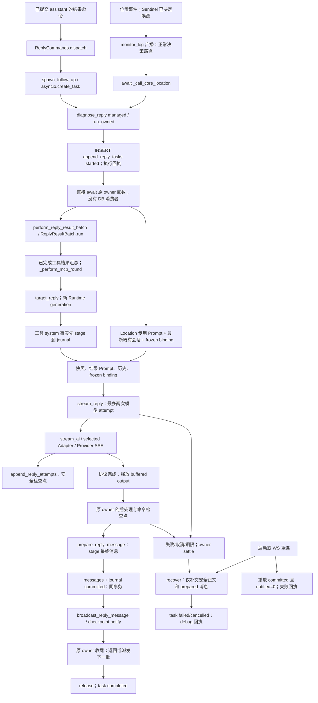
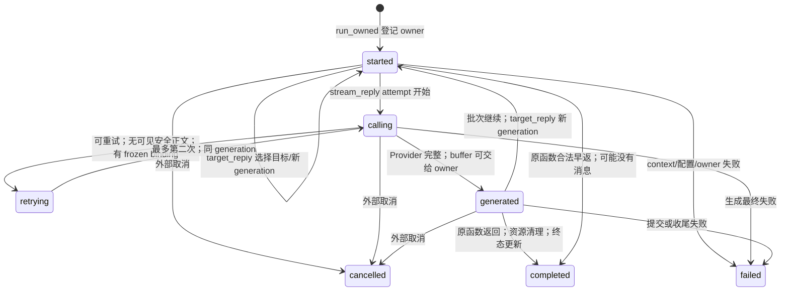

# AionHome 后端追加回复公共链路专项审计

日期：2026-11-17（Asia/Shanghai）。仅审计，未实施修复。报告位于当前 Penumbra 工作区，审计对象为 AionHome 后端。

## 1. 基线、边界和主要结论

| 项目 | 基线 |
| --- | --- |
| 后端 | `/Users/remix/Desktop/AionsHome-main`，HEAD `ee130a95b64af3a8aaff0604459075fc05e5cdd9`，开始时工作树干净 |
| 当前工作区 | `/Users/remix/Desktop/Penumbra`，HEAD `cf15b1564d38e57de1d758c164755c1b8eaa7bce` |
| 已有未提交内容 | `docs/chat-streaming-state-audit.md`；保留并校验原文件哈希 |
| 本次新增 | 仅 `docs/append-reply-pipeline-audit.md` |

本轮关联追加回复的执行、提交、通知和恢复边界，没有实施重构计划中的功能 PR。已核对 AionHome AGENTS.md 及运行时模型/重构计划；保持消息身份与持久化、Prompt 顺序、command 副作用顺序、WS 类型/payload/timing、Connection/Protocol/Model 选择和现有重试策略不变。不重新审计 MCP 工具周期、Location heartbeat/变化算法或 Sentinel 决策规则。

**关键架构结论：当前没有“持久化待办任务 → 公共消费者扫描领取 → 恢复模型生成”的队列。** `append_reply_tasks` 是协程执行回执；`run_owned` 在协程已经开始运行后创建回执并直接执行原函数。MCP 由 `spawn_follow_up/create_task` 派发，Location 变化后的 Core 由调用方直接 `await`。恢复只补交消息和补发通知，不重放触发、工具或模型。

这改变了排障方向：不能把缺少下一步回复一律归为“pending 任务没被消费者捞取”，也不能把 `completed`、`failed` 或“Provider 已结束”单独作为消息是否提交的证据。

证据等级：E1＝当前函数/实际入口在隔离环境动态复现；E2＝源码调用链确认，未动态复现整个场景；E3＝仅条件推演。E1 也不等于确认了生产现场根因。

| 编号 | 分类 / 等级 | 结论 |
| --- | --- | --- |
| D1 | D，E1 | Location 已决定 `call_core=true` 后，任务创建前的 monitor_log 广播可阻塞 Core 交接；此时没有 append 回执和 owner 期限 |
| D2 | D，E1 | owner 期限取消批次后，finally 中结果持久化附带的无界广播可继续等待，阻止 settle/Guard 释放/任务终结；回收逻辑仍视其为活 owner |
| D3 | D，E1（受控同毫秒并发） | Location 主回复 ID 已加 generation 唯一性，但触发消息 `_lt`、系统消息 `_ls` 仍仅用毫秒；并发可产生主键冲突，使一个合法追加失败 |
| R1 | C / 可复现中断边界，E1 | 主回复已提交且已通知后，export 等收尾异常可让下一批交接不发生；task.failed 是 owner 失败，不能解释为本条消息未提交 |
| R2 | C / 架构能力限制，E2 | create_task 派发与回执创建之间无持久化交接；进程中断/启动前取消不会自动恢复生成；当前不是 durable queue 契约 |
| R3 | C / 恢复时机限制，E2 | DB/通知故障残留依靠收尾、启动、WS 重连触发恢复，没有周期性补偿消费者；不能保证故障解除后立即自行恢复 |
| O1 | 可观测性缺口，E2 | 原 assistant/trigger、append task、Runtime generation、MCP diagnostic generation 未形成统一持久关联 |

**没有确认两个实际现象具有相同生产根因。** D1/D3 是 Location 独立交接/提交风险；D2 是混合结果批次的公共清理风险，不证明纯 MCP 也会在同一分支卡住；R1 位于 MCP 结果续写提交后的交接边界。现有有限重试、frozen binding、工具事实保留和主消息通知日志总体有效，应保留。

## 2. 真实实现及各模块职责

| 模块/函数 | 真实职责 | 不承担的职责 |
| --- | --- | --- |
| [reply_commands.py:88](/Users/remix/Desktop/AionsHome-main/aion-chat/reply_commands.py:88) `ReplyCommands.dispatch` | 对已提交回复收集后续结果命令；实例内只派发一次；交给 spawn_follow_up | 不持久化一个可恢复执行的任务 payload |
| [reply_commands.py:30](/Users/remix/Desktop/AionsHome-main/aion-chat/reply_commands.py:30) `spawn_follow_up` | 继承 chain depth，创建 asyncio Task | 不扫描 DB，不保证进程退出后重新消费 |
| [append_reply_diagnostics.py:219](/Users/remix/Desktop/AionsHome-main/aion-chat/append_reply_diagnostics.py:219) `diagnose_reply(managed=True)` | 建立诊断 ContextVar，调用 run_owned，记录未处理异常 | 不调度 pending 任务 |
| [append_reply_runtime.py:323](/Users/remix/Desktop/AionsHome-main/aion-chat/append_reply_runtime.py:323) `run_owned` | 新 owner、持久回执、owner deadline、执行原函数、终态/资源清理 | 不按 task ID 恢复原触发或模型请求 |
| [append_reply_runtime.py:300](/Users/remix/Desktop/AionsHome-main/aion-chat/append_reply_runtime.py:300) `target_reply` | 设置 conv/source，新建一轮 ReplyGeneration，重置当前 attempts | 不是另一个队列入队动作；同 owner 可多次调用 |
| [routes/chat.py:4294](/Users/remix/Desktop/AionsHome-main/aion-chat/routes/chat.py:4294) `perform_reply_result_batch` | 拥有结果批次循环和后续命令交接，继承 resolved_request | 不为每个已完成工具创建独立消费者 |
| [command_runtime.py:85](/Users/remix/Desktop/AionsHome-main/aion-chat/command_runtime.py:85) `ReplyResultBatch` | 按顺序接收每个 command 的终态结果，全部收集后 finalizer，finally 保存已得结果/settle | 不是 DB 的 pending/running job 状态机 |
| [routes/chat.py:4563](/Users/remix/Desktop/AionsHome-main/aion-chat/routes/chat.py:4563) `_perform_mcp_round` | 一批完成结果 → Prompt/上下文 → 模型 → 正常后处理/提交 → 下一批 commands | 不重新执行刚完成的工具 |
| [location.py:1083](/Users/remix/Desktop/AionsHome-main/aion-chat/location.py:1083) `_call_core_location` | 位置变化主动联系入口；选既有最新会话，构建专用 Prompt，生成、提交、派生命令 | 不消费 `append_reply_tasks`，不走 MCP 结果批次的同一个入口 |
| [append_reply_runtime.py:468](/Users/remix/Desktop/AionsHome-main/aion-chat/append_reply_runtime.py:468) `stream_reply` | 仅模型生成的有限重试、完整性验证、buffer、检查点、frozen wire | 不在 retry 中运行工具、Prompt 构建、command 或提交 |
| [append_reply_checkpoint.py:171](/Users/remix/Desktop/AionsHome-main/aion-chat/append_reply_checkpoint.py:171) | attempt 检查点、最终消息 journal、幂等补交、通知重放 | 不是任务输入仓库，不能重建丢失的 Prompt 或工具执行上下文 |
| [main.py:91](/Users/remix/Desktop/AionsHome-main/aion-chat/main.py:91)、[main.py:493](/Users/remix/Desktop/AionsHome-main/aion-chat/main.py:493) | 启动回收中断 owner；WS 建连时恢复并重放 | 没有周期性“消费者主循环” |

其余 managed 公共入口有 [schedule.py:395](/Users/remix/Desktop/AionsHome-main/aion-chat/schedule.py:395) alarm、`:753` monitor、[camera.py:626](/Users/remix/Desktop/AionsHome-main/aion-chat/camera.py:626) camera、[activity.py:1047](/Users/remix/Desktop/AionsHome-main/aion-chat/activity.py:1047) activity。这里只确认它们接入同一个 owner/runtime/journal，不扩展审计其触发算法。

### 2.1 完整调用关系图

图中两条路径只在 owner/runtime/journal 合流。MCP 的 append owner 实际在工具执行**之前**就建立；工具完成后是在同一 owner 内开始新的 generation，不是每个结果重新入队。Location 是直接 await 的调用栈，不是由公共后台消费者唤醒。

公共追加回复没有单独向浏览器开放的 HTTP SSE 消费端：Provider SSE 是内部输入，`stream_reply` 完整缓存后才交给业务 owner，公开消息主要通过提交后的 WS 和历史 HTTP 读取呈现。主 Chat 的初始 send SSE 与后续 create_task 不是同一生命周期；不能因为初始 SSE 已结束就判定后续没有执行，或要求 Location 主动联系出现同样的 SSE start/chunk。

### 2.2 三种持久状态

| 表 | 关键字段与写入点 | 能证明什么 |
| --- | --- | --- |
| `append_reply_tasks` | id/source/conv_id/status/attempts/reason/created_at/updated_at/owner_pid/owner_started_at；[runtime:95](/Users/remix/Desktop/AionsHome-main/aion-chat/append_reply_runtime.py:95)、`:336` | owner 协程已开始登记；不是排队输入。没有任务 Prompt、完整 binding、原 assistant ID 或触发事件 ID |
| `append_reply_attempts` | generation_id + attempt 主键，task_id、conv_id、message_id、status、safe_text、kind、reason、diagnostic、facts、updated_at；[checkpoint:196](/Users/remix/Desktop/AionsHome-main/aion-chat/append_reply_checkpoint.py:196) | 本轮模型 attempt 的安全输出/状态；不是原始全文，也不是可执行 command |
| `append_reply_messages` | message_id 主键，generation_id/task_id/payload/committed/notified；[checkpoint:224](/Users/remix/Desktop/AionsHome-main/aion-chat/append_reply_checkpoint.py:224) | 最终消息已准备；committed 表示消息事务已提交；notified 表示既有发送流程处理成功，不是客户端阅读/展示 ACK |

`messages` 仍是聊天历史事实源。`prepare_reply_message` 与实际 INSERT 是两步；实际业务事务内 `mark_reply_committed`，失败时 `commit_pending` 只补 INSERT，不回放副作用。[runtime:227](/Users/remix/Desktop/AionsHome-main/aion-chat/append_reply_runtime.py:227) → [checkpoint:255](/Users/remix/Desktop/AionsHome-main/aion-chat/append_reply_checkpoint.py:255)。

## 3. 生命周期与状态转换

源码没有 DB `pending/running`。不要用检查维度的名称替代真实状态。

owner deadline 到期通常最终记 failed/timeout，外部 CancelledError 记 cancelled。进程中断后，非活 owner 的非终态回执转 failed/service_restarted。D2 说明 deadline 已触发也不保证 finally 已完成，所以可能仍看到 started/calling/generated。

attempt 的独立状态为 `started → streaming → generated` 或 `failed`；owner 成功返回时把**当前 generation** 的 generated attempt 标为 handled，见 [runtime:340](/Users/remix/Desktop/AionsHome-main/aion-chat/append_reply_runtime.py:340)。消息则独立经历 `prepared(committed=0) → committed=1 → notified=1`，没有要求 task 必须 completed 才能提交消息。

因此以下组合成立且不能误判：

- task.generated：Provider 完成，消息可能尚未 stage/提交。
- task.failed + messages 已有正常正文：提交后收尾失败，或某一后续 generation 失败；前一条正文不应重生成。
- task.completed + notified=0：内容成功，通知失败/离线待重放。
- task.completed + attempts=0 + conv_id=null：例如 Location 没有任何既有 conversation 而直接 return；表示函数结束，不证明生成过回复。[location.py:1102](/Users/remix/Desktop/AionsHome-main/aion-chat/location.py:1102)
- 同一 task 下面有多个 generation；task.attempts 在 target_reply 时清零，终态数字只反映最后一轮，不是整个工具链累计模型调用次数。

状态 UPDATE 以 `status NOT IN ('completed','failed','cancelled')` 保证终态不被后续更新覆盖，[runtime:279](/Users/remix/Desktop/AionsHome-main/aion-chat/append_reply_runtime.py:279)。没有按 task ID 争抢执行权的 DB claim 操作；并发控制主要由本地 owner/chain、消息唯一身份和原子提交承担。

## 4. MCP 结果交接链路

本节只还原结果汇总到下一轮回复的边界，不重新评估远端工具执行、参数或 MCP 周期算法。

| 步骤 | 函数、数据与实际行为 |
| --- | --- |
| 建立追加 owner | Main/其他已提交回复 → `ReplyCommands.dispatch` → create_task → managed `perform_reply_result_batch`。先有 task row，再执行这批工具 |
| 取得源身份/绑定 | 参数 `source_message_id` 是本轮回复锚点，`task_source_message_id` 是原用户/后台触发锚点。标准 dispatch 传 `resolved_request`；缺省兼容入口才在 [chat:4303](/Users/remix/Desktop/AionsHome-main/aion-chat/routes/chat.py:4303) 读取既有 conversation 并 resolve 一次，不创建新会话 |
| 原始目标保留 | [chat:4377](/Users/remix/Desktop/AionsHome-main/aion-chat/routes/chat.py:4377) `_capture_mcp_task` 按明确 IDs 读取 objective/initial_reply，使用 MCPTaskContext 在后续批次 remember 记录；不依赖“最近一条 assistant”代替来源 |
| 接收多工具结果 | [command_runtime:103](/Users/remix/Desktop/AionsHome-main/aion-chat/command_runtime.py:103) 按命令源顺序逐个 await，每个 command 一个终态结果；不是并行 gather。较慢工具会让后面的 finalizer 等待，但没有“第一项一完成就提前续写”的分支 |
| 汇总/启动生成 | 全部结果齐备后仅一次 finalizer → `_perform_mcp_round` → target_reply 新 generation。工具失败一般也成为结果供模型解释；全体 `continue_alone=False` 则不请求模型，[chat:4601](/Users/remix/Desktop/AionsHome-main/aion-chat/routes/chat.py:4601) |
| 事实先保留 | [chat:4584](/Users/remix/Desktop/AionsHome-main/aion-chat/routes/chat.py:4584) 为 MCP/POI/route 结果 stage system journal，尚不插入 messages，保留原 Prompt/history 时机；后续上下文失败也能补交工具事实 |
| 结果真正进入 Prompt | `_prepare_reply_result_batch` 在 [chat:4399](/Users/remix/Desktop/AionsHome-main/aion-chat/routes/chat.py:4399) 生成有界 ai_result/结果头，按源顺序形成 user inputs；纯 MCP 增加任务目标提示。Anthropic 以 `extra_user_messages=inputs` 注入（`:4674`），其他协议拼到 messages（`:4718`） |
| Runtime/Provider | `_follow_up_generation_kwargs` 从父请求投影同 binding/options，[chat:885](/Users/remix/Desktop/AionsHome-main/aion-chat/routes/chat.py:885)。`stream_reply` 固定 messages/kwargs 和实际 wire request，在同一模型/协议/连接重试模型部分 |
| 成功提交 | 正常解析 → `_persist_reply_result_batch` 保存工具事实 → assistant prepare → 实际 INSERT + mark_committed 同事务，见 [chat:4851](/Users/remix/Desktop/AionsHome-main/aion-chat/routes/chat.py:4851)、`:4866`、`:4889` → notify → 后续收尾 → 返回 next_commands/source_message_id |
| 失败提交 | [chat:4733](/Users/remix/Desktop/AionsHome-main/aion-chat/routes/chat.py:4733) → `_persist_failed_result_reply`（[chat:3443](/Users/remix/Desktop/AionsHome-main/aion-chat/routes/chat.py:3443)）：保存已完成工具事实，安全 partial + 错误另存 assistant，不执行未完成正文中的 command；最终 owner.failed |
| 部分完成/取消 | `ReplyResultBatch.run` finally 保存已有 results，未开始/在途状态标 cancelled，并调用 settle；此时不强行调用 finalizer。成功结果不会仅因另一工具失败而主动清空；但进程突然退出前尚只在 RAM 的结果不能保证恢复，见 R2 |

重复续写保护具有不同范围：ReplyCommands.dispatched 只保护同一实例；batch.statuses/finalizer_started 防同一 batch 再跑；unknown_mcp_calls 只阻止本 chain 中结果未知/timeout 的相同远端调用重复发送，不拦截一个已成功工具在后续明确命令中的合法再次调用。[command_runtime.py:110](/Users/remix/Desktop/AionsHome-main/aion-chat/command_runtime.py:110)

本次没有发现从“工具全部完成 → finalizer → stream_reply”之间存在一个未唤醒的独立数据库消费者。`mcp_loading` 和 batch_submitted 都不证明下一轮 Provider 已请求；以 attempt/checkpoint/实际 Adapter 阶段核对。`stream_reply` 先缓存完整成功，再 yield 给 owner，因此“模型仍运行但未出现追加正文”在这段期间可以是正常行为。

## 5. Location 事件交接链路

### 5.1 位置变化主动联系

真实关系为 [location.py:928](/Users/remix/Desktop/AionsHome-main/aion-chat/location.py:928) `_on_state_change → _notify_sentinel`，在已得到 `call_core=true` 之后：正常决策路径 `append_monitor_log → await manager.broadcast(monitor_log) → await _call_core_location`（`:1074`）；Sentinel 调用异常的既有 fallback 路径直接 `_call_core_location`（`:1038`）。这里只审计交接顺序，不评价触发条件或 fallback 决策。

`_call_core_location` 被 managed decorator 包围，所以**进入这个函数前** run_owned 已写 task.started。该函数先选 `ORDER BY conversations.updated_at DESC LIMIT 1` 的既有会话，再 target_reply，新建 generation。它没有源 assistant，因为这是主动唤醒，不是继承某条 assistant 的结果；使用最近会话是当前契约，不能擅自改成新建会话或某个 UI 当前会话。

专用 Prompt 明确拼接 event_desc、core_reason、冻结的 location status/config、最近监控记录和多久未聊天，[location.py:1125](/Users/remix/Desktop/AionsHome-main/aion-chat/location.py:1125)、`:1156`。`resolve_conversation_main` 在 `:1203` 取得该 conversation 的 Connection/Protocol/Model 和 options，再传 frozen binding 到 stream_reply，不借用 Sentinel 模型。上下文、Location Prompt 和本轮 binding 不在模型 retry 中重建。

成功后处理 → 插入 cam_trigger `_lt` 与 system `_ls`、保存 public display → 广播 system → prepare assistant → assistant INSERT + mark_committed 同事务 → 主消息 journal notify → command dispatch/TTS/export/log，见 [location.py:1298](/Users/remix/Desktop/AionsHome-main/aion-chat/location.py:1298) 至 `:1374`。Provider 失败通常由公共 owner 回收安全 partial 并发 task failure；没有公开 partial 时以 durable task failure 为主，不能要求每次都有 assistant 错误行。

该入口是 heartbeat/事件处理链中的直接 await，并不是生产队列里的独立 worker；外层调用生命周期可以影响它。owner deadline 从进入 managed wrapper 才开始，Sentinel 和 D1 的前置广播不在这个期限内。

### 5.2 不要与 `[Location]` 查询续写混淆

assistant 发出的 `[Location]` command 经 `ReplyCommands → ReplyResultBatch → execute_location` 返回结果，再由 [chat:4434](/Users/remix/Desktop/AionsHome-main/aion-chat/routes/chat.py:4434) 调用 [prompts/location.py:4](/Users/remix/Desktop/AionsHome-main/aion-chat/prompts/location.py:4) `build_location_follow_up_prompt`，进入 `_perform_mcp_round`。这是工具结果公共批次路径，携带 `_location_config/_location_status` 快照。

位置变化主动联系用 `_call_core_location` 内部的“位置变化通知”Prompt，不调用上述查询 Prompt builder。因此 MCP 与 Location 查询确实共用批次 finalizer；MCP 与位置变化主动联系只共用 owner/runtime/journal。把三者画成同一消费者会掩盖真正交接点。

### 5.3 对照结论

| 类别 | 本次结论 |
| --- | --- |
| MCP 独立交接 | 没有发现一个“结果已交给 DB 队列，但无人消费”的 MCP 专用断点。结果顺序汇总和一次 finalizer 已有保护；R1 复现的是提交后 next_commands 尚未返回时被导出异常截断，非远端工具未完成 |
| Location 独立交接 | D1 在 append owner 建立前；D3 在附属消息提交时。均不需要假设定位算法或 Sentinel 规则错误 |
| 两者共用追加机制 | 同用 run_owned/stream_reply/journal；D2 是公共结果批次 finally 的真实缺口，适用于含对应非 MCP result 的路径，未证明单纯位置变化 Core 或纯 MCP 也经过该无界清理分支 |
| 模型生成问题 | frozen binding、有限 retry、terminal 校验按现有契约有效；Provider 最终失败可能只留下 task failure，或保留 partial 的失败消息，不能当“没创建任务” |
| 结果提交/广播问题 | messages/committed/notified 必须分别核对；主消息通知失败不应导致模型重跑，现有 journal 做到了。旁路广播/导出仍有 D1/D2/R1 的不同阻断点 |

以上基于各自源码交接关系，未把两个偶发现象直接归为同一根因。

## 6. 异常、重试、提交与恢复矩阵

### 6.1 现有模型重试契约

[runtime.py:447](/Users/remix/Desktop/AionsHome-main/aion-chat/append_reply_runtime.py:447) classify → [runtime.py:498](/Users/remix/Desktop/AionsHome-main/aion-chat/append_reply_runtime.py:498) 最多两次 attempt；attempt=300s、generation=600s、owner=720s、retry delay=0.5s 是现有政策。generation 总期限包含两次调用及记账/backoff；两个完整 300s 加 backoff 不保证都能跑满。

result_batch 的 soft admission 截止是 owner 初始 720s；首次准入 MCP 时 owner 最多延长一次 generation budget 至 1320s，后续新批次仍不得在 720s 后准入，[runtime.py:375](/Users/remix/Desktop/AionsHome-main/aion-chat/append_reply_runtime.py:375)。不是每批无限续期。

retry 同时要求：第一次失败、classify 可重试、当前安全可见正文为空、存在 frozen binding。Thinking/command-only 等非公开输出在没有执行其副作用时仍可能重试；检查的是 `generation.value.text`，不是“上游从未发出任何字节”。这由现有测试明确固化，不能误审为自动重复工具。

| 故障 | 当前模型 retry | 提交与终态/恢复 |
| --- | --- | --- |
| 408/429/5xx、连接/读取超时、transport error | 满足上述条件时至多第二次，同 binding/messages/wire | 最终失败保存安全 partial/诊断或 task failure；不重跑工具 |
| 401/403、400/404/422、已知 auth/invalid_request/context_length/额度拒绝类型 | 不盲重试；输出限制也不重试 | request_rejected/output_limit 等明确 reason；主消息/工具事实按阶段保留 |
| Provider 200 SSE 缺合法 terminal/坏帧 | stream_reply 的 reply_stream_completed/error 检查拒绝成功，条件允许才 retry | 有 visible partial 不重试，补交为安全失败正文；不会当完整输出执行 command |
| 本地 binding/config/type/assertion 错误 | 不切 Provider/协议，不盲重试 | configuration_error；task failure |
| Prompt/上下文构建失败 | 不在 stream_reply 内，不重试工具或上下文 | owner context_failed；MCP staged 工具事实可补交；没有 attempt 不代表没有任务 |
| checkpoint DB 暂时失败 | 仅记录 checkpoint_pending，保留 RAM，不触发第二次模型请求 | 后续 checkpoint/prepare/settle 再保存；持续 DB 故障仍有恢复能力限制 |
| Provider 已完成，正常后处理失败，尚未 stage assistant | 不重新请求模型 | 从安全 checkpoint 回收为失败正文；原命令副作用不重放，无法保证与正常最终正文/装饰完全等价 |
| assistant 已 stage，但 INSERT/commit 失败或提交结果模糊 | 不重新请求模型 | journal commit_pending 幂等 INSERT；同 ID 不覆盖首次结果；任务可 failed 而消息补交成功 |
| 主消息 commit 成功，journal notify 失败/无连接/超时 | 不重生、不回滚正文 | committed=1/notified=0；notify 返回 False，正常 caller 不因此抛错；可 task.completed，后续 WS 重放 |
| 原始 manager.broadcast 或 export 等旁路失败 | 不自动重试模型 | 可中断函数/后续批次；owner.failed，即使前一条正文已落盘，见 R1；Location 前置广播另有 D1 |
| owner deadline 触发 | 取消当前 owner 内工作，正常经 settle 后 failed/timeout | 不代表 finally 必然完成；D2 能使其继续卡在清理 |
| 外部 CancelledError | 不当作 Provider error retry | settle，cancelled 后重新抛出；DB 写失败可能阻止终态落盘，active registry 最终清除需 finally 真正执行完 |
| 进程重启/owner 已死 | **不继续模型、工具或触发** | 非终态回执 failed/service_restarted；恢复 prepared 消息或有安全正文的最新 attempt；没有正文只保留失败回执 |
| depth_limit/owner_budget_exhausted/全部结果不适合单独续写 | 不是 Provider failure retry | 当前 chain 停止准入，task 可正常 completed；stopped reason 在 MCP 诊断而非完整写入 task 状态 |

上一轮 Main Chat 的某些 Adapter EOF 风险不能直接移植为本链路缺陷：这里 [runtime.py:524](/Users/remix/Desktop/AionsHome-main/aion-chat/append_reply_runtime.py:524) 额外校验 `_append_attempt` 的 transport 元数据；非 append attempt 的 stream_event 不记录状态是 opt-in 边界。250 项测试含实际 Adapter 的 terminal 验证。

### 6.2 恢复具体做什么

1. [runtime.py:249](/Users/remix/Desktop/AionsHome-main/aion-chat/append_reply_runtime.py:249) `_settle_reply` 在 owner 异常后立即调用 checkpoint recover 和 notify_task，失败仅记录 commit_pending。
2. [checkpoint.py:358](/Users/remix/Desktop/AionsHome-main/aion-chat/append_reply_checkpoint.py:358) 按 task 找每个 generation 最新未 handled attempt；有 safe_text、无既有 journal 时创建失败 assistant，然后补交所有 prepared 未 committed 消息。没有 safe_text 不合成空正文/隐藏推理。
3. [runtime.py:138](/Users/remix/Desktop/AionsHome-main/aion-chat/append_reply_runtime.py:138) 启动/WS 连接时验证 PID + process create_time。同进程还检查 `_active_owners`；其他活 worker 不被抢占。这里只判 owner 生存，不判业务进展，D2 的活但卡住任务不会被强行恢复。
4. [checkpoint.py:290](/Users/remix/Desktop/AionsHome-main/aion-chat/append_reply_checkpoint.py:290) notify 与 `:339` replay 使用当前 messages 内容，避免重放旧编辑；重放关闭 TTS/autoplay，不复活已删除消息。正常 notify 使用现有 5s bound，发送失败保留 notified=0。
5. [main.py:491](/Users/remix/Desktop/AionsHome-main/aion-chat/main.py:491) 先接受 WS，再 replay_failures；后者还先触发 recovery。失败回执通过现有 debug 消息重放，与主消息 journal 分开。

没有“失败任务重新置 pending”的自动操作；recover 不是模型恢复。若只把 task.failed 改成 started，也没有消费者可继续执行，并可能破坏不重跑工具的契约。本轮未调用上述恢复函数操作生产状态。

## 7. 已确认问题及最小修复建议

### D1：Location 的非关键通知挡在创建追加 owner 之前

**位置/调用链：** Sentinel 已得到 true → [location.py:1074](/Users/remix/Desktop/AionsHome-main/aion-chat/location.py:1074) append_monitor_log → `await manager.broadcast(monitor_log)` → `:1078` Core managed wrapper。实际 [ws.py:64](/Users/remix/Desktop/AionsHome-main/aion-chat/ws.py:64) 对每个 socket 串行 await send_text，这里没有 journal notify 的 5s 边界。单个 socket send 抛普通异常会被 manager 捕获，但持续 pending 的 send 不会自行返回。

**E1 证据：** 当前 `_notify_sentinel`，固定假 Sentinel 返回 call_core=true，不运行定位算法；让 monitor_log broadcast 等待未完成 future，Core 入口调用次数为 0，append_reply_tasks 甚至尚未建立。取消测试调用栈后仍没有 append owner 回执。探针 `test_location_monitor_broadcast_blocks_after_positive_decision_before_owner`。

**影响：** “已满足唤醒决定，但无追加任务/attempt”成立，不属于 Provider 生成失败，也不是消费者丢任务。主 owner deadline 尚未启动，无法用其 720s 保证退出。正常 manager 返回 False（无连接/已失败连接）不会阻止 Core；问题条件是广播挂起，不能把所有离线情况算作缺陷。

**最小建议：** 将 monitor_log 的投递结果与 Core 交接解耦，复用现有通知容错边界，使非关键投递不能无限阻止已决定的业务交接；保留 Sentinel 判断和事件顺序契约，具体时序变化需单独评审。不要对整个 `_notify_sentinel` 自动重试，否则可能重复 Sentinel/Core/副作用。append task 没建立之前的失败也应有明确交接结果；本轮不增字段/日志系统。

### D2：owner deadline 触发后，finally 的广播仍可永久阻止终结

**位置/调用链：** [runtime.py:329](/Users/remix/Desktop/AionsHome-main/aion-chat/append_reply_runtime.py:329) owner deadline 取消批次 → [command_runtime.py:144](/Users/remix/Desktop/AionsHome-main/aion-chat/command_runtime.py:144) finally → `_persist_reply_result_batch` → 对已完成的 Location/activity/camera system 结果，先 DB commit，再 [chat.py:4489](/Users/remix/Desktop/AionsHome-main/aion-chat/routes/chat.py:4489) 直接 await 原始 manager.broadcast → 最后才调用 batch settle（`:150`）和 owner 的异常收尾。这个广播没有 journal notify 边界，且已经在原 timeout 取消的清理栈内；一次取消不会再定期取消这段 finally。

**E1 证据：** 使用真实 ReplyResultBatch/结果 persistence/managed owner，仅替换工具执行为合成结果：第一项 Location 成功，第二项等待，缩短隔离测试 owner deadline 至 50ms。deadline 触发后进入 finally 的 system 广播并挂起；任务持续未结束，settle 未调用，task 仍 started，`_active_owners` 仍登记。调用隔离库的 recover_interrupted 也不会抢活 owner。测试用第二次外部 cancel 才完成清理；这只是清理探针，不是建议生产执行恢复。

**影响：** 有任务却不再推进，也不落 failed/cancelled。公共结果批次的 settle 负责丢弃 camera_guard（[chat.py:4354](/Users/remix/Desktop/AionsHome-main/aion-chat/routes/chat.py:4354)），因此存在 Guard 释放被延期的调用链；探针实际验证 settle 未执行，没有触发真实摄像头。**纯 MCP 工具 system 事实走 journal notify，不是本探针的无界分支**，不能据此断言近期纯 MCP 现场就是同根因。

**最小建议：** 清理阶段先确保已完成事实持久化与 Guard 释放能够结束，网络通知失败交给既有 journal/重放语义，不让 finally 的通知 await 阻止 owner 终态。统一这几类 system result 的交付边界，保留原始落盘/Prompt 可见时机；不要再加一层重跑整个 batch 的 retry，也不要只缩短 owner timeout。

### D3：Location 附属消息仍用毫秒 ID，合法并发可冲突

**位置/调用链：** `_call_core_location` target_reply 已分配唯一 generation，主 assistant 的 [location.py:1189](/Users/remix/Desktop/AionsHome-main/aion-chat/location.py:1189) reply_message_id 使用该身份；但 [location.py:1303](/Users/remix/Desktop/AionsHome-main/aion-chat/location.py:1303) 的 `msg_{int(now*1000)}_lt` 和 `:1311` 的 `_ls` 没有 generation/UUID。两个 owner 可并发，系统没有 Location conversation 级互斥；两项 INSERT 在同一事务内遇主键冲突即回滚本次触发/system 记录。

**E1 证据与适用限度：** 两次真实 Location Core 入口并发、假 Provider 已成功返回，固定隔离 clock 使提交阶段同毫秒。一次 completed，一次 IntegrityError/failed；两个主 assistant 最终分别为正常正文与检查点回收的失败正文，只有一组 `_lt/_ls`。这证明碰撞条件成立时缺陷可达，不估计真实同毫秒发生概率，不宣称生产现场发生过。

**最小建议：** 附属消息 ID 继承本 owner/generation 的唯一后缀，保留消息角色/相对提交顺序和原会话归属；独立事务仍依既有契约。避免用全局锁串行化所有主动回复来掩盖 ID 问题，不新增自动重试。

## 8. 潜在问题、可复现边界和能力限制

### R1：已提交回复的收尾失败会阻止下一批交接

**位置：** `_perform_mcp_round` 的 assistant 已在 [chat.py:4890](/Users/remix/Desktop/AionsHome-main/aion-chat/routes/chat.py:4890) commit，`:4913` journal notify；随后还 await music/command effects/export/cache upgrade，直到 `:4953` 才返回 next_commands。`perform_reply_result_batch` 只有收到返回值后才进入下一循环。Location 也在 [location.py:1362](/Users/remix/Desktop/AionsHome-main/aion-chat/location.py:1362) await export，失败可使已保存主动回复的 owner 记 failed。

**E1：** 真正结果续写入口，假工具成功、假模型输出正常正文 + 下一批 MCP 命令，注入 export OSError。正常正文已 commit/通知，task.failed/postprocess_failed，没有下一批工具或第二次模型调用，之前工具只执行一次。探针 `test_mcp_postcommit_export_error_blocks_next_batch`。

这是明确的中断边界，但**task.failed 不必是错误状态判断**：task 表达整个 owner 的执行，确实有收尾异常。不能因此重生已提交消息。可疑之处是导出文件故障也成为下一批业务交接的前提。建议分清哪些收尾必须阻断 command 顺序、哪些可以容错；只隔离经确认非关键的收尾。调度/副作用故障不能统一吞掉，不在本轮擅自修改其顺序。

### R2：创建和恢复不是耐久执行契约

`batch_submitted` 在 [reply_commands.py:105](/Users/remix/Desktop/AionsHome-main/aion-chat/reply_commands.py:105) 记录，然后 create_task；task row 在子协程 run_owned 才 INSERT。启动前 cancel 的诊断 callback 在 [mcp_chain_diagnostics.py:189](/Users/remix/Desktop/AionsHome-main/aion-chat/mcp_chain_diagnostics.py:189) 只记录 cancelled_before_start，不创建耐久任务。进程在这段退出，没有 DB 输入供重新消费。

同样，工具成功刚进入 RAM、尚未 `_perform_mcp_round` stage 或 batch finally persist 时进程终止，恢复不可能复原全部结果。这里是持久性窗口，不是证明 MCP 工具执行周期本身错误；本轮没有以杀生产进程验证。

当前没有已声明“接受后必执行”的 durable queue contract，故列能力限制而非直接认定消费者缺陷。若后续业务明确要求可靠交接，需要单独设计 event/source identity、提交证明和不重跑成功工具的恢复契约；不能简单扫描 started 重新执行 owner。

### R3：恢复是事件触发，部分卡住状态不能自动对账

运行时 settle 失败会留日志；后续恢复入口仅启动和 WS 建连（[main.py:91](/Users/remix/Desktop/AionsHome-main/aion-chat/main.py:91)、`:493`）。没有周期性扫描 started/notification_pending 的消费者。DB 恢复但没有新连接时，prepared/终态更新可能继续残留。现有 [test_append_reply_checkpoints.py:456](/Users/remix/Desktop/AionsHome-main/aion-chat/tests/contract/test_append_reply_checkpoints.py:456) 证明同进程可通过**显式 recover_interrupted**补交，不证明有自动周期任务调用它。

活但不前进的 owner 也会被 PID + active owner 规则保留；其他活 worker 的 task 不能凭状态旧就抢占。不能简单把 `updated_at` 超龄视为可重放模型；模型和副作用可能已完成。是否需要额外的只读诊断入口/恢复触发应另案确认，本轮不新增 worker、超时或恢复操作。

### 仅理论上的风险（E3，不列确认缺陷）

[ReplyTask.release:273](/Users/remix/Desktop/AionsHome-main/aion-chat/append_reply_runtime.py:273) 先清 resources 列表再依次 cancel；若未来同一 owner 注册多个资源且前一个 cancel 抛错，后面的可能不再释放。目前生产注册点仅 alarm/location 的单个 TTS，未确认多资源实例的可达路径，不为此新增通用清理框架。持续存储损坏/整个进程无法调度也不可能由现有 journal 保证无损，本报告不将这种一般可能性当成现场根因。

## 9. 并发、Guard、去重和递归分析

| 边界 | 结论与依据 |
| --- | --- |
| 多个追加 owner | ContextVar owner/meta/wire request 隔离，任务/Runtime generation UUID、生成消息稳定身份；没有全局 conversation 互斥。多个 owner 可以使用不同上下文快照向同一 conversation 追加，不会共用 accumulator。唯一性保护不覆盖 D3 的附属 ID |
| 同源重复触发 | 没有 `source_assistant_id + source_generation_id` 的数据库唯一约束；dispatch 只防同实例重复。未发现标准入口自动重复提交同源的证据，不能据此新增去重而误拦合法 repeated call |
| 同一 batch 多工具 | 顺序执行、结果按源命令对应，finalizer 仅一次；不是迟到分支并发修改同一 results。取消时只保留已完成 prefix，其他状态 cancelled，不伪造未完成结果 |
| 原目标和历史窗口 | MCPTaskContext 保留原目标/初始回复；追加 Prompt 仍会读取当前历史（20/30 条），不是整段源 generation 的完整历史快照。[chat.py:4647](/Users/remix/Desktop/AionsHome-main/aion-chat/routes/chat.py:4647)、`:4694`。长时间执行后历史变化是当前契约；目标保留不等于所有历史冻结 |
| Binding/Protocol/Model | 标准 MCP 继承 resolved_request；Location 选择既有目标会话后 resolve 一次。重试不 re-resolve、不 fallback；wire request 首次冻结，后续 transport 不一致报配置失败，[runtime.py:431](/Users/remix/Desktop/AionsHome-main/aion-chat/append_reply_runtime.py:431) |
| Guard | `_active_owners` 是进程内生存登记，不是互斥锁；`_chain` 是深度/执行状态上下文。camera_guard 才是相应能力的同会话占用，由 batch settle 释放；D2 会阻塞该释放边界。未发现纯 MCP 公共锁永久占用的证据 |
| 深度 | spawn_follow_up 限制跨回复派生深度，batch loop 限制同链下一批深度，`can_start_next_batch` 决定相关通知/派发准入。相邻检查保护不同时间点；当前保留 depth 0 可运行、D+1 既有契约，没有依据判定为误拦 |
| 同 ID 提交/恢复 | stage collision 验证 conv/role/generation；实际 commit_pending `ON CONFLICT DO NOTHING`，不会覆盖首次正常消息，重复恢复不调用模型；删除消息/会话时清 journal 防复活，[checkpoint.py:377](/Users/remix/Desktop/AionsHome-main/aion-chat/append_reply_checkpoint.py:377) |
| 多 worker | PID + create_time 防 PID 复用、保留其他活 worker；messages 唯一约束防重复补交。通知可至少一次，notified 非客户端 ACK；不能要求多 worker WS 投递恰好一次或每个客户端都展示 |

## 10. 过度防御分类

A 必要保护；B 可等价简化；C 需要先澄清契约/有阻断风险；D 有明确源码及验证支持的问题。

| 项目 | 分类 | 真实保护边界、理由及位置 |
| --- | --- | --- |
| owner / generation / attempt 三层期限 | A | 工具+上下文+收尾、一次追加生成含重试、单次 Provider 是不同生命周期；[runtime:24](/Users/remix/Desktop/AionsHome-main/aion-chat/append_reply_runtime.py:24)、`:60`。不能合成单个 HTTP read timeout |
| HTTPX timeout 与本地期限 | A | 网络每读超时与 wall-clock 总期限不同；`ReplyDeadlineExceeded` 只归因本地期限，不能吞并 Provider Timeout；deadline 测试通过 |
| 多层 catch（Adapter、stream_reply、结果 finalizer、run_owned、diagnostic） | A | 分别对应上游协议、有限模型重试、工具事实/失败正文、owner 终态、可选日志；合并会改变工具重放和提交边界 |
| freeze binding / messages / 实际 wire | A | 防配置修改、mutable 输入被第一次改写、Provider builder 二次读取改变请求。并非三个同义校验；[runtime:472](/Users/remix/Desktop/AionsHome-main/aion-chat/append_reply_runtime.py:472)、`:431` |
| 只重试模型、无 binding 不 retry、有 visible partial 不 retry | A | 阻止换模型与丢已生成正文，不重跑成功工具；[runtime:551](/Users/remix/Desktop/AionsHome-main/aion-chat/append_reply_runtime.py:551)。不扩展自动 retry |
| terminal/error/文本失败标记多层判断 | A，可局部 B | terminal 判断协议完成，元数据识别拒绝/限制，文本标记兼容旧 Adapter 返回错误字符串；不能因几个 if 相似而删完整性检查，`:524` |
| 三表 persistence 与业务 messages | A | attempt 是安全中断副本，journal 是最终待提交/待通知消息，messages 是事实；不重复执行业务 command，不能用单 task.status 替代 |
| 工具 stage-only 与 finally 再 persist | A | 先耐久保留事实但不提前进入 Prompt/history，再在原点提交；[chat:4584](/Users/remix/Desktop/AionsHome-main/aion-chat/routes/chat.py:4584)、`:4955`。必须保留现有时机 |
| batch.persisted / tools_saved / result.saved | A | 分别防整批、工具 carrier、部分非 MCP 结果重复保存，适应中途异常/多次 finally；[chat:4456](/Users/remix/Desktop/AionsHome-main/aion-chat/routes/chat.py:4456)。结果列表不是全有或全无 |
| dispatch.dispatched / batch already started / unknown remote call 去重 | A | 实例派发、重复 batch、结果未知的远端调用，真实边界不同；[reply_commands:88](/Users/remix/Desktop/AionsHome-main/aion-chat/reply_commands.py:88)、[command_runtime:103](/Users/remix/Desktop/AionsHome-main/aion-chat/command_runtime.py:103) |
| 多处 depth/owner budget 准入 | A，表述可 B | 跨 task 派发、循环推进、通知/后续能力准入；检查时间不同。可集中准入判定结果，但保留 D+1/soft cutoff，不靠删 guard 猜修缺回复 |
| 成功路径 release + finally release | B（需保留顺序） | `release` 先清列表，重复调用通常无副作用；第一次在 completed 前，让清理异常保持 owner.failed。可整理为单一终结 helper，不能把 completed 提前到资源清理之前；[runtime:345](/Users/remix/Desktop/AionsHome-main/aion-chat/append_reply_runtime.py:345)、`:367` |
| Location 的 `except Exception: raise` | B | [location:1242](/Users/remix/Desktop/AionsHome-main/aion-chat/location.py:1242) 没转换/清理，可去除外壳，保持异常进入 run_owned |
| unknown-model 分支的旧持久化/TTS 注释与临时 resolution_error_text | B | [location:1206](/Users/remix/Desktop/AionsHome-main/aion-chat/location.py:1206) 注释仍说保留未知模型文本，现实现统一抛 configuration_error。可校正注释/归并分支；不恢复旧“当正常文本播报”行为 |
| `reply_failure` 外 catch 与 safe wrapper | B（低价值） | [diagnostics:153](/Users/remix/Desktop/AionsHome-main/aion-chat/append_reply_diagnostics.py:153)、`:193` 都防诊断失效；可收敛无抛出接口，但现有测试会注入日志/helper 故障，不能让观察失败改变业务异常 |
| 非关键导出等 await 位于 next_commands 返回前 | C / R1 | 已提交消息不会重生，但收尾失败能阻断下一轮；先确认业务 side effect 次序，再仅隔离非关键项，不能泛化吞异常 |
| completed 同时覆盖“无目标/无需回复/成功落盘/停止递归” | C | owner 完成不等于每个业务目标完成，source/reason 诊断不足时容易误读。先明确展示语义，不用新增 pending/running 模仿队列 |
| 回执 task row 被误当队列、盲扫 failed 重跑 | C / R2 | schema 无输入/绑定/源事实，不可安全重建 owner；不能新增这种恢复操作 |
| 旧兼容 resolved_request=None | A（兼容入口），可 B 整理 | [chat:4303](/Users/remix/Desktop/AionsHome-main/aion-chat/routes/chat.py:4303) 单次 resolve 后再 frozen；不能删导致 perform_mcp_check 等旧调用失效，也不能每次 retry 再 resolve |
| journal notify 接受 None 作为成功 | B/契约收敛项 | [checkpoint:302](/Users/remix/Desktop/AionsHome-main/aion-chat/append_reply_checkpoint.py:302) 只对 False 判失败，兼容旧 broadcast 返回 None；生产 manager 已返回 bool。可先统一调用/测试返回约定，再考虑收紧；不能将现有假 manager 的成功误判为生产回执 |
| Location 前置广播、清理栈无界广播、毫秒 ID | D1/D2/D3 | 都有针对性交接复现；不是“保护太多”，而是保护边界未覆盖这些分支 |
| 前后端重复执行工具/恢复 | 未发现可删除项 | 本链路模型/工具执行在后端；WS journal 恢复发送消息，前端 HTTP 历史重读是展示对账，不能据此删后端恢复。未重新审计前端性能或 MCP 周期 |

## 11. 时间线与可观测性

### 11.1 一次追加的可重建时间线

| 时间点 | 现有记录 | 能否确认 |
| --- | --- | --- |
| T0 触发/工具结果产生 | Location monitor log；MCPChainDiag execution/batch 事件，内存 results | 没有统一持久 trigger ID。Location 正常监控日志可早于 append task；单凭 call_core=true 不能证明后续 owner 进入 |
| T1 派发 | batch_submitted/create_task；Location 直接调用栈 | 无耐久 dispatched 时间/输入；派发后未启动与未派发仅凭 task 表不能区分 |
| T2 owner 创建 | task.id/created_at/source/owner_pid/create_time | 有 row 证明 run_owned 已开始，不能据 row.started 证明模型调用 |
| T3 target/context | task.conv_id/source 更新，Runtime generation 内存身份 | 无独立 context 完成时间；context 失败可只有 task.reason 与诊断日志 |
| T4 attempt | attempts.generation_id/attempt/message_id/status/updated_at；failure log 的 generation/attempt | 调用边界从 calling 开始，仍可能未到网络；真实 HTTP stage/status 在 request-local meta/失败诊断 |
| T5 Provider 完成 | attempt.generated、安全正文、task.generated | 证明模型完整返回；不证明 stage/commit 或所有 command 完成 |
| T6 最终消息准备 | journal.payload、task_id/generation_id/message_id | 可定位 prepared 未 committed；payload 已是正常后处理后的投影 |
| T7 消息提交 | journal.committed + messages 同 ID | 可确认保存；没有独立 committed_at 字段，messages.created_at 是消息创建时间 |
| T8 通知 | journal.notified，WS 服务器日志 sent/failed | 不是每客户端消费 ACK；没有独立 notified_at；恢复可能晚于正常 owner |
| T9 owner 结束 | task.status/reason/updated_at | updated_at 是最后状态更新时间，非独立 completion_timestamp；task.attempts 只记最后 generation |

### 11.2 关联缺口 O1

- task 表没有 source assistant message ID、source generation ID 或 trigger ID。源参数和 MCPTaskContext 在调用内存中；从某条原 assistant 不能仅靠这张表可靠找到它的追加 task。
- MCPChainDiag 的 `Observation.generation_id` / parent_generation_id / chain_id（[mcp_chain_diagnostics.py:45](/Users/remix/Desktop/AionsHome-main/aion-chat/mcp_chain_diagnostics.py:45)）和 Runtime `ReplyGeneration.id` 是不同生成机制，不能直接 JOIN。另有 shadow 诊断使用 `conv_id:suffix:depth`，也不是 DB generation ID。[chat.py:4622](/Users/remix/Desktop/AionsHome-main/aion-chat/routes/chat.py:4622)
- `append_reply_failure` 日志可带 Runtime generation_id/attempt/message_id，但没有统一 task_id/source assistant；checkpoint_pending/commit_pending/notification_pending 日志多只有异常类型，不能可靠定位具体 owner。[diagnostics.py:169](/Users/remix/Desktop/AionsHome-main/aion-chat/append_reply_diagnostics.py:169)、[runtime.py:199](/Users/remix/Desktop/AionsHome-main/aion-chat/append_reply_runtime.py:199)、[checkpoint.py:309](/Users/remix/Desktop/AionsHome-main/aion-chat/append_reply_checkpoint.py:309)
- Provider request ID 不是 task/attempt 的结构字段。MCP 结果续写 `include_error_details=True` 尽量保留安全错误详情；Location 没开启此选项，部分非 2xx append 错误经 `provider_reply_detail` 变成内部 diagnostic ID，不能把它当 Provider request ID。[ai_providers.py:458](/Users/remix/Desktop/AionsHome-main/aion-chat/ai_providers.py:458)、[diagnostics.py:201](/Users/remix/Desktop/AionsHome-main/aion-chat/append_reply_diagnostics.py:201)。本轮仅记诊断缺口，不复制未经脱敏的上游正文或 headers。

### 11.3 用现有证据回答“停在哪一步”

| 问题 | 可用判断及限制 |
| --- | --- |
| 没有创建任务？ | 没有 task row 只说明无耐久 owner 记录；还可能是 D1、创建 DB 失败、启动前取消/进程退出。需要 source 日志，不能靠邻近时间猜关联 |
| 创建了但没派发？ | 当前 row 在协程已消费时才写，因此不是 durable queue 的“待派发”状态；若 started/0，多半停在工具/上下文/早返前，需诊断 |
| 派发了但没消费？ | batch_submitted 与 owner_started/cancelled_before_start 可以提供局部证据；没有统一 task/source ID 时无法完整持久还原 |
| 消费但没调用模型？ | 有 task、无 attempt；可能正常 no_inputs/skip/depth，也可能 context_failed。calling 也不能独自证明已经发 HTTP |
| 调用了但没有结果？ | attempts started/streaming/failed + failure stage/HTTP/terminal；记录可能受 checkpoint DB 故障影响；只有日志无法保证重建全部时间点 |
| 有结果但没有提交？ | attempt.generated 有输出，journal 缺失或 committed=0；前者尚未 prepare，后者可走仅提交恢复。不得重跑成功工具或模型 |
| 已提交但没有广播？ | messages + committed=1/notified=0 能定位待投递；notified=1 仍不能证明 UI 展示，需客户端历史对账；task.failed 不能否定已提交事实 |

本轮未读取生产任务/日志，所以只能交付上述源码和隔离证据，不能替生产 incident 给出某个具体 task/request ID 的停点。后续若补可观测性，优先贯通现有 IDs 和阶段，不默认新增表、全量追踪系统或敏感 Prompt 日志。

## 12. 最小后续 PR 拆分与依赖

| PR | 边界 | 依赖与验收 |
| --- | --- | --- |
| PR1：清理阶段可终结 | D2，仅非 MCP 结果持久化/通知与 settle/Guard 边界 | 可独立；deadline 后能退出，成功事实不丢，Guard 释放；复用 journal，禁止整批重试 |
| PR2：Location 唤醒交接 | D1，仅已决定 call_core 后的通知/交接关系 | 不改 heartbeat、变化算法、Sentinel 策略；无连接/坏 socket 不阻断 Core；明确兼容事件时序 |
| PR3：Location 附属身份 | D3，`_lt/_ls` 继承本轮唯一身份 | 可独立；同毫秒并发不冲突，不新增全局串行锁，不改会话选择 |
| PR4：提交后收尾边界 | R1，先分类关键副作用与文件导出/可选收尾，再隔离经确认的非关键失败 | 建议 PR1 后；已提交消息不重生，下一批是否继续有明确契约，业务 command 顺序不被泛化吞错改变 |
| PR5：现有标识关联与诊断语义 | O1、completed/failed/commit/notify 含义、source→task→Runtime generation 映射 | 独立契约评审，优先复用字段/安全日志，不将 MCP diagnostic generation 与 Runtime ID 混用；不本轮新增存储 |
| PR6：等价简化 | B 类裸 except/rethrow、重复诊断外壳、旧注释和资源终结组织 | 行为修复后单独做；不与重试/时序变化混合，保留多层期限及 partial/checkpoint |
| 可选架构项：耐久交接/恢复时机 | R2/R3，只有业务确认需要接受后必执行/故障后自动补偿时再设计 | 依赖 source identity 与提交证明；不能扫描失败 task 重放工具/模型；不作为本轮默认修复 |

未提出自动切换 Provider/协议、扩大自动重试或重新执行成功工具。MCP 周期、Location 算法和 Chat 性能优化不并入这些 PR。

## 13. 隔离验证与审计限制

所有验证位于 `/private/tmp/aion-append-reply-audit`。从当前后端复制 415 个 Python 文件及测试需要的静态文件，排除 data、settings、`.env`、生产 DB、venv 和缓存。复用已有 Python 环境，不安装依赖；禁用 pycache/pytest cache，socket connect 被 guard 阻断；工具、Provider、Sentinel 全用合成实现，SQLite 仅临时库。未启动生产 main/lifespan，也未执行生产恢复或修改任务状态。

| 验证 | 结果 | 证据 |
| --- | --- | --- |
| 现有专项测试 | 250 项通过 | [existing-tests.log](/private/tmp/aion-append-reply-audit/existing-tests.log) |
| Location positive decision → 广播阻塞 → 无 owner | E1 复现 D1 | [临时探针](/private/tmp/aion-append-reply-audit/backend-copy/tests/contract/test_pipeline_audit_probes.py)、[probes.log](/private/tmp/aion-append-reply-audit/probes.log) |
| Location 同毫秒并发提交 | E1 复现 D3，固定 clock，不推断生产概率 | 同上 |
| MCP 主回复已提交、export 失败、下一批未开始 | E1 复现 R1，已完成工具不重跑 | 同上；前三个探针共 3 passed |
| owner deadline → finally 的 system result 广播挂起 | E1 复现 D2；第二次 cancel 仅用于结束隔离探针 | [cleanup-probe.log](/private/tmp/aion-append-reply-audit/cleanup-probe.log)，1 passed |
| 副本一致性 | 415 个原版 Python 文件逐字节一致 | 临时新增探针不计入原版文件，源码未改 |

现有测试覆盖 `test_append_reply*.py` 全部专项模块（runtime/recovery/entry_retry/checkpoints/deadlines/transport_terminal/diagnostics/provider_diagnostics/failure_delivery/legacy_notifications/tts_cleanup），另含 `test_reply_result_batch.py`、`test_location_core_frozen_llm_binding.py`、`test_location_follow_up_prompt.py`。这里只复用 MCP 结果/绑定测试验证公共交接，不重审工具内部实现。

250 项现有测试通过证明已覆盖场景的保护仍然有效，不排除新增故障输入暴露的缺口。没有跑真实 Provider、生产 MCP、生产 Location、生产数据库或生产网络现场；报告中的 D/E1 是条件可达缺陷，R 是中断/能力边界，E3 不作为现场归因。

本轮仅新增本报告，保留上一轮审计文档和所有未提交内容；未改源码、现有测试、配置，未 commit/push/deploy。结束核对时工作区还出现未跟踪的 `docs/sse-library-comparative-study.md`，非本轮生成，未读取或修改。后端工作树保持干净。报告完成后停止，等待人工确认。
