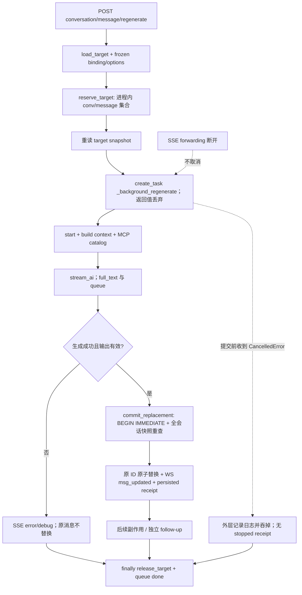
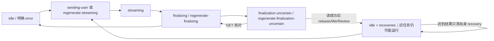

# CHAT-B2-AUDIT：生成生命周期与真正中止能力

审计日期：2026-11-17（Asia/Shanghai）。本轮仅静态读取当前工作区源码和已安装依赖源码，新增本报告；没有实施 CHAT-B2-A，没有运行应用、测试或构建，没有调用真实 Provider、数据库或线上服务，没有 commit、push、deploy。

## 1. 基线、范围与结论

| 工作区 | 分支 / HEAD | 开始时状态 |
| --- | --- | --- |
| Penumbra：`/Users/remix/Desktop/Penumbra` | `main` / `8df2190b645326d63bd228cec203d145babd4920` | 干净 |
| AionHome：`/Users/remix/Desktop/AionsHome-main` | `refactor-code-main` / `86c3670139b42944a77a8cc4a4564fe5a65d1190` | 干净 |

已分别阅读两仓库根 `AGENTS.md`、`docs/engineering-principles.md`；另读 Penumbra `CLAUDE.md`、UI 入口，以及 AionHome AGENTS 要求的 runtime model / refactor master plan。AionHome 根目录没有 `CLAUDE.md`。这里只核对 Main send、canonical regenerate 及其实际共享边界，不以旧审计报告代替源码。本轮属于 CHAT-B2 契约准备，不改变持久化、Prompt 顺序、WS type/payload/timing、command grammar 或副作用顺序。

**结论：可以通过范围受控的渐进改造实现可靠的真正中止，无须重写 Chat 状态管理或统一 Diary / append-reply；但现有代码尚不具备可靠中止能力，也不是加一个 `task.cancel()` 和按钮即可交付。** 必须补齐：覆盖准备阶段的 Main execution 身份和任务强引用、显式流关闭、用户取消与系统取消分流、持久终态和 partial、取消与后处理的明确分界，以及前端按终态释放发送权限。多 worker 的任务定位能力目前不存在；真实部署是否多 worker 未核验，不能把单进程方案宣称为跨 worker 可用。[A1] [A2] [A3] [A4] [A5]

实施前应纠正的假设：

| 假设 / 方向 | 为什么有问题及影响 | 推荐替代 |
| --- | --- | --- |
| 前后端已有同一个 execution，可直接取 Task | 前端 executionId 是本地 UUID 派生；后端 debug scope 只是观测。send receipt 没有执行状态或 Task 引用；regenerate 的占位集合也没有 Task。[A2] [A3] [A5] [P1] | send 复用 `conv_id + client_msg_id`；regenerate 把现有尝试 UUID 传入后端；建立 Main 专属任务引用和可读结果 |
| Composer 现在整块锁死，需要重写 | 当前 `disabled` 和 `submitDisabled` 已分离，生成时文本、附件可编辑。误判会扩大 UI 改造。[P2] [P3] | 保留现有草稿隔离，只收紧发送权并接入停止 |
| Task cancelled 就等于用户停止成功 | 缺少取消原因、partial 落盘、终态；还可能在已提交/副作用中间取消。[A1] [A4] | 只在可取消阶段接受停止，关闭流并持久化结果后确认 |
| 删除“返回编辑”只需删 UI | `releaseAfterReview` 会把未知执行放入 recoveries 并释放 active，允许下一次 send/regenerate；仅藏按钮不足以定义新契约。[P1] [P4] | 移除 Main 的非终态 release 能力，保留只读核对；草稿编辑从来不依赖 release |

下文“已确认”均指静态源码证据；“建议”不是已实现功能；网络运行效果、代理行为和远端计费均未实测。

## 2. 当前执行生命周期图

### 2.1 Main send：SSE 与后台执行分离，但后台 ownership 不完整

```mermaid
sequenceDiagram
    participant UI as ChatView / Sender
    participant C as conversation controller
    participant H as send HTTP 路由
    participant DB as SQLite
    participant T as 独立 asyncio Task
    participant V as Provider HTTP stream
    UI->>C: send(content, immutable attachments, client_msg_id)
    C->>C: active; sending-user; 本地 executionId
    C->>H: POST /api/conversations/{id}/send
    H->>H: 验证 / 冻结 binding 与 options
    H->>DB: user + send receipt 原子提交
    H->>UI: WS msg_created(user)
    H->>H: Prompt 快照 / URL Reader / history / digest / recall
    Note over H: 此时尚未创建生成 Task，HTTP 也尚未返回 SSE
    H->>T: create_task(run_in_device_context(_bg_generate()))
    Note over H,T: create_task 返回值被丢弃，无 Main Task registry
    H-->>C: StreamingResponse(generate())
    T->>T: cache window / MCP catalog；queue start
    T->>V: stream_ai -> adapter -> client.stream
    loop chunks
        V-->>T: chunk
        T->>T: full_text += chunk；queue.put
        T-->>C: queue -> SSE forwarder -> event reducer
    end
    opt 客户端断开 / idle timeout / reader cancel
        C->>C: flush partial -> finalizing -> HTTP 核对
        Note over H,T: 转发停止；Task 不取消，继续生成、存储与后处理
    end
    T->>T: 命令 admission / MUSIC / schedule / HEART / memory 等
    T->>DB: assistant + link_send_assistant 同事务提交
    T->>UI: WS msg_created(assistant)
    T->>T: music result / export / digest / 事件 / 独立 follow-up
    T->>T: finally queue done（不向客户端发送 done 帧）
    C->>DB: 经 GET receipt + HTTP history 确认主回复身份
    C->>C: idle 或 error；证据不足则 finalization-uncertain
```

入口、准备与任务创建：[A1]；用户消息与 receipt：[A2]；Provider 与保存：[A6] [A7]；前端消费、核对：[P1] [P5]。

### 2.2 canonical regenerate



证据：[A4] [A5]。原消息、voice、HEART 的事务契约已有明确保护，不应为停止重写。canonical regenerate 不是“删旧消息再 send”。

### 2.3 前端当前状态路径



当前状态由每会话 controller 持有，sessions 位于 `useChatSend.ts` 模块级；切会话/页面卸载不 dispose execution。刷新页面则本地 controller、partial 和 UUID 关联不具备持久恢复保证。[P1] [P6]

## 3. 后台 Task 由谁持有，断开后谁继续运行

| 对象 | 当前持有方式 | 可否从停止 HTTP 路由定位 |
| --- | --- | --- |
| Main send `_bg_generate` | `asyncio.create_task(...)` 返回值未赋值；协程闭包持有 history、full_text、queue 等。事件循环调度及等待中的 Future/callback 支撑运行，没有应用级强引用表、可回收句柄或 owner cleanup callback。[A1] | 否 |
| canonical regenerate `_background_regenerate` | 同样丢弃 Task 返回值；`_active_targets` 只持有 `(conv_id,message_id)`，用于拒绝同目标并发，不存 Task。[A4] [A5] | 否 |
| SSE forwarder | 只从 queue 读事件。send 的 finally 标记 `_cutover_client_disconnected`，仅供 OpenAI cutover 观测。[A1] | 无取消权 |
| debug execution scope | ContextVar 存 debug owner/execution 字符串，decorator 不包装后台任务生命周期。[A3] | 否，不能作为控制平面 |
| 已提交 reply 的工具/追加回复 | `ReplyCommands.dispatch -> spawn_follow_up -> create_task`；独立 Task。append-reply 另有持久任务/attempt journal、owner ContextVar 和资源清理，不是 Main Task 表。[A8] [A9] | 无现成 Main cancellation API；不可按 conv 粗暴取消 |

不是断言“任务立刻会被 GC”：运行中通常有等待链维系引用；准确结论是 **Main 没有显式、可寻址的生命周期 owner**，不能依赖弱引用任务清单实现精确停止。

客户端断开后，已创建的 Main Task 继续 Provider 读取、命令解析、消息提交、WS 广播、导出及追加回复提交。队列无容量限制且没有消费端解除/丢弃策略，断开后仍可能累积本轮输出，直到 Task 结束。未来可以在 disconnected 时跳过纯转发 enqueue；这属于局部资源处理，不应把断开变成 cancel。[A1] [A7]

**准备阶段是另一条边界：** user 已写入后，URL Reader、instant digest、并行 memory recall 等仍在请求协程里，直到约 2739 行才创建后台 Task。断开 SSE 的结论不能倒推到“所有准备阶段都由后台 owner 保护”；请求被上层取消/进程退出时可能只剩 user + 空 assistant receipt。`instant_digest` 自身也可能进行辅助模型 HTTP 请求，不能只注册最后的主模型流。[A1] [A10]

本机 Starlette `StreamingResponse` 对旧 ASGI 版本使用断连监听/task group，对新版本在 send OSError 时抛 `ClientDisconnect`；两者都没有本项目独立 Task 的引用。实际 ASGI/proxy 断连时点未实测，不能保证 `_cutover_client_disconnected` 总会及时变为 true。[D1]

## 4. 取消如何传播到实际网络流

### 4.1 已存在的关闭链

在 Task **正等待 Provider 网络读取** 时，取消沿同一 await 链传播：

```text
Main Task.cancel()
  -> stream_ai.__anext__()
  -> call_anthropic / call_custom / call_aipro / call_siliconflow / call_gemini
  -> resp.aiter_bytes / aiter_lines -> HTTPX transport -> HTTPCore read
  -> CancelledError
  -> HTTP/1.1 stream 的 BaseException cleanup（shield）
  -> response stream.aclose -> _response_closed
  -> 未读完响应：HTTP11Connection.aclose -> network_stream.aclose
  -> async with client.stream finally: response.aclose
  -> AsyncClient.__aexit__: transport / proxy pool close
```

这不是只凭 `task.cancel()` 的推测：已读取本机 `.venv` 的 HTTPX 0.28.1 和 HTTPCore 源码。`AsyncClient.stream` 的 finally 明确 `await response.aclose()`；Response 经 BoundAsyncStream、AsyncResponseStream 传给 PoolByteStream；HTTP/1.1 未完成连接关闭到 AnyIO socket stream。HTTPX AsyncClient 每次 adapter 调用独立创建，默认不启用 HTTP/2；不能据此推断其他部署 transport 的行为。[D2] [D3] [D4]

但是如果生成器已经 `yield chunk`，Task 正在调用方其他 await / 后处理里，取消未必注入最内层 `__anext__`。Python `async for` 的退出不构成对子生成器的确定性 `aclose` 契约。Main 两个调用端都缺少 `aclosing(stream_ai(...))`；OpenAI/Gemini 分发层对子 adapter 也没有显式关闭。因此“网络读取时可传播”不等于“所有暂停点均已及时关闭”。需要补齐持有生成器的一层层关闭责任，而不是等 GC/finalizer。[A6] [A11]

### 4.2 各 Provider 实际情况

| 实际 adapter | 当前传输与关闭代码 | 当前可靠性 / 缺口 |
| --- | --- | --- |
| Anthropic 原生（AiPro、custom，含相应 gateway/header 适配） | `_call_anthropic_impl` 用 `AsyncClient(timeout=Timeout(300, read=600)) + client.stream`；`call_anthropic` 捕获取消后重新抛出，finally 调用 impl `aclose`；`stream_ai` 的两个 Anthropic 分支已有 `aclosing(call_anthropic(...))`。[A11] [A12] | 网络读取中的取消可关闭连接；内部关闭最完整。但 Main 外层流关闭仍缺失。wrapper 对 `stream.aclose()` 的 BaseException 做吞掉处理，仅保护原异常，不能当作关闭已成功的确认 |
| OpenAI 兼容 AiPro | `call_aipro`，独立 AsyncClient timeout=300，双层 async with。[A13] | 网络读取取消可关闭；分发生成器与 Main 调用端缺显式 aclosing；不是 OpenAI SDK 的 remote cancel API |
| OpenAI 兼容 custom | `call_custom`，timeout=600，同样双层 async with。[A14] | 同上；不能把 HTTP read timeout 当用户取消 |
| SiliconFlow OpenAI 兼容 | `call_siliconflow`，timeout=300。[A15] | 同上 |
| Gemini 原生 | `call_gemini`，timeout=300，`aiter_lines`。[A16] | 同上；不是异步生成 job 的远端取消 |
| 准备阶段的辅助模型 / embedding | `instant_digest -> nonstream_llm.complete_text` 和 `memory.get_embedding` 使用局部 AsyncClient。[A10] | 等待中的取消具备上下文清理路径，但目前不在可寻址 Main 后台 Task 内；应纳入同一 execution 的准备阶段，不能声称已可停止 |

这里只确认 **停止本地后台消费并关闭上游 HTTP 请求** 的可行性。代理/网关收到 TCP close 后是否立即停止远端推理、是否继续计费，没有 Provider 取消回执或本轮实测证据，均为未知；报告不作保证。没有发现 Main 使用独立远端 job id 或 Provider 专用 cancel endpoint。

### 4.3 `CancelledError`、失败和 EOF

- Main send 的内外 `except Exception` 不会捕获当前 Python 的 `asyncio.CancelledError`。若直接取消生成中的 Task，通常跳过正常后处理/assistant 提交，只运行其已进入的 finally；**不会保留 partial 为持久结果，也不会生成用户停止终态**。缓存窗口/MCP catalog 等初始化位于外层 try/finally 之前，此处失败或取消甚至不能保证 queue done。[A1] [A6]
- canonical regenerate 内层明确重抛取消，但外层 `except asyncio.CancelledError` 在 `committed == False` 时不重抛，只记日志并 finally release。Task 可能表现为正常返回，SSE 只是 EOF，原消息未替换。`committed == True` 才重抛；这不是 Stop 契约。[A4]
- `run_in_device_context` 只设置/恢复 ContextVar，不捕捷取消；不能补足 owner。[A17]
- MCP 真正 `call_tool`、connect/discovery 的异常处理会传播取消（包括 exception group 内取消）；`mcp_client.test_connection` 的宽 `except BaseException` 会返回失败，但它是独立测试连接入口，不在 Main 生成的 call_tool 路径内。不把这个非共享入口列为 B2 必改项。[A18]
- Anthropic 要求 `message_stop`，缺失时抛 `RemoteProtocolError`，还会识别 damaged/limited output。OpenAI 兼容/Gemini adapter 的干净 EOF 没有等价的 Main 完成强校验：未见终止标志但已有正文时，Main 可能按完成保存。已有 `stream_event/stream_payload` 的终止观测主要被 `_append_attempt` 开关限制，不能直接认定 Main 具备该能力。[A12] [A13] [A14] [A15] [A16] [A19]

最后一项是与可靠终态直接相关的真实缺口：SSE/HTTP 正常 EOF、Provider protocol completed、用户取消必须分别判定。建议只补 Main 完成判据，复用现有协议解析结果，不迁移 append-reply 的重试策略。

## 5. partial、receipt、Assistant 的保存时序与当前语义

| 时点 | Main send | canonical regenerate |
| --- | --- | --- |
| 接受用户提交 | user 与 `chat_send_receipts(conv_id,client_msg_id,user_message_id)` 同事务；duplicate 同身份不再生成。[A2] | 不创建 user；校验并 reserve 原目标。[A4] |
| 流式输出 | `full_text` 在闭包内存累加；queue 仅传输，前端 accumulator 保存 partial；没有 Main checkpoint 落盘。[A6] [P1] | 相同；不修改旧目标 |
| Provider exception / timeout | send 追加安全错误文本，随后仍走后处理并保存 partial + 错误正文；外层异常则可能只有日志和 EOF。[A6] [A7] | error/debug 经 SSE；不 commit replacement，原目标保留；断流后无可读的失败 execution receipt。[A4] |
| 正常后处理 | 部分副作用 **先于 assistant 提交**：MUSIC 查询、schedule、HEART、异步 memory write；不是一个统一可回滚事务。[A7] | 先准备纯输出，再事务提交；schedule 等主要副作用在提交与 persisted receipt 后执行。[A4] |
| 正文提交 | assistant INSERT 与 `link_send_assistant` 同事务；receipt 只关联主回复，不关联 follow-up。[A2] [A7] | `commit_replacement` 原 ID 替换；重查会话快照，含 voice/HEART 更新；commit 后才发 persisted receipt。[A5] |
| 提交以后 | WS、music result、export/digest、能力事件、独立 follow-up、metrics/debug 仍可能运行。[A7] [A8] | WS/persisted 后仍有 side effects、follow-up、export 等。[A4] |
| 原始 Task 直接取消 | 无用户停止分支。提交前通常不保存 assistant/partial；提交后已有记录保留，后续副作用可能被截断 | 提交前保留旧目标，但无停止回执/持久 partial；提交后不能撤销替换 |
| SSE done / EOF | queue done 是转发器内部 sentinel，**没有发出业务完成事件**；前端 EOF 后核对 history | 同左；persisted receipt 是替换证据，不是整个 Task/后处理已结束的执行终态 |

现有 receipt 的限制：[A2]

1. `assistant_message_id == null` 只能表示“读不到已关联主 assistant”，无法区分准备中、Provider 生成中、用户停止、异常退出、消息删除。
2. assistant 非空只证明主消息已提交，不证明主 Task 的后处理已经结束。前端在断流后可能先确认历史，从而允许下一条请求，而旧后处理还在运行。
3. `read_send_receipt` JOIN user、LEFT JOIN assistant：删除 user 会使 receipt API 读不到；删除 assistant 会返回 null，像“尚未生成”。前端若取消后仍依赖消息是否存在推断终态，会重新锁住或错误恢复旧结果。删除路由没有停止生成的语义。[A22]
4. 没有 execution status 更新：`completed/failed/cancelled` 都不是 Main receipt 的现有字段。`has_error` 是局部变量/debug/正文诊断，不是持久执行结果。

明确区分目标语义：

| 事实 | 当前可观察证据 | B2 应表达 |
| --- | --- | --- |
| SSE disconnected | 前端网络/timeout/reader cancel；后端最多有本地观测标记 | 传输状态，不改变 execution 终态，不取消后台 |
| Provider interrupted | 抛网络异常；Anthropic unexpected EOF；其他协议存在漏判 | 非用户原因的中断/失败，带原因；保留 partial，禁止当成功执行命令 |
| User cancelled | 当前无此契约 | `cancelled` 及 user 原因，关闭流与保存 partial 完成后才终结 |
| Provider completed | Anthropic message_stop；其他协议完成标志需明确消费 | Provider 阶段完成，随后仍可能处于执行 finalizing |
| Provider failed | 安全错误正文或 SSE error/debug | `failed` + Provider 原因，不与主动停止共用错误文案 |

建议停止后保留：已保存 user（除非用户另行主动删除）、独立的安全 partial 和 execution receipt；不把 partial 自动提交成正常成功 Assistant。regenerate 被停止时旧 Assistant 保持不变，partial 另存到本次 execution。新生成属于用户显式新意图，使用新请求身份；同一原身份的重试只返回原结果，绝不重新调用 Provider。

## 6. 前端状态与交互：逐项回答

### 6.1 当前什么会锁定什么

| 条件 | 下一条草稿 / 附件 | send | 消息 edit/delete | regenerate |
| --- | --- | --- | --- | --- |
| ready + idle | 可编辑 | 有正文或附件且上传就绪才可发 | 持久化消息可操作，另有内容安全限制 | 仅最新非 carryover 的尾部 Assistant |
| sending-user / streaming / regenerate-streaming | **可编辑** | 禁止；目前仍显示 disabled Send | 整体禁止 | 禁止 |
| finalizing / regenerate-finalizing | **可编辑** | 禁止 | 整体禁止 | 禁止 |
| 两种 finalization-uncertain | **可编辑**，不依赖核对 | 禁止；可经旧 release 流程绕过 | 整体禁止；release 后可操作 | 禁止；release 后可能重新允许 |
| error，未 confirmedFailure/rejectedSubmission | 可编辑 | policy 禁止 | policy 禁止 | policy 另查失败目标 |
| 明确拒绝或确认失败 | 可编辑 | 通常恢复 | 通常恢复；旧 inline 控制内容仍受限 | 失败目标/尾部和服务就绪满足才可用 |
| workspace 未 ready、切换中、配置读取/保存、会话 mutation、模型不可用、modelSelectionPending | `draftEditable` 复用 INITIAL 状态的 readiness，可能禁用整个输入和附件 | 禁止 | 部分工作区变化时禁用 | 禁止 |

证据：[P2] [P7] [P8] [P9]。`Sender.isSubmitting` 只阻止重复提交，不禁用 textarea；`attachmentsReady` 只约束提交，不约束增删附件。[P3]

### 6.2 八个问题的最小答案

1. **编辑和发送权限已经能独立控制。** 保留 `Sender.disabled` / `submitDisabled`。若“始终编辑”包含模型不可用/保存配置期间，应让 draftEditable 只依赖有效草稿 owner 和必要的工作区挂载条件，不再依赖 Provider readiness。没有选中会话时如何承载草稿是单独 UI 选择，本轮不扩展为全局草稿系统。[P2] [P3]
2. **旧 execution 未终结时可以只禁发。** 现有 active 门禁可复用，但不能通过 recovery release 清掉。发送和 regenerate 都必须认服务端执行终态；网络错误、GET 成功但无结果、Task cancellation 请求已发送都不能解锁。[P1] [P4]
3. **发送/停止复用当前右侧按钮位置。** 给 Sender 传入派生动作 `send / stop / stopping / waiting` 和独立 `onStop`；stop 的 enabled 不依赖文本、附件上传或 isSubmitting。发送快捷键仍只走 handleSubmit，不能把 Enter 改为 stop；停止由明确按钮触发。sending-user 等待响应头时也须有停止途径，不能等收到 SSE start 才可寻址。[P3] [P5]
4. **停止中：** 点击后立即显示“停止中…”、禁重复停止，正文和附件继续编辑，partial 继续保留；停止 HTTP 失败/丢响应显示“停止结果待确认”，仍禁发。后端明确还在可取消阶段时允许显式再停止；重复请求必须幂等。不要用本地 abort 后的 error 假装 stopped。
5. **迟到结果与草稿隔离：** 保留 Sender `draftRevisionRef/valueRef`、按会话的 draft map、附件 capture 快照/refs/ownerEpoch/requestId。成功/停止只结算原 execution 与其 submission recovery，不能 `setValue("")`、清当前附件或把旧提交自动塞回下一条草稿。[P1] [P2] [P3] [P10]
6. **恢复已有消息 edit/delete：** 移除 edit/delete policy 对整个会话 execution 的一刀切禁用；保留持久身份、工作区归属、保存时的局部 busy、legacy inline 正文安全约束。regenerate 仍受 execution 门禁。当前 Bubble 在 `executionStatus !== undefined` 时不显示操作，而 regenerate streaming 会直接覆盖目标气泡；应把“已保存目标”和“本次临时结果”分开呈现（unknown 的独立 partial 分支可复用），使旧目标仍可操作。不能只改 policy。[P7] [P8] [P9] [P11]
7. **不允许旧结果覆盖新编辑/删除：** 后端 canonical regenerate 已有会话快照事务重查，足以拦截生成期间的旧目标覆盖，不必再加全会话锁。Main send 保存的是新 ID，不会直接 PUT 旧消息。前端保留 HTTP-authoritative history sequence、删除过滤、编辑 Dialog 独立 content；对正在编辑/删除的 regen 目标停用其替换 overlay，不能让迟到 SSE 把新正文视觉覆盖。终态之后核对只刷新事实，不能重放旧 persisted 内容到消息 API。[A5] [P11] [P12] [P13]
8. **重新核对可以继续只读。** 当前 `retryFinalization` 走 receipt/history GET；`manual` 参数不启动写入。新增服务端 execution GET 后优先读终态，必要时读主消息/历史；保留现有 focus/online/WS 触发的读路径即可。核对不调用 cancel/send/regenerate，不提交 partial，不赋予编辑权限。读取到权威终态后可结束发送等待，这是反映事实，不是“返回编辑”流程。[P1] [P5] [P6]

补充：当前 regenerate 成功核对依赖 **SSE persisted receipt + HTTP 内容投影相等**。断流丢 receipt 后，即使目标已替换，也可能一直 unknown；编辑/删除目标后更不应该拿“内容不同/不存在”当未完成。B2 execution GET 应独立提供本次尝试终态与目标身份，不能继续以内容相等充当执行状态。[P1] [P14]

### 6.3 目标按钮契约

| 后端/本地证据 | 按钮 | 草稿 / 附件 | 发送 / 再生成 |
| --- | --- | --- | --- |
| 无未终结 execution | 发送（沿用内容/上传条件） | 可编辑 | 按正常资格允许 |
| preparing / generating，包括 SSE 已断 | 停止 | 可编辑 | 禁止 |
| stop 已请求、尚未确认资源关闭和终态 | 停止中…（disabled） | 可编辑 | 禁止 |
| 后端正在完成不可中断提交/后处理，或暂时无法确认 | 等待确认（disabled） | 可编辑 | 禁止 |
| execution completed / cancelled / 明确 failed | 恢复发送；取消用中性“已停止” | 可编辑 | 按正常资格允许 |

“停止中”只是现有 execution 上的操作进度，不需要重设计一套前端业务状态机。服务端 phase/terminal 投影到现有 active/finalizing/uncertain 足够。状态反馈必须独立于 `executionError`；当前 `ChatExecutionNotice` 在 error 为 null 时会提前返回，不能只给它增加一个无错误 stopping 状态就期待出现提示。[P2]

## 7. 真实竞争与影响范围

### 7.1 必须处理的竞争

| 场景 | 现有事实 / 风险 | 足够的小边界处理 |
| --- | --- | --- |
| stop 在 SSE start / Task 创建之前到达 | send 大量准备发生在 HTTP 请求里；无 Task 可找。[A1] | 在耗时准备前登记 execution/owner；原请求和停止按同一身份仲裁。未找到不能返回 cancelled，见 §9 |
| 取消与 Provider 最后输出同时发生 | Task.cancel 只安排注入；后处理有实际写入，任意 await 都可成为取消点。[A6] [A7] | 在进入正常后处理前同步切 phase；可取消阶段 stop 胜出则跳过命令；进入 finalizing 则返回实际完成状态/等待，不再硬取消 |
| 主消息已存，但 postprocess 未结束，SSE 断开 | 当前 receipt/history 已足以让前端回 idle，但 Task 还会产生副作用。[A7] [P1] | execution terminal 以 owner 完成清理/提交后处理为准；消息 receipt 不能代替 |
| 重复 stop / stop HTTP 自己断开 | 重复 cancel 可能打断第一次取消的 partial/终态保存 | 第一次标记 cancel_requested 后只触发一次 Task.cancel；owner 完成清理。stop 请求的取消不能级联取消 owner；等待 owner 时使用不传递请求取消的方式 |
| 用户编辑/删除 regen 目标，旧流迟到 | 后端 commit snapshot 已能拒绝，前端 streaming overlay 仍可能盖住目标。[A5] [P11] | 复用快照重查 + 局部停止展示该目标 overlay；临时结果单列，不加全局锁 |
| 删除 user/assistant 后重新核对 | 当前 receipt JOIN 使身份消失或 assistant=null。[A2] | execution 终态独立于消息存在；取消 partial 不进入会自动补回 messages 的 recovery journal |
| B1 release 后新请求与旧请求并发 | 这是现有真实允许路径，不是纯理论。[P4] | 移除 Main release 权；按会话保留唯一未终结 Main execution，后端接受边界也拒绝并发，其他会话不受限 |
| 服务重启/请求落到另一 worker | 内存 Task 消失或不可达；不能把未找到当停止成功 | durable 终态/owner 识别；重启孤儿标记系统 interrupted，绝不自动重发。跨 worker 控制见 §9.5 |
| OpenAI/Gemini 干净 EOF 缺协议终止 | 现有 Main 可能成功提交不完整正文/执行命令。[A19] | 主流生成完成判据单独固化合同，区分 completed/interrupted |

SQLite await 取消不能撤销已完成的 commit；`committed` Python 变量也不能替代数据库事实。推荐从正常后处理入口起不再对 owner 注入用户取消，以避开 commit/flag 间隙及 Main 提交前副作用。失败仍按既有规则收尾，不声称能够回滚已执行日程、memory 或远端工具。[A5] [A7]

### 7.2 实际共享关系与隔离范围

| 对象 | 与 Main 的实际联系 | B2 是否应取消 |
| --- | --- | --- |
| 其他会话 Main | 共享 adapter/WS/DB，但任务应按 execution 定位 | 否；不能按 Provider/client 全局关闭，不能扫描并取消同一模型全部 Task |
| Diary 独立 chat/feed | 自己的 route、history/entry、任务与独立配置；可能共享 stream_ai / ReplyCommands | 否；只回归共用流关闭，不能接入 Main stop registry |
| MCP catalog discovery | Main 准备阶段 await；持有共享 client/catalog，但本次请求的等待可取消 | 取消本次等待可以；不 disconnect 全局 MCP client，不清共享缓存来“停止” |
| 主回复后 MCP 工具 / Location、Activity、Camera、Web follow-up | ReplyCommands 在主消息提交后创建独立 follow-up；append-reply owner 有自己的任务/attempt/结果保存。[A8] [A9] | 不追杀已提交 continuation；停止窗口在提交命令前关闭。无法撤销已发送远端工具 |
| Location / Activity / Camera / Schedule 主动触发 | 有自己的 append owner/调用点，可能写同一 conversation；不是 Main Task 子引用 | 否；保留触发、target 和状态机。其新增消息导致 regenerate 快照 conflict 是现有正常保护 |
| 已异步提交的 memory write / metrics / auto digest | Main 的独立 create_task 或既有调度行为 | 不把它们纳入“整会话停止”；已提交工作保留 |

不要把 append-reply 的资源注册、超时、两次 Provider 尝试、恢复提交 journal 整体搬到 Main。它们保护不同生命周期，迁移会引入本任务不需要的重试、写入与副作用变化。可以复用纯 partial 安全投影、终态单向更新和测试方法。[A9] [A20]

## 8. 直接可复用的 API、状态与代码

| 可复用项 | 用法与边界 |
| --- | --- |
| send `client_msg_id` + `_persist_send_messages` 幂等事务 | 继续作为原提交身份；同身份不会重新生成。保留 user 的早提交契约。[A2] |
| `GET /api/conversations/{conv}/send-results/{client}`，no-store | 保留身份读接口；增加/关联 execution 结果，不把 null/404 当取消或失败。[A2] |
| canonical regenerate 路由、`reserve_target`、`commit_replacement` | 保留目标检查、原 ID 替换、乐观事务重查；reserve 不是 Task registry，需关联本次尝试身份。[A4] [A5] |
| `stream_ai` frozen binding/options、现有 httpx async with | 不改协议选择、Prompt 构造或自动 fallback，只明确流所有者与退出路径。[A11] |
| Anthropic `aclosing` / wrapper finally | 保留并把调用端和其他分发分支关闭责任补齐。[A11] [A12] |
| `append_reply_checkpoint.project` | 可复用其无副作用的正文安全投影（去私有/未闭合控制段、命令、凭据片段）；不要用正常命令处理流程保存取消 partial，也不要复用自动补提交。[A20] |
| sessions/controller/active identity/finalization Promise | 会话隔离与去重核对已有，不需要 Redux/新全局状态机。stop 复用原 execution 对象与 isCurrent 保护。[P1] [P6] |
| 草稿 revision、附件 immutable capture、recovery identity | 保留下一条草稿和已提交快照独立的实现。[P3] [P10] |
| history sequence/abort/删除过滤、edit Dialog 独立草稿、HTTP 编辑/删除读回 | 保留消息事实权威及本地输入保护，只解决 active overlay 与 mutation 的局部交叉。[P12] [P13] |

## 9. 最小改造建议（等待评估后实施）

### 9.1 一份 Main execution 事实，不建通用任务框架

建议新增一个 Main 专属 execution 记录，覆盖 send 与 canonical regenerate。send 复用 `(conv_id, client_msg_id)` 派生身份；regenerate 复用前端当前尝试 UUID，但必须通过正常请求字段/头传给后端，不能依赖可关闭的 debug header。记录关联 kind、user/target/assistant ID、phase、terminal outcome/reason，以及取消后的安全 partial。消息链接可以为空，不能通过删除消息让执行事实消失。

Provider 阶段结果与 execution 结果分开表达：例如 Provider 已 completed、assistant 已 committed，但后处理失败，应保留消息身份并表达 postprocess 失败，不能改称 Provider failed，更不能授权自动重发。可以用 provider outcome 与 reason/committed IDs 表达，不必为此增加一组平行状态机。

保留现有 send receipt 的幂等与主回复关联，不复制两套生命周期状态：现有 GET 关联 execution 投影，新建共同 execution GET 覆盖 regenerate。新增身份及字段必须由后端契约定义，前端不推导业务状态。

最小运行 phase 是 `preparing / generating / finalizing`；终态可为 `completed / cancelled / failed`，系统中断通过 `failed + interrupted/service_restarted` 原因区分。`cancel_requested` 是操作标志，不是终态；`sse_disconnected` 仅为传输事实。无需为上述每个观测再设计前端大状态机。

进程内 registry 强持有 `identity -> task + phase/cancel-request`，完成后清除 Task 句柄，结果保留在 receipt。每会话只阻止另一个尚未终结的 Main send/regenerate；不限制其他会话、Diary、独立后台流程。这个约束保护本次明确要求的顺序，不是全局业务锁；可用一次接受事务/局部注册原子操作完成，不添加层层重复校验。

### 9.2 覆盖准备阶段与停止先到

把 owner 建立到耗时准备之前；允许保留 user 的原保存顺序，不重排 Prompt 或业务步骤。不要为了 registry 复用而把 ASGI 请求 Task 本身当可取消 owner（那会把 HTTP 生命周期与执行绑定）。应由独立 owner 负责准备和生成，HTTP 只接收接受结果与 SSE；迁移这一边界前先固定当前 user/receipt/WS 顺序合同。

前端在 POST 前已有 send UUID，停止可按同身份发起。**停止先于原请求接受时不能把“未找到”视为“已停止”。** 要覆盖“立即停止且仍在等待响应头”，建议原请求接受与 stop intent 共享同一幂等身份记录：stop 可记该身份的取消意图，随后原请求接受时仍按契约保存 user，但不启动准备/Provider；不创建用户消息的 stop 本身不能伪造 user receipt。只针对这一个身份，不用预先再做一轮 reserve HTTP 握手，也不加常驻轮询。不存在/无权限/旧后端的查询仍保持 unknown。此边界和记录保留策略须先写合成合同，不能在本轮假设已经具备。

### 9.3 一条精确停止命令 + 一个只读 execution 查询

建议接口形状（非最终命名）：

- `POST /api/conversations/{conv}/executions/{execution}/cancel`：认证、校验会话及执行归属；已终结直接返回原终态；可取消阶段记录 user intent 并只 cancel 对应 Task；finalizing 返回当前状态，不打断已开始的正常后处理。可以返回明确的 stopping/accepted，再由现有核对入口读取，或等 owner 收尾后直接返回；不能把 202/cancel() 返回 true 当终态。
- `GET /api/conversations/{conv}/executions/{execution}`：no-store，返回 identity、phase、outcome/reason、消息身份、必要安全 partial；不调用 Provider、不重发、不取消、不写消息。结果不能依赖原 user/assistant 仍存在。

重复停止幂等，取消接口自己的断连不影响 owner 的清理。未发现 owner 或关闭失败时保持未知/明确失败，不能伪造 cancelled。停止后不自动重发；显式新生成采用新 execution identity；同身份仅回原结果。

### 9.4 明确取消截止点和 partial 语义

1. **preparing / generating 可停止。** 捕获到携带本 execution user intent 的取消后，显式关闭当前生成器和 HTTP 流；不走 schedule、HEART、MUSIC、MCP dispatch 等正常完成路径。
2. **在现有正常命令后处理之前切 finalizing。** 在同一事件循环的同步阶段判定 stop intent 并切换 phase，不在判定与切换之间 await。之后拒绝硬取消，等待原路径收尾，避免截断现有先于 assistant 的副作用。不会为此重排正常命令或消息提交。
3. **只在资源清理、partial 和终态保存后确认 cancelled。** `CancelledError` 若无用户意图则是系统取消/中断，不标“用户主动停止”。原异常不能被 cleanup 成功返回掩盖。
4. **partial 放在 execution 结果，不自动 INSERT 正常 Assistant。** 复用安全投影，保留已生成可公开正文，标“已停止”；不触发命令，不执行自动 digest。零正文可只有 stopped 记录。regenerate 原消息/voice/HEART 保持原样。不要调用 append recovery 的自动消息补提交流程。
5. **恢复读取不覆盖用户后来的 mutation。** 取消 partial 作为独立结果展示；已有消息被删除/编辑后，不能用旧 receipt 内容重新写回或重新盖住消息。执行结果与当前消息内容是两个事实。

这里建议把“保留 partial”落实为停止后可经 GET 恢复的持久结果，而不只保留当前页内存；这满足停止响应丢失后的核对，也避免取消后刷新就丢正文。实现只需在取消收尾保存一次，不要求为 Main 新增逐 token checkpoint。进程在取消收尾完成前崩溃时的最后一段内存正文仍可能丢失，不能在没有 checkpoint 的情况下承诺崩溃零丢失；它不应被伪装成已确认的用户停止。

采用上述截止点后，用户恰在 Provider 完成后点击停止，可能得到 `finalizing` 后的 `completed`，而非 cancelled；这是如实反映已越过取消边界。等待期间仍能编辑草稿，不能发送。已提交的工具追加链不被冒充为本次尚未结束的主生成，也不撤销。

### 9.5 进程/部署边界

仓库 `main.py` 的直接 uvicorn 启动没有显式 workers 配置，但这不能证明线上单 worker。本轮没有读取进程/线上服务。单进程强引用 registry 只能控制本进程 Task。[A21]

若评估环境明确单 worker，先交付该范围和持久 receipt 足够；复用 append owner 的思想，在启动清理时将确定失去 owner 的非终态 execution 标为系统中断，不自动恢复生成。不能把所有 running 一律改为 user cancelled。

若要求多 worker 下也可靠，**缺少 owner 路由/控制信号传递**：cancel 打到另一 worker 时仅凭 SQLite execution ID 无法 task.cancel。需要可验证的 owner 定向投递或受约束的单 owner 运行模式；先确认真实部署要求再选择，不为未知部署默认引入 Redis、分布式锁、队列和轮询。无此保证时 B2 不可宣称跨 worker 可靠。

### 9.6 前端只改现有边界

- application/execution client 增加 cancel 和只读结果映射；controller 将 stop 绑定到当前 execution，保持 active 至权威终态；取消结果不能被 SSE EOF 的旧 finalize 覆盖。
- sessions/useChatSend 透传按会话 stop；不要因导航 dispose、不要全局 abort。
- Sender 增加右侧按钮动作，保持文本、附件、IME 与发送快捷键原逻辑；草稿编辑不以模型就绪或历史核对成功为条件。
- Main 删除 `ChatExecutionReviewAction` 接线及 `releaseAfterReview` 非终态放行能力；共享组件如其他页面仍有消费，后续实施先查引用，不扩大删除范围。
- edit/delete policy 改为消息级资格；保留 regenerate 并发门禁。regenerate 临时输出与旧目标独立，接入 mutation 后抑制旧 overlay；不新增消息状态机。
- 重新核对保持 GET-only，终态判断独立于 SSE 是否完整收到、消息当前内容是否等于旧 receipt。无须常驻新轮询或“核对后才能编辑”的确认弹窗。

## 10. 推荐 PR 拆分与测试矩阵

每个 PR 先落该边界的合同测试，再改实现；每步验证正常路径没有新增确认、等待或内容损失。以下全部是 **后续计划，本轮未新增或运行测试**。

| PR | 明确边界 | 必要验收 |
| --- | --- | --- |
| CHAT-B2-A | Main execution 接受、身份、owner/Task 引用、持久状态和只读 GET；覆盖准备阶段，不接停止 UI | send 幂等/用户早提交/WS 顺序不变；regenerate UUID 贯穿；同会话 Main 防并发，其他会话可同时运行；删除消息仍可查终态；准备异常有明确结果 |
| CHAT-B2-B | Provider 流关闭和 Main 完成判据 | 所有实际 adapter，网络读取/响应头等待/刚 yield/调用方退出都可证明资源关闭；Anthropic 无 message_stop、OpenAI/Gemini 缺完成标志不能被当完成；不引入 Provider 重试/fallback |
| CHAT-B2-C | cancel API、取消截止点、partial 与终态原子语义 | 真正关闭上游；重复停止幂等；用户取消与失败分离；正常完成与停止竞争；finalizing 不截断提交；SSE 断开继续运行；取消不提交命令、不重发 |
| CHAT-B2-D | controller + Sender 发送/停止/停止中 + 删除 release 流程 | 全阶段可编辑草稿/附件；未知与 stopping 禁发；cancel 失败、断流仍可恢复只读核对；旧结果不清新草稿；IME/快捷键与触屏可用 |
| CHAT-B2-E | 消息 edit/delete 与 regenerate overlay 的局部交叉 | 执行中已有消息可编辑/删除；快照 conflict 保护后端；旧 SSE/GET 不覆盖 mutation；未终结禁止 regenerate；只读核对不再依赖内容相等 |

重点测试矩阵：

| 维度 | 必测情形与断言 |
| --- | --- |
| 正常生成 | send 与 regenerate，fast/normal 代表路径；消息身份、receipt、Prompt、命令顺序、WS 时序保持；无需额外确认；生成时可写下一草稿 |
| 协议矩阵 | Anthropic AiPro/custom；AiPro/custom OpenAI、SiliconFlow、Gemini。fake transport 必须走真实 adapter，记录流 `aclose`、client exit，不能只 mock `stream_ai` 然后断言 Task.cancel |
| 网络关闭 | fake AsyncByteStream 阻塞在读取、等待 headers、已经 yield 后停止；用仅绑定本机的合成 HTTP 服务可进一步观察对端断开；绝不使用真实 Provider/凭据 |
| 接受/准备 | stop 在 POST 接受前、user 提交后、URL/digest/recall、MCP catalog、SSE start 前；不晚启动 Provider，不丢 user，不出现无终态锁死 |
| 主动停止 | 空正文、部分正文、thinking-only、半个控制 marker/命令；保留安全 partial，原 user 保留；无正常 assistant 成功提交，无命令/工具执行，无自动 resend |
| 传输与 Provider 失败 | SSE reader cancel、120s idle timeout、代理断流只影响传输；HTTP error、Provider read timeout、无协议 terminal、异常 EOF 是失败/中断，不能显示用户停止 |
| 完成竞争 | 末个 chunk/协议 terminal、postprocess 入口、DB commit 前后、WS/persisted 丢失、stop 响应丢失；终态只选一次，完成先胜则返回 completed，取消先胜不得继续命令 |
| 幂等与隔离 | 连点 stop、重复原 send、停止后显式新 regenerate、新 UUID；不重跑旧请求，不误伤 B 会话/Diary/MCP 已提交追加回复/Location/Activity |
| 消息 mutation | 编辑/删除旧消息、regen target、send user 或主 assistant；迟到 SSE/GET、分页/导航中的旧历史；不覆盖新正文、不复活删除消息、不因 receipt JOIN 丢身份而永久 unknown |
| 草稿与附件 | 停止时继续输入、IME、增删附件、上传完成/移除、切 A/B、旧请求拒绝或终态迟到；只结算原提交，不清新草稿、不回填旧附件 |
| 核对 | 仅 GET；包含 running/cancelled/completed/failed/not-found/不可达/旧服务响应；不取消、不重新 POST、不提交 partial；即使消息删改也能识别终态 |
| 资源与重启 | Task 强引用移除、queue 断开不无限留存、单次 cancel 不打断 cleanup；进程丢失为系统 interrupted；如宣称多 worker，必须验证请求跨 worker 定位 |

已有可扩展的合成合同：AionHome `test_chat_send_receipts.py`、`test_canonical_regenerate_route.py`、`test_anthropic_provenance.py`；Penumbra `chat-send-abort.test.ts`、`chat-manual-recovery.test.ts`、`chat-execution-sessions.test.ts`、`ChatView.drafts.test.tsx`、message edit/delete policy 测试。已阅读其中相关断言；已有 disconnect/consumer close 测试不能代替 B2 全链路取消测试。B1 中“未知执行 release 后可新发送”的用例应明确替换为新合同，不能继续作为预期行为。[T1] [T2] [T3] [T4]

## 11. 明确不需要处理的问题

- 不更换 SSE 库；客户端 parser/AbortController 不是服务端 Task owner，换库无法补上停止事实。
- 不把浏览器断流自动映射为取消，不因切页/切会话终止后台。
- 不自动重发、不用 resend 探测状态、不自动提交 partial，不新增“返回编辑”或“保留临时回复”确认流程。
- 不统一 Main、Diary、append-reply、proactive 流程；不搬用后者的自动重试、工具 ownership、TTS 与恢复消息 journal。
- 不取消同会话全部后台任务，不撤销已提交消息、工具调用、日程或 memory；不尝试让远端外部副作用事务回滚。
- 不重写 Prompt、模型/连接配置、MCP grammar、cache window 或 WS 总线；不调整既有正常命令副作用顺序。
- 不为了理论竞争增加多层锁、全局发送锁、常驻轮询、分布式队列或重复 HTTP 校验。保留已有 canonical regenerate 快照事务和草稿/附件身份保护即可。
- 不清除 legacy inline 消息编辑的必要安全限制，不把未持久化临时气泡当作可 PUT/DELETE 的消息。
- 不承诺远端推理/计费在 socket 关闭后立即结束；本轮缺少这类证据。

## 12. 验证边界与最终判断

这是源码审计，未运行任何业务测试、网络联调或数据库查询。读取了本机安装的 HTTPX/HTTPCore/Starlette 源码以确认关闭与断连机制，但没有用本机依赖版本替代线上事实。报告中的关闭可靠性、PR 测试矩阵和跨 worker 条件必须在后续合成验收中兑现。

**现有架构能以较小、分边界的改动实现可靠真正中止。现状缺的不是 SSE 功能，而是 Main execution 的可寻址 owner、端到端确定性流关闭、取消安全边界及持久终态/partial；regenerate 还缺可查询的尝试身份。补齐这些能力后，前端可沿用 CHAT-B1 草稿与会话隔离，只增加停止操作和终态门禁。若要求在未知多 worker 部署中仅加内存 Task 表就保证可靠，则不能达到目标，具体还缺 owner 定向控制机制。**

本轮交付仅此报告，停止在人工评估处，不进入 CHAT-B2-A。交付核对：Penumbra 仅新增本文件，AionHome 无工作区变更；报告引用及空白格式做了静态检查，没有将任何业务测试标为通过。

## 源码索引

行号对应本报告开头两个 HEAD 的当前工作树。链接采用绝对路径，定位函数入口或关键分支；相邻实现细节见正文说明。

[A1]: /Users/remix/Desktop/AionsHome-main/aion-chat/routes/chat.py:1319 "send_message；准备、_bg_generate、create_task 与 SSE generate（至 2757 行）"
[A2]: /Users/remix/Desktop/AionsHome-main/aion-chat/chat_send_receipts.py:8 "initialize/read/link receipt；_persist_send_messages 在 routes/chat.py:755；GET 在 :1307"
[A3]: /Users/remix/Desktop/AionsHome-main/aion-chat/chat_debug.py:66 "observe_generation：只设置观测 scope"
[A4]: /Users/remix/Desktop/AionsHome-main/aion-chat/routes/chat.py:3788 "regenerate_target_message；background 取消在 :4247；create_task 在 :4260"
[A5]: /Users/remix/Desktop/AionsHome-main/aion-chat/regenerate_contract.py:57 "reserve/release；commit_replacement 在 :163"
[A6]: /Users/remix/Desktop/AionsHome-main/aion-chat/routes/chat.py:2203 "Main stream_ai 调用、full_text 累加及异常路径"
[A7]: /Users/remix/Desktop/AionsHome-main/aion-chat/routes/chat.py:2261 "Main 命令后处理；assistant/link 提交在 :2519；follow-up 在 :2619"
[A8]: /Users/remix/Desktop/AionsHome-main/aion-chat/reply_commands.py:32 "spawn_follow_up 与 ReplyCommands.dispatch"
[A9]: /Users/remix/Desktop/AionsHome-main/aion-chat/append_reply_runtime.py:323 "run_owned；stream_reply 的尝试/关闭在 :468 之后"
[A10]: /Users/remix/Desktop/AionsHome-main/aion-chat/memory.py:636 "instant_digest；_call_minimax :897 -> nonstream_llm.complete_text；embedding :171"
[A11]: /Users/remix/Desktop/AionsHome-main/aion-chat/ai_providers.py:2416 "stream_ai；Anthropic aclosing 分支 :2792/:2962；其他分发无显式 aclosing"
[A12]: /Users/remix/Desktop/AionsHome-main/aion-chat/ai_providers.py:1735 "Anthropic HTTP stream；message_stop :2235；unexpected EOF :2268；wrapper :2294"
[A13]: /Users/remix/Desktop/AionsHome-main/aion-chat/ai_providers.py:1064 "call_aipro"
[A14]: /Users/remix/Desktop/AionsHome-main/aion-chat/ai_providers.py:1153 "call_custom"
[A15]: /Users/remix/Desktop/AionsHome-main/aion-chat/ai_providers.py:915 "call_siliconflow"
[A16]: /Users/remix/Desktop/AionsHome-main/aion-chat/ai_providers.py:993 "call_gemini"
[A17]: /Users/remix/Desktop/AionsHome-main/aion-chat/device_prompt_context.py:77 "run_in_device_context"
[A18]: /Users/remix/Desktop/AionsHome-main/aion-chat/mcp_client.py:52 "_propagate_cancellation；call_tool 取消分支 :300；test_connection 宽捕获 :635"
[A19]: /Users/remix/Desktop/AionsHome-main/aion-chat/append_reply_runtime.py:393 "stream_event / stream_payload 只对 _append_attempt 写完成事实"
[A20]: /Users/remix/Desktop/AionsHome-main/aion-chat/append_reply_checkpoint.py:89 "project 安全 partial；discard 在 :377；恢复 journal 不属于 Main"
[A21]: /Users/remix/Desktop/AionsHome-main/aion-chat/main.py:536 "直接 uvicorn 启动入口"
[A22]: /Users/remix/Desktop/AionsHome-main/aion-chat/routes/chat.py:1260 "delete_message；update_message 在 :1283；未关联 Main 生成取消"
[D1]: /Users/remix/Desktop/AionsHome-main/.venv/lib/python3.14/site-packages/starlette/responses.py:242 "本机 StreamingResponse disconnect 分支"
[D2]: /Users/remix/Desktop/AionsHome-main/.venv/lib/python3.14/site-packages/httpx/_client.py:1543 "AsyncClient.stream finally；BoundAsyncStream :162；client exit :2010"
[D3]: /Users/remix/Desktop/AionsHome-main/.venv/lib/python3.14/site-packages/httpx/_models.py:1065 "Response.aclose -> stream；transport default.py:274 -> httpcore stream"
[D4]: /Users/remix/Desktop/AionsHome-main/.venv/lib/python3.14/site-packages/httpcore/_async/http11.py:336 "取消/异常 close；连接 aclose :254；PoolByteStream connection_pool.py:409；AnyIO backend :52"
[P1]: /Users/remix/Desktop/Penumbra/src/application/chat-send/chat-send-controller.ts:126 "createChatSendController；performFinalization :243；send :470；releaseAfterReview :675"
[P2]: /Users/remix/Desktop/Penumbra/src/components/chat/ChatView.tsx:316 "draftEditable；Sender 接线 :578；ChatExecutionNotice :740"
[P3]: /Users/remix/Desktop/Penumbra/src/components/chat/Sender.tsx:173 "handleSubmit/revision；canSend :233；右侧按钮 :294"
[P4]: /Users/remix/Desktop/Penumbra/src/components/chat/ChatExecutionReviewAction.tsx:5 "返回编辑 UI；controller release 与 recovery 行为见 P1"
[P5]: /Users/remix/Desktop/Penumbra/src/application/chat-execution/chat-execution-client.ts:29 "send/regenerate POST、120s idle timeout、event mapping"
[P6]: /Users/remix/Desktop/Penumbra/src/components/chat-workspace/useChatSend.ts:23 "模块级 sessions、前后台核对、导航后保留 execution；chat-execution-sessions.ts:5"
[P7]: /Users/remix/Desktop/Penumbra/src/components/chat-workspace/chat-sender-policy.ts:15 "发送资格，active/uncertain/error 与 readiness"
[P8]: /Users/remix/Desktop/Penumbra/src/components/chat-workspace/chat-message-edit-policy.ts:7 "内容与工作区编辑资格；delete policy 同目录"
[P9]: /Users/remix/Desktop/Penumbra/src/components/chat-workspace/chat-regenerate-policy.ts:13 "尾部目标与 regenerate 门禁"
[P10]: /Users/remix/Desktop/Penumbra/src/application/chat-media/attachment-drafts.ts:21 "附件 owner/revision/requestId、capture、recovery 和 refs"
[P11]: /Users/remix/Desktop/Penumbra/src/components/chat-workspace/presentation/chat-execution-composer.ts:22 "unknown partial 独立展示；regenerate overlay 替换持久目标"
[P12]: /Users/remix/Desktop/Penumbra/src/components/chat-workspace/chat-workspace-controller.ts:387 "history sequence/abort/归属保护；message-deleted 过滤 :461"
[P13]: /Users/remix/Desktop/Penumbra/src/domain/message/message-edit.ts:8 "编辑前后 HTTP 读回；message-delete.ts:8 幂等删除读回；MessageEditDialog 独立 content"
[P14]: /Users/remix/Desktop/Penumbra/src/application/chat-send/chat-regenerate-persistence.ts:1 "regenerate receipt 内容投影与相等判定"
[T1]: /Users/remix/Desktop/AionsHome-main/aion-chat/tests/contract/test_chat_send_receipts.py:14 "断流不丢 send 身份、主回复与 follow-up 区分"
[T2]: /Users/remix/Desktop/AionsHome-main/aion-chat/tests/contract/test_canonical_regenerate_route.py:57 "reserve/disconnect 与事务冲突合同；Anthropic provenance close/cancel 用例在 test_anthropic_provenance.py:748/:840"
[T3]: /Users/remix/Desktop/Penumbra/src/application/chat-send/chat-manual-recovery.test.ts:46 "B1 release 未知结果、保留 partial、不自动 POST"
[T4]: /Users/remix/Desktop/Penumbra/src/components/chat/ChatView.drafts.test.tsx:78 "执行中草稿/附件仍可编辑、提交快照隔离"
