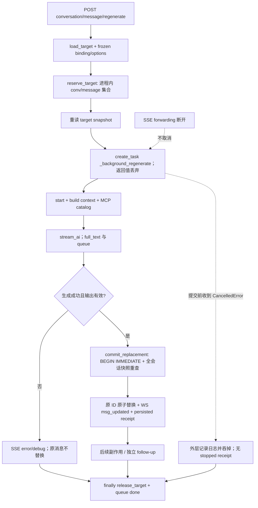
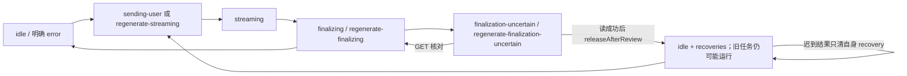

# CHAT-B2-AUDIT：生成生命周期与真正中止能力

审计日期：2026-11-17（Asia/Shanghai）。本轮仅静态读取当前工作区源码和已安装依赖源码，新增本报告；没有实施 CHAT-B2-A，没有运行应用、测试或构建，没有调用真实 Provider、数据库或线上服务，没有 commit、push、deploy。

**2026-11-18 实施前复核：** 原审计保留，不重复研究。下一轮以 [S6E2 最小实施结论](#13-s6e2-实施前差异与最小方案2026-11-18) 为准：沿用 S6E2-A / B / C，Provider 完成判定仍属原 CHAT-B2，不纳入 Stop / Abort。


**2026-11-18 S6E2-A 已实施：** 本次代码、合同结果和实际限制见 [第 14 节](#14-s6e2-a-实施记录2026-11-18)。第 1–13 节保留为原审计及实施依据；B / C 尚未实施。

**2026-11-18 S6E2-B 已实施：** 公开 API、兼容性与本次合同结果见 [第 15 节](#15-s6e2-b-实施记录2026-11-18)；Composer 尚未改造。

**2026-11-18 S6E2-C 已实施：** 前端接口、Composer / 消息操作、合同结果和刷新 partial 的明确缺口见 [第 16 节](#16-s6e2-c-实施记录2026-11-18)。

## 1. 基线、范围与结论

| 工作区 | 分支 / HEAD | 开始时状态 |
| --- | --- | --- |
| Penumbra：`/Users/remix/Desktop/Penumbra` | `main` / `8df2190b645326d63bd228cec203d145babd4920` | 干净 |
| AionHome：`/Users/remix/Desktop/AionsHome-main` | `refactor-code-main` / `86c3670139b42944a77a8cc4a4564fe5a65d1190` | 干净 |

已分别阅读两仓库根 `AGENTS.md`、`docs/engineering-principles.md`；另读 Penumbra `CLAUDE.md`、UI 入口，以及 AionHome AGENTS 要求的 runtime model / refactor master plan。AionHome 根目录没有 `CLAUDE.md`。这里只核对 Main send、canonical regenerate 及其实际共享边界，不以旧审计报告代替源码。本轮属于 CHAT-B2 契约准备，不改变持久化、Prompt 顺序、WS type/payload/timing、command grammar 或副作用顺序。

**结论：可以通过范围受控的渐进改造实现可靠的真正中止，无须重写 Chat 状态管理或统一 Diary / append-reply；但现有代码尚不具备可靠中止能力，也不是加一个 `task.cancel()` 和按钮即可交付。** 必须补齐：覆盖准备阶段的 Main execution 身份和任务强引用、显式流关闭、用户取消与系统取消分流、持久终态和 partial、取消与后处理的明确分界，以及前端按终态释放发送权限。多 worker 的任务定位能力目前不存在；真实部署是否多 worker 未核验，不能把单进程方案宣称为跨 worker 可用。[A1] [A2] [A3] [A4] [A5]

实施前应纠正的假设：

| 假设 / 方向 | 为什么有问题及影响 | 推荐替代 |
| --- | --- | --- |
| 前后端已有同一个 execution，可直接取 Task | 前端 executionId 是本地 UUID 派生；后端 debug scope 只是观测。send receipt 没有执行状态或 Task 引用；regenerate 的占位集合也没有 Task。[A2] [A3] [A5] [P1] | send 复用 `conv_id + client_msg_id`；regenerate 把现有尝试 UUID 传入后端；建立 Main 专属任务引用和可读结果 |
| Composer 现在整块锁死，需要重写 | 当前 `disabled` 和 `submitDisabled` 已分离，生成时文本、附件可编辑。误判会扩大 UI 改造。[P2] [P3] | 保留现有草稿隔离，只收紧发送权并接入停止 |
| Task cancelled 就等于用户停止成功 | 缺少取消原因、partial 落盘、终态；还可能在已提交/副作用中间取消。[A1] [A4] | 只在可取消阶段接受停止，关闭流并持久化结果后确认 |
| 删除“返回编辑”只需删 UI | `releaseAfterReview` 会把未知执行放入 recoveries 并释放 active，允许下一次 send/regenerate；仅藏按钮不足以定义新契约。[P1] [P4] | 移除 Main 的非终态 release 能力，保留只读核对；草稿编辑从来不依赖 release |

下文“已确认”均指静态源码证据；“建议”不是已实现功能；网络运行效果、代理行为和远端计费均未实测。

## 2. 当前执行生命周期图

### 2.1 Main send：SSE 与后台执行分离，但后台 ownership 不完整

```mermaid
sequenceDiagram
    participant UI as ChatView / Sender
    participant C as conversation controller
    participant H as send HTTP 路由
    participant DB as SQLite
    participant T as 独立 asyncio Task
    participant V as Provider HTTP stream
    UI->>C: send(content, immutable attachments, client_msg_id)
    C->>C: active; sending-user; 本地 executionId
    C->>H: POST /api/conversations/{id}/send
    H->>H: 验证 / 冻结 binding 与 options
    H->>DB: user + send receipt 原子提交
    H->>UI: WS msg_created(user)
    H->>H: Prompt 快照 / URL Reader / history / digest / recall
    Note over H: 此时尚未创建生成 Task，HTTP 也尚未返回 SSE
    H->>T: create_task(run_in_device_context(_bg_generate()))
    Note over H,T: create_task 返回值被丢弃，无 Main Task registry
    H-->>C: StreamingResponse(generate())
    T->>T: cache window / MCP catalog；queue start
    T->>V: stream_ai -> adapter -> client.stream
    loop chunks
        V-->>T: chunk
        T->>T: full_text += chunk；queue.put
        T-->>C: queue -> SSE forwarder -> event reducer
    end
    opt 客户端断开 / idle timeout / reader cancel
        C->>C: flush partial -> finalizing -> HTTP 核对
        Note over H,T: 转发停止；Task 不取消，继续生成、存储与后处理
    end
    T->>T: 命令 admission / MUSIC / schedule / HEART / memory 等
    T->>DB: assistant + link_send_assistant 同事务提交
    T->>UI: WS msg_created(assistant)
    T->>T: music result / export / digest / 事件 / 独立 follow-up
    T->>T: finally queue done（不向客户端发送 done 帧）
    C->>DB: 经 GET receipt + HTTP history 确认主回复身份
    C->>C: idle 或 error；证据不足则 finalization-uncertain
```

入口、准备与任务创建：[A1]；用户消息与 receipt：[A2]；Provider 与保存：[A6] [A7]；前端消费、核对：[P1] [P5]。

### 2.2 canonical regenerate



证据：[A4] [A5]。原消息、voice、HEART 的事务契约已有明确保护，不应为停止重写。canonical regenerate 不是“删旧消息再 send”。

### 2.3 前端当前状态路径



当前状态由每会话 controller 持有，sessions 位于 `useChatSend.ts` 模块级；切会话/页面卸载不 dispose execution。刷新页面则本地 controller、partial 和 UUID 关联不具备持久恢复保证。[P1] [P6]

## 3. 后台 Task 由谁持有，断开后谁继续运行

| 对象 | 当前持有方式 | 可否从停止 HTTP 路由定位 |
| --- | --- | --- |
| Main send `_bg_generate` | `asyncio.create_task(...)` 返回值未赋值；协程闭包持有 history、full_text、queue 等。事件循环调度及等待中的 Future/callback 支撑运行，没有应用级强引用表、可回收句柄或 owner cleanup callback。[A1] | 否 |
| canonical regenerate `_background_regenerate` | 同样丢弃 Task 返回值；`_active_targets` 只持有 `(conv_id,message_id)`，用于拒绝同目标并发，不存 Task。[A4] [A5] | 否 |
| SSE forwarder | 只从 queue 读事件。send 的 finally 标记 `_cutover_client_disconnected`，仅供 OpenAI cutover 观测。[A1] | 无取消权 |
| debug execution scope | ContextVar 存 debug owner/execution 字符串，decorator 不包装后台任务生命周期。[A3] | 否，不能作为控制平面 |
| 已提交 reply 的工具/追加回复 | `ReplyCommands.dispatch -> spawn_follow_up -> create_task`；独立 Task。append-reply 另有持久任务/attempt journal、owner ContextVar 和资源清理，不是 Main Task 表。[A8] [A9] | 无现成 Main cancellation API；不可按 conv 粗暴取消 |

不是断言“任务立刻会被 GC”：运行中通常有等待链维系引用；准确结论是 **Main 没有显式、可寻址的生命周期 owner**，不能依赖弱引用任务清单实现精确停止。

客户端断开后，已创建的 Main Task 继续 Provider 读取、命令解析、消息提交、WS 广播、导出及追加回复提交。队列无容量限制且没有消费端解除/丢弃策略，断开后仍可能累积本轮输出，直到 Task 结束。未来可以在 disconnected 时跳过纯转发 enqueue；这属于局部资源处理，不应把断开变成 cancel。[A1] [A7]

**准备阶段是另一条边界：** user 已写入后，URL Reader、instant digest、并行 memory recall 等仍在请求协程里，直到约 2739 行才创建后台 Task。断开 SSE 的结论不能倒推到“所有准备阶段都由后台 owner 保护”；请求被上层取消/进程退出时可能只剩 user + 空 assistant receipt。`instant_digest` 自身也可能进行辅助模型 HTTP 请求，不能只注册最后的主模型流。[A1] [A10]

本机 Starlette `StreamingResponse` 对旧 ASGI 版本使用断连监听/task group，对新版本在 send OSError 时抛 `ClientDisconnect`；两者都没有本项目独立 Task 的引用。实际 ASGI/proxy 断连时点未实测，不能保证 `_cutover_client_disconnected` 总会及时变为 true。[D1]

## 4. 取消如何传播到实际网络流

### 4.1 已存在的关闭链

在 Task **正等待 Provider 网络读取** 时，取消沿同一 await 链传播：

```text
Main Task.cancel()
  -> stream_ai.__anext__()
  -> call_anthropic / call_custom / call_aipro / call_siliconflow / call_gemini
  -> resp.aiter_bytes / aiter_lines -> HTTPX transport -> HTTPCore read
  -> CancelledError
  -> HTTP/1.1 stream 的 BaseException cleanup（shield）
  -> response stream.aclose -> _response_closed
  -> 未读完响应：HTTP11Connection.aclose -> network_stream.aclose
  -> async with client.stream finally: response.aclose
  -> AsyncClient.__aexit__: transport / proxy pool close
```

这不是只凭 `task.cancel()` 的推测：已读取本机 `.venv` 的 HTTPX 0.28.1 和 HTTPCore 源码。`AsyncClient.stream` 的 finally 明确 `await response.aclose()`；Response 经 BoundAsyncStream、AsyncResponseStream 传给 PoolByteStream；HTTP/1.1 未完成连接关闭到 AnyIO socket stream。HTTPX AsyncClient 每次 adapter 调用独立创建，默认不启用 HTTP/2；不能据此推断其他部署 transport 的行为。[D2] [D3] [D4]

但是如果生成器已经 `yield chunk`，Task 正在调用方其他 await / 后处理里，取消未必注入最内层 `__anext__`。Python `async for` 的退出不构成对子生成器的确定性 `aclose` 契约。Main 两个调用端都缺少 `aclosing(stream_ai(...))`；OpenAI/Gemini 分发层对子 adapter 也没有显式关闭。因此“网络读取时可传播”不等于“所有暂停点均已及时关闭”。需要补齐持有生成器的一层层关闭责任，而不是等 GC/finalizer。[A6] [A11]

### 4.2 各 Provider 实际情况

| 实际 adapter | 当前传输与关闭代码 | 当前可靠性 / 缺口 |
| --- | --- | --- |
| Anthropic 原生（AiPro、custom，含相应 gateway/header 适配） | `_call_anthropic_impl` 用 `AsyncClient(timeout=Timeout(300, read=600)) + client.stream`；`call_anthropic` 捕获取消后重新抛出，finally 调用 impl `aclose`；`stream_ai` 的两个 Anthropic 分支已有 `aclosing(call_anthropic(...))`。[A11] [A12] | 网络读取中的取消可关闭连接；内部关闭最完整。但 Main 外层流关闭仍缺失。wrapper 对 `stream.aclose()` 的 BaseException 做吞掉处理，仅保护原异常，不能当作关闭已成功的确认 |
| OpenAI 兼容 AiPro | `call_aipro`，独立 AsyncClient timeout=300，双层 async with。[A13] | 网络读取取消可关闭；分发生成器与 Main 调用端缺显式 aclosing；不是 OpenAI SDK 的 remote cancel API |
| OpenAI 兼容 custom | `call_custom`，timeout=600，同样双层 async with。[A14] | 同上；不能把 HTTP read timeout 当用户取消 |
| SiliconFlow OpenAI 兼容 | `call_siliconflow`，timeout=300。[A15] | 同上 |
| Gemini 原生 | `call_gemini`，timeout=300，`aiter_lines`。[A16] | 同上；不是异步生成 job 的远端取消 |
| 准备阶段的辅助模型 / embedding | `instant_digest -> nonstream_llm.complete_text` 和 `memory.get_embedding` 使用局部 AsyncClient。[A10] | 等待中的取消具备上下文清理路径，但目前不在可寻址 Main 后台 Task 内；应纳入同一 execution 的准备阶段，不能声称已可停止 |

这里只确认 **停止本地后台消费并关闭上游 HTTP 请求** 的可行性。代理/网关收到 TCP close 后是否立即停止远端推理、是否继续计费，没有 Provider 取消回执或本轮实测证据，均为未知；报告不作保证。没有发现 Main 使用独立远端 job id 或 Provider 专用 cancel endpoint。

### 4.3 `CancelledError`、失败和 EOF

- Main send 的内外 `except Exception` 不会捕获当前 Python 的 `asyncio.CancelledError`。若直接取消生成中的 Task，通常跳过正常后处理/assistant 提交，只运行其已进入的 finally；**不会保留 partial 为持久结果，也不会生成用户停止终态**。缓存窗口/MCP catalog 等初始化位于外层 try/finally 之前，此处失败或取消甚至不能保证 queue done。[A1] [A6]
- canonical regenerate 内层明确重抛取消，但外层 `except asyncio.CancelledError` 在 `committed == False` 时不重抛，只记日志并 finally release。Task 可能表现为正常返回，SSE 只是 EOF，原消息未替换。`committed == True` 才重抛；这不是 Stop 契约。[A4]
- `run_in_device_context` 只设置/恢复 ContextVar，不捕捷取消；不能补足 owner。[A17]
- MCP 真正 `call_tool`、connect/discovery 的异常处理会传播取消（包括 exception group 内取消）；`mcp_client.test_connection` 的宽 `except BaseException` 会返回失败，但它是独立测试连接入口，不在 Main 生成的 call_tool 路径内。不把这个非共享入口列为 B2 必改项。[A18]
- Anthropic 要求 `message_stop`，缺失时抛 `RemoteProtocolError`，还会识别 damaged/limited output。OpenAI 兼容/Gemini adapter 的干净 EOF 没有等价的 Main 完成强校验：未见终止标志但已有正文时，Main 可能按完成保存。已有 `stream_event/stream_payload` 的终止观测主要被 `_append_attempt` 开关限制，不能直接认定 Main 具备该能力。[A12] [A13] [A14] [A15] [A16] [A19]

最后一项是与可靠终态直接相关的真实缺口：SSE/HTTP 正常 EOF、Provider protocol completed、用户取消必须分别判定。建议只补 Main 完成判据，复用现有协议解析结果，不迁移 append-reply 的重试策略。

## 5. partial、receipt、Assistant 的保存时序与当前语义

| 时点 | Main send | canonical regenerate |
| --- | --- | --- |
| 接受用户提交 | user 与 `chat_send_receipts(conv_id,client_msg_id,user_message_id)` 同事务；duplicate 同身份不再生成。[A2] | 不创建 user；校验并 reserve 原目标。[A4] |
| 流式输出 | `full_text` 在闭包内存累加；queue 仅传输，前端 accumulator 保存 partial；没有 Main checkpoint 落盘。[A6] [P1] | 相同；不修改旧目标 |
| Provider exception / timeout | send 追加安全错误文本，随后仍走后处理并保存 partial + 错误正文；外层异常则可能只有日志和 EOF。[A6] [A7] | error/debug 经 SSE；不 commit replacement，原目标保留；断流后无可读的失败 execution receipt。[A4] |
| 正常后处理 | 部分副作用 **先于 assistant 提交**：MUSIC 查询、schedule、HEART、异步 memory write；不是一个统一可回滚事务。[A7] | 先准备纯输出，再事务提交；schedule 等主要副作用在提交与 persisted receipt 后执行。[A4] |
| 正文提交 | assistant INSERT 与 `link_send_assistant` 同事务；receipt 只关联主回复，不关联 follow-up。[A2] [A7] | `commit_replacement` 原 ID 替换；重查会话快照，含 voice/HEART 更新；commit 后才发 persisted receipt。[A5] |
| 提交以后 | WS、music result、export/digest、能力事件、独立 follow-up、metrics/debug 仍可能运行。[A7] [A8] | WS/persisted 后仍有 side effects、follow-up、export 等。[A4] |
| 原始 Task 直接取消 | 无用户停止分支。提交前通常不保存 assistant/partial；提交后已有记录保留，后续副作用可能被截断 | 提交前保留旧目标，但无停止回执/持久 partial；提交后不能撤销替换 |
| SSE done / EOF | queue done 是转发器内部 sentinel，**没有发出业务完成事件**；前端 EOF 后核对 history | 同左；persisted receipt 是替换证据，不是整个 Task/后处理已结束的执行终态 |

现有 receipt 的限制：[A2]

1. `assistant_message_id == null` 只能表示“读不到已关联主 assistant”，无法区分准备中、Provider 生成中、用户停止、异常退出、消息删除。
2. assistant 非空只证明主消息已提交，不证明主 Task 的后处理已经结束。前端在断流后可能先确认历史，从而允许下一条请求，而旧后处理还在运行。
3. `read_send_receipt` JOIN user、LEFT JOIN assistant：删除 user 会使 receipt API 读不到；删除 assistant 会返回 null，像“尚未生成”。前端若取消后仍依赖消息是否存在推断终态，会重新锁住或错误恢复旧结果。删除路由没有停止生成的语义。[A22]
4. 没有 execution status 更新：`completed/failed/cancelled` 都不是 Main receipt 的现有字段。`has_error` 是局部变量/debug/正文诊断，不是持久执行结果。

明确区分目标语义：

| 事实 | 当前可观察证据 | B2 应表达 |
| --- | --- | --- |
| SSE disconnected | 前端网络/timeout/reader cancel；后端最多有本地观测标记 | 传输状态，不改变 execution 终态，不取消后台 |
| Provider interrupted | 抛网络异常；Anthropic unexpected EOF；其他协议存在漏判 | 非用户原因的中断/失败，带原因；保留 partial，禁止当成功执行命令 |
| User cancelled | 当前无此契约 | `cancelled` 及 user 原因，关闭流与保存 partial 完成后才终结 |
| Provider completed | Anthropic message_stop；其他协议完成标志需明确消费 | Provider 阶段完成，随后仍可能处于执行 finalizing |
| Provider failed | 安全错误正文或 SSE error/debug | `failed` + Provider 原因，不与主动停止共用错误文案 |

建议停止后保留：已保存 user（除非用户另行主动删除）、独立的安全 partial 和 execution receipt；不把 partial 自动提交成正常成功 Assistant。regenerate 被停止时旧 Assistant 保持不变，partial 另存到本次 execution。新生成属于用户显式新意图，使用新请求身份；同一原身份的重试只返回原结果，绝不重新调用 Provider。

## 6. 前端状态与交互：逐项回答

### 6.1 当前什么会锁定什么

| 条件 | 下一条草稿 / 附件 | send | 消息 edit/delete | regenerate |
| --- | --- | --- | --- | --- |
| ready + idle | 可编辑 | 有正文或附件且上传就绪才可发 | 持久化消息可操作，另有内容安全限制 | 仅最新非 carryover 的尾部 Assistant |
| sending-user / streaming / regenerate-streaming | **可编辑** | 禁止；目前仍显示 disabled Send | 整体禁止 | 禁止 |
| finalizing / regenerate-finalizing | **可编辑** | 禁止 | 整体禁止 | 禁止 |
| 两种 finalization-uncertain | **可编辑**，不依赖核对 | 禁止；可经旧 release 流程绕过 | 整体禁止；release 后可操作 | 禁止；release 后可能重新允许 |
| error，未 confirmedFailure/rejectedSubmission | 可编辑 | policy 禁止 | policy 禁止 | policy 另查失败目标 |
| 明确拒绝或确认失败 | 可编辑 | 通常恢复 | 通常恢复；旧 inline 控制内容仍受限 | 失败目标/尾部和服务就绪满足才可用 |
| workspace 未 ready、切换中、配置读取/保存、会话 mutation、模型不可用、modelSelectionPending | `draftEditable` 复用 INITIAL 状态的 readiness，可能禁用整个输入和附件 | 禁止 | 部分工作区变化时禁用 | 禁止 |

证据：[P2] [P7] [P8] [P9]。`Sender.isSubmitting` 只阻止重复提交，不禁用 textarea；`attachmentsReady` 只约束提交，不约束增删附件。[P3]

### 6.2 八个问题的最小答案

1. **编辑和发送权限已经能独立控制。** 保留 `Sender.disabled` / `submitDisabled`。若“始终编辑”包含模型不可用/保存配置期间，应让 draftEditable 只依赖有效草稿 owner 和必要的工作区挂载条件，不再依赖 Provider readiness。没有选中会话时如何承载草稿是单独 UI 选择，本轮不扩展为全局草稿系统。[P2] [P3]
2. **旧 execution 未终结时可以只禁发。** 现有 active 门禁可复用，但不能通过 recovery release 清掉。发送和 regenerate 都必须认服务端执行终态；网络错误、GET 成功但无结果、Task cancellation 请求已发送都不能解锁。[P1] [P4]
3. **发送/停止复用当前右侧按钮位置。** 给 Sender 传入派生动作 `send / stop / stopping / waiting` 和独立 `onStop`；stop 的 enabled 不依赖文本、附件上传或 isSubmitting。发送快捷键仍只走 handleSubmit，不能把 Enter 改为 stop；停止由明确按钮触发。sending-user 等待响应头时也须有停止途径，不能等收到 SSE start 才可寻址。[P3] [P5]
4. **停止中：** 点击后立即显示“停止中…”、禁重复停止，正文和附件继续编辑，partial 继续保留；停止 HTTP 失败/丢响应显示“停止结果待确认”，仍禁发。后端明确还在可取消阶段时允许显式再停止；重复请求必须幂等。不要用本地 abort 后的 error 假装 stopped。
5. **迟到结果与草稿隔离：** 保留 Sender `draftRevisionRef/valueRef`、按会话的 draft map、附件 capture 快照/refs/ownerEpoch/requestId。成功/停止只结算原 execution 与其 submission recovery，不能 `setValue("")`、清当前附件或把旧提交自动塞回下一条草稿。[P1] [P2] [P3] [P10]
6. **恢复已有消息 edit/delete：** 移除 edit/delete policy 对整个会话 execution 的一刀切禁用；保留持久身份、工作区归属、保存时的局部 busy、legacy inline 正文安全约束。regenerate 仍受 execution 门禁。当前 Bubble 在 `executionStatus !== undefined` 时不显示操作，而 regenerate streaming 会直接覆盖目标气泡；应把“已保存目标”和“本次临时结果”分开呈现（unknown 的独立 partial 分支可复用），使旧目标仍可操作。不能只改 policy。[P7] [P8] [P9] [P11]
7. **不允许旧结果覆盖新编辑/删除：** 后端 canonical regenerate 已有会话快照事务重查，足以拦截生成期间的旧目标覆盖，不必再加全会话锁。Main send 保存的是新 ID，不会直接 PUT 旧消息。前端保留 HTTP-authoritative history sequence、删除过滤、编辑 Dialog 独立 content；对正在编辑/删除的 regen 目标停用其替换 overlay，不能让迟到 SSE 把新正文视觉覆盖。终态之后核对只刷新事实，不能重放旧 persisted 内容到消息 API。[A5] [P11] [P12] [P13]
8. **重新核对可以继续只读。** 当前 `retryFinalization` 走 receipt/history GET；`manual` 参数不启动写入。新增服务端 execution GET 后优先读终态，必要时读主消息/历史；保留现有 focus/online/WS 触发的读路径即可。核对不调用 cancel/send/regenerate，不提交 partial，不赋予编辑权限。读取到权威终态后可结束发送等待，这是反映事实，不是“返回编辑”流程。[P1] [P5] [P6]

补充：当前 regenerate 成功核对依赖 **SSE persisted receipt + HTTP 内容投影相等**。断流丢 receipt 后，即使目标已替换，也可能一直 unknown；编辑/删除目标后更不应该拿“内容不同/不存在”当未完成。B2 execution GET 应独立提供本次尝试终态与目标身份，不能继续以内容相等充当执行状态。[P1] [P14]

### 6.3 目标按钮契约

| 后端/本地证据 | 按钮 | 草稿 / 附件 | 发送 / 再生成 |
| --- | --- | --- | --- |
| 无未终结 execution | 发送（沿用内容/上传条件） | 可编辑 | 按正常资格允许 |
| preparing / generating，包括 SSE 已断 | 停止 | 可编辑 | 禁止 |
| stop 已请求、尚未确认资源关闭和终态 | 停止中…（disabled） | 可编辑 | 禁止 |
| 后端正在完成不可中断提交/后处理，或暂时无法确认 | 等待确认（disabled） | 可编辑 | 禁止 |
| execution completed / cancelled / 明确 failed | 恢复发送；取消用中性“已停止” | 可编辑 | 按正常资格允许 |

“停止中”只是现有 execution 上的操作进度，不需要重设计一套前端业务状态机。服务端 phase/terminal 投影到现有 active/finalizing/uncertain 足够。状态反馈必须独立于 `executionError`；当前 `ChatExecutionNotice` 在 error 为 null 时会提前返回，不能只给它增加一个无错误 stopping 状态就期待出现提示。[P2]

## 7. 真实竞争与影响范围

### 7.1 必须处理的竞争

| 场景 | 现有事实 / 风险 | 足够的小边界处理 |
| --- | --- | --- |
| stop 在 SSE start / Task 创建之前到达 | send 大量准备发生在 HTTP 请求里；无 Task 可找。[A1] | 在耗时准备前登记 execution/owner；原请求和停止按同一身份仲裁。未找到不能返回 cancelled，见 §9 |
| 取消与 Provider 最后输出同时发生 | Task.cancel 只安排注入；后处理有实际写入，任意 await 都可成为取消点。[A6] [A7] | 在进入正常后处理前同步切 phase；可取消阶段 stop 胜出则跳过命令；进入 finalizing 则返回实际完成状态/等待，不再硬取消 |
| 主消息已存，但 postprocess 未结束，SSE 断开 | 当前 receipt/history 已足以让前端回 idle，但 Task 还会产生副作用。[A7] [P1] | execution terminal 以 owner 完成清理/提交后处理为准；消息 receipt 不能代替 |
| 重复 stop / stop HTTP 自己断开 | 重复 cancel 可能打断第一次取消的 partial/终态保存 | 第一次标记 cancel_requested 后只触发一次 Task.cancel；owner 完成清理。stop 请求的取消不能级联取消 owner；等待 owner 时使用不传递请求取消的方式 |
| 用户编辑/删除 regen 目标，旧流迟到 | 后端 commit snapshot 已能拒绝，前端 streaming overlay 仍可能盖住目标。[A5] [P11] | 复用快照重查 + 局部停止展示该目标 overlay；临时结果单列，不加全局锁 |
| 删除 user/assistant 后重新核对 | 当前 receipt JOIN 使身份消失或 assistant=null。[A2] | execution 终态独立于消息存在；取消 partial 不进入会自动补回 messages 的 recovery journal |
| B1 release 后新请求与旧请求并发 | 这是现有真实允许路径，不是纯理论。[P4] | 移除 Main release 权；按会话保留唯一未终结 Main execution，后端接受边界也拒绝并发，其他会话不受限 |
| 服务重启/请求落到另一 worker | 内存 Task 消失或不可达；不能把未找到当停止成功 | durable 终态/owner 识别；重启孤儿标记系统 interrupted，绝不自动重发。跨 worker 控制见 §9.5 |
| OpenAI/Gemini 干净 EOF 缺协议终止 | 现有 Main 可能成功提交不完整正文/执行命令。[A19] | 主流生成完成判据单独固化合同，区分 completed/interrupted |

SQLite await 取消不能撤销已完成的 commit；`committed` Python 变量也不能替代数据库事实。推荐从正常后处理入口起不再对 owner 注入用户取消，以避开 commit/flag 间隙及 Main 提交前副作用。失败仍按既有规则收尾，不声称能够回滚已执行日程、memory 或远端工具。[A5] [A7]

### 7.2 实际共享关系与隔离范围

| 对象 | 与 Main 的实际联系 | B2 是否应取消 |
| --- | --- | --- |
| 其他会话 Main | 共享 adapter/WS/DB，但任务应按 execution 定位 | 否；不能按 Provider/client 全局关闭，不能扫描并取消同一模型全部 Task |
| Diary 独立 chat/feed | 自己的 route、history/entry、任务与独立配置；可能共享 stream_ai / ReplyCommands | 否；只回归共用流关闭，不能接入 Main stop registry |
| MCP catalog discovery | Main 准备阶段 await；持有共享 client/catalog，但本次请求的等待可取消 | 取消本次等待可以；不 disconnect 全局 MCP client，不清共享缓存来“停止” |
| 主回复后 MCP 工具 / Location、Activity、Camera、Web follow-up | ReplyCommands 在主消息提交后创建独立 follow-up；append-reply owner 有自己的任务/attempt/结果保存。[A8] [A9] | 不追杀已提交 continuation；停止窗口在提交命令前关闭。无法撤销已发送远端工具 |
| Location / Activity / Camera / Schedule 主动触发 | 有自己的 append owner/调用点，可能写同一 conversation；不是 Main Task 子引用 | 否；保留触发、target 和状态机。其新增消息导致 regenerate 快照 conflict 是现有正常保护 |
| 已异步提交的 memory write / metrics / auto digest | Main 的独立 create_task 或既有调度行为 | 不把它们纳入“整会话停止”；已提交工作保留 |

不要把 append-reply 的资源注册、超时、两次 Provider 尝试、恢复提交 journal 整体搬到 Main。它们保护不同生命周期，迁移会引入本任务不需要的重试、写入与副作用变化。可以复用纯 partial 安全投影、终态单向更新和测试方法。[A9] [A20]

## 8. 直接可复用的 API、状态与代码

| 可复用项 | 用法与边界 |
| --- | --- |
| send `client_msg_id` + `_persist_send_messages` 幂等事务 | 继续作为原提交身份；同身份不会重新生成。保留 user 的早提交契约。[A2] |
| `GET /api/conversations/{conv}/send-results/{client}`，no-store | 保留身份读接口；增加/关联 execution 结果，不把 null/404 当取消或失败。[A2] |
| canonical regenerate 路由、`reserve_target`、`commit_replacement` | 保留目标检查、原 ID 替换、乐观事务重查；reserve 不是 Task registry，需关联本次尝试身份。[A4] [A5] |
| `stream_ai` frozen binding/options、现有 httpx async with | 不改协议选择、Prompt 构造或自动 fallback，只明确流所有者与退出路径。[A11] |
| Anthropic `aclosing` / wrapper finally | 保留并把调用端和其他分发分支关闭责任补齐。[A11] [A12] |
| `append_reply_checkpoint.project` | 可复用其无副作用的正文安全投影（去私有/未闭合控制段、命令、凭据片段）；不要用正常命令处理流程保存取消 partial，也不要复用自动补提交。[A20] |
| sessions/controller/active identity/finalization Promise | 会话隔离与去重核对已有，不需要 Redux/新全局状态机。stop 复用原 execution 对象与 isCurrent 保护。[P1] [P6] |
| 草稿 revision、附件 immutable capture、recovery identity | 保留下一条草稿和已提交快照独立的实现。[P3] [P10] |
| history sequence/abort/删除过滤、edit Dialog 独立草稿、HTTP 编辑/删除读回 | 保留消息事实权威及本地输入保护，只解决 active overlay 与 mutation 的局部交叉。[P12] [P13] |

## 9. 最小改造建议（等待评估后实施）

### 9.1 一份 Main execution 事实，不建通用任务框架

建议新增一个 Main 专属 execution 记录，覆盖 send 与 canonical regenerate。send 复用 `(conv_id, client_msg_id)` 派生身份；regenerate 复用前端当前尝试 UUID，但必须通过正常请求字段/头传给后端，不能依赖可关闭的 debug header。记录关联 kind、user/target/assistant ID、phase、terminal outcome/reason，以及取消后的安全 partial。消息链接可以为空，不能通过删除消息让执行事实消失。

Provider 阶段结果与 execution 结果分开表达：例如 Provider 已 completed、assistant 已 committed，但后处理失败，应保留消息身份并表达 postprocess 失败，不能改称 Provider failed，更不能授权自动重发。可以用 provider outcome 与 reason/committed IDs 表达，不必为此增加一组平行状态机。

保留现有 send receipt 的幂等与主回复关联，不复制两套生命周期状态：现有 GET 关联 execution 投影，新建共同 execution GET 覆盖 regenerate。新增身份及字段必须由后端契约定义，前端不推导业务状态。

最小运行 phase 是 `preparing / generating / finalizing`；终态可为 `completed / cancelled / failed`，系统中断通过 `failed + interrupted/service_restarted` 原因区分。`cancel_requested` 是操作标志，不是终态；`sse_disconnected` 仅为传输事实。无需为上述每个观测再设计前端大状态机。

进程内 registry 强持有 `identity -> task + phase/cancel-request`，完成后清除 Task 句柄，结果保留在 receipt。每会话只阻止另一个尚未终结的 Main send/regenerate；不限制其他会话、Diary、独立后台流程。这个约束保护本次明确要求的顺序，不是全局业务锁；可用一次接受事务/局部注册原子操作完成，不添加层层重复校验。

### 9.2 覆盖准备阶段与停止先到

把 owner 建立到耗时准备之前；允许保留 user 的原保存顺序，不重排 Prompt 或业务步骤。不要为了 registry 复用而把 ASGI 请求 Task 本身当可取消 owner（那会把 HTTP 生命周期与执行绑定）。应由独立 owner 负责准备和生成，HTTP 只接收接受结果与 SSE；迁移这一边界前先固定当前 user/receipt/WS 顺序合同。

前端在 POST 前已有 send UUID，停止可按同身份发起。**停止先于原请求接受时不能把“未找到”视为“已停止”。** 要覆盖“立即停止且仍在等待响应头”，建议原请求接受与 stop intent 共享同一幂等身份记录：stop 可记该身份的取消意图，随后原请求接受时仍按契约保存 user，但不启动准备/Provider；不创建用户消息的 stop 本身不能伪造 user receipt。只针对这一个身份，不用预先再做一轮 reserve HTTP 握手，也不加常驻轮询。不存在/无权限/旧后端的查询仍保持 unknown。此边界和记录保留策略须先写合成合同，不能在本轮假设已经具备。

### 9.3 一条精确停止命令 + 一个只读 execution 查询

建议接口形状（非最终命名）：

- `POST /api/conversations/{conv}/executions/{execution}/cancel`：认证、校验会话及执行归属；已终结直接返回原终态；可取消阶段记录 user intent 并只 cancel 对应 Task；finalizing 返回当前状态，不打断已开始的正常后处理。可以返回明确的 stopping/accepted，再由现有核对入口读取，或等 owner 收尾后直接返回；不能把 202/cancel() 返回 true 当终态。
- `GET /api/conversations/{conv}/executions/{execution}`：no-store，返回 identity、phase、outcome/reason、消息身份、必要安全 partial；不调用 Provider、不重发、不取消、不写消息。结果不能依赖原 user/assistant 仍存在。

重复停止幂等，取消接口自己的断连不影响 owner 的清理。未发现 owner 或关闭失败时保持未知/明确失败，不能伪造 cancelled。停止后不自动重发；显式新生成采用新 execution identity；同身份仅回原结果。

### 9.4 明确取消截止点和 partial 语义

1. **preparing / generating 可停止。** 捕获到携带本 execution user intent 的取消后，显式关闭当前生成器和 HTTP 流；不走 schedule、HEART、MUSIC、MCP dispatch 等正常完成路径。
2. **在现有正常命令后处理之前切 finalizing。** 在同一事件循环的同步阶段判定 stop intent 并切换 phase，不在判定与切换之间 await。之后拒绝硬取消，等待原路径收尾，避免截断现有先于 assistant 的副作用。不会为此重排正常命令或消息提交。
3. **只在资源清理、partial 和终态保存后确认 cancelled。** `CancelledError` 若无用户意图则是系统取消/中断，不标“用户主动停止”。原异常不能被 cleanup 成功返回掩盖。
4. **partial 放在 execution 结果，不自动 INSERT 正常 Assistant。** 复用安全投影，保留已生成可公开正文，标“已停止”；不触发命令，不执行自动 digest。零正文可只有 stopped 记录。regenerate 原消息/voice/HEART 保持原样。不要调用 append recovery 的自动消息补提交流程。
5. **恢复读取不覆盖用户后来的 mutation。** 取消 partial 作为独立结果展示；已有消息被删除/编辑后，不能用旧 receipt 内容重新写回或重新盖住消息。执行结果与当前消息内容是两个事实。

这里建议把“保留 partial”落实为停止后可经 GET 恢复的持久结果，而不只保留当前页内存；这满足停止响应丢失后的核对，也避免取消后刷新就丢正文。实现只需在取消收尾保存一次，不要求为 Main 新增逐 token checkpoint。进程在取消收尾完成前崩溃时的最后一段内存正文仍可能丢失，不能在没有 checkpoint 的情况下承诺崩溃零丢失；它不应被伪装成已确认的用户停止。

采用上述截止点后，用户恰在 Provider 完成后点击停止，可能得到 `finalizing` 后的 `completed`，而非 cancelled；这是如实反映已越过取消边界。等待期间仍能编辑草稿，不能发送。已提交的工具追加链不被冒充为本次尚未结束的主生成，也不撤销。

### 9.5 进程/部署边界

仓库 `main.py` 的直接 uvicorn 启动没有显式 workers 配置，但这不能证明线上单 worker。本轮没有读取进程/线上服务。单进程强引用 registry 只能控制本进程 Task。[A21]

若评估环境明确单 worker，先交付该范围和持久 receipt 足够；复用 append owner 的思想，在启动清理时将确定失去 owner 的非终态 execution 标为系统中断，不自动恢复生成。不能把所有 running 一律改为 user cancelled。

若要求多 worker 下也可靠，**缺少 owner 路由/控制信号传递**：cancel 打到另一 worker 时仅凭 SQLite execution ID 无法 task.cancel。需要可验证的 owner 定向投递或受约束的单 owner 运行模式；先确认真实部署要求再选择，不为未知部署默认引入 Redis、分布式锁、队列和轮询。无此保证时 B2 不可宣称跨 worker 可靠。

### 9.6 前端只改现有边界

- application/execution client 增加 cancel 和只读结果映射；controller 将 stop 绑定到当前 execution，保持 active 至权威终态；取消结果不能被 SSE EOF 的旧 finalize 覆盖。
- sessions/useChatSend 透传按会话 stop；不要因导航 dispose、不要全局 abort。
- Sender 增加右侧按钮动作，保持文本、附件、IME 与发送快捷键原逻辑；草稿编辑不以模型就绪或历史核对成功为条件。
- Main 删除 `ChatExecutionReviewAction` 接线及 `releaseAfterReview` 非终态放行能力；共享组件如其他页面仍有消费，后续实施先查引用，不扩大删除范围。
- edit/delete policy 改为消息级资格；保留 regenerate 并发门禁。regenerate 临时输出与旧目标独立，接入 mutation 后抑制旧 overlay；不新增消息状态机。
- 重新核对保持 GET-only，终态判断独立于 SSE 是否完整收到、消息当前内容是否等于旧 receipt。无须常驻新轮询或“核对后才能编辑”的确认弹窗。

## 10. 推荐 PR 拆分与测试矩阵

每个 PR 先落该边界的合同测试，再改实现；每步验证正常路径没有新增确认、等待或内容损失。以下全部是 **后续计划，本轮未新增或运行测试**。

| PR | 明确边界 | 必要验收 |
| --- | --- | --- |
| CHAT-B2-A | Main execution 接受、身份、owner/Task 引用、持久状态和只读 GET；覆盖准备阶段，不接停止 UI | send 幂等/用户早提交/WS 顺序不变；regenerate UUID 贯穿；同会话 Main 防并发，其他会话可同时运行；删除消息仍可查终态；准备异常有明确结果 |
| CHAT-B2-B | Provider 流关闭和 Main 完成判据 | 所有实际 adapter，网络读取/响应头等待/刚 yield/调用方退出都可证明资源关闭；Anthropic 无 message_stop、OpenAI/Gemini 缺完成标志不能被当完成；不引入 Provider 重试/fallback |
| CHAT-B2-C | cancel API、取消截止点、partial 与终态原子语义 | 真正关闭上游；重复停止幂等；用户取消与失败分离；正常完成与停止竞争；finalizing 不截断提交；SSE 断开继续运行；取消不提交命令、不重发 |
| CHAT-B2-D | controller + Sender 发送/停止/停止中 + 删除 release 流程 | 全阶段可编辑草稿/附件；未知与 stopping 禁发；cancel 失败、断流仍可恢复只读核对；旧结果不清新草稿；IME/快捷键与触屏可用 |
| CHAT-B2-E | 消息 edit/delete 与 regenerate overlay 的局部交叉 | 执行中已有消息可编辑/删除；快照 conflict 保护后端；旧 SSE/GET 不覆盖 mutation；未终结禁止 regenerate；只读核对不再依赖内容相等 |

重点测试矩阵：

| 维度 | 必测情形与断言 |
| --- | --- |
| 正常生成 | send 与 regenerate，fast/normal 代表路径；消息身份、receipt、Prompt、命令顺序、WS 时序保持；无需额外确认；生成时可写下一草稿 |
| 协议矩阵 | Anthropic AiPro/custom；AiPro/custom OpenAI、SiliconFlow、Gemini。fake transport 必须走真实 adapter，记录流 `aclose`、client exit，不能只 mock `stream_ai` 然后断言 Task.cancel |
| 网络关闭 | fake AsyncByteStream 阻塞在读取、等待 headers、已经 yield 后停止；用仅绑定本机的合成 HTTP 服务可进一步观察对端断开；绝不使用真实 Provider/凭据 |
| 接受/准备 | stop 在 POST 接受前、user 提交后、URL/digest/recall、MCP catalog、SSE start 前；不晚启动 Provider，不丢 user，不出现无终态锁死 |
| 主动停止 | 空正文、部分正文、thinking-only、半个控制 marker/命令；保留安全 partial，原 user 保留；无正常 assistant 成功提交，无命令/工具执行，无自动 resend |
| 传输与 Provider 失败 | SSE reader cancel、120s idle timeout、代理断流只影响传输；HTTP error、Provider read timeout、无协议 terminal、异常 EOF 是失败/中断，不能显示用户停止 |
| 完成竞争 | 末个 chunk/协议 terminal、postprocess 入口、DB commit 前后、WS/persisted 丢失、stop 响应丢失；终态只选一次，完成先胜则返回 completed，取消先胜不得继续命令 |
| 幂等与隔离 | 连点 stop、重复原 send、停止后显式新 regenerate、新 UUID；不重跑旧请求，不误伤 B 会话/Diary/MCP 已提交追加回复/Location/Activity |
| 消息 mutation | 编辑/删除旧消息、regen target、send user 或主 assistant；迟到 SSE/GET、分页/导航中的旧历史；不覆盖新正文、不复活删除消息、不因 receipt JOIN 丢身份而永久 unknown |
| 草稿与附件 | 停止时继续输入、IME、增删附件、上传完成/移除、切 A/B、旧请求拒绝或终态迟到；只结算原提交，不清新草稿、不回填旧附件 |
| 核对 | 仅 GET；包含 running/cancelled/completed/failed/not-found/不可达/旧服务响应；不取消、不重新 POST、不提交 partial；即使消息删改也能识别终态 |
| 资源与重启 | Task 强引用移除、queue 断开不无限留存、单次 cancel 不打断 cleanup；进程丢失为系统 interrupted；如宣称多 worker，必须验证请求跨 worker 定位 |

已有可扩展的合成合同：AionHome `test_chat_send_receipts.py`、`test_canonical_regenerate_route.py`、`test_anthropic_provenance.py`；Penumbra `chat-send-abort.test.ts`、`chat-manual-recovery.test.ts`、`chat-execution-sessions.test.ts`、`ChatView.drafts.test.tsx`、message edit/delete policy 测试。已阅读其中相关断言；已有 disconnect/consumer close 测试不能代替 B2 全链路取消测试。B1 中“未知执行 release 后可新发送”的用例应明确替换为新合同，不能继续作为预期行为。[T1] [T2] [T3] [T4]

## 11. 明确不需要处理的问题

- 不更换 SSE 库；客户端 parser/AbortController 不是服务端 Task owner，换库无法补上停止事实。
- 不把浏览器断流自动映射为取消，不因切页/切会话终止后台。
- 不自动重发、不用 resend 探测状态、不自动提交 partial，不新增“返回编辑”或“保留临时回复”确认流程。
- 不统一 Main、Diary、append-reply、proactive 流程；不搬用后者的自动重试、工具 ownership、TTS 与恢复消息 journal。
- 不取消同会话全部后台任务，不撤销已提交消息、工具调用、日程或 memory；不尝试让远端外部副作用事务回滚。
- 不重写 Prompt、模型/连接配置、MCP grammar、cache window 或 WS 总线；不调整既有正常命令副作用顺序。
- 不为了理论竞争增加多层锁、全局发送锁、常驻轮询、分布式队列或重复 HTTP 校验。保留已有 canonical regenerate 快照事务和草稿/附件身份保护即可。
- 不清除 legacy inline 消息编辑的必要安全限制，不把未持久化临时气泡当作可 PUT/DELETE 的消息。
- 不承诺远端推理/计费在 socket 关闭后立即结束；本轮缺少这类证据。

## 12. 验证边界与最终判断

这是源码审计，未运行任何业务测试、网络联调或数据库查询。读取了本机安装的 HTTPX/HTTPCore/Starlette 源码以确认关闭与断连机制，但没有用本机依赖版本替代线上事实。报告中的关闭可靠性、PR 测试矩阵和跨 worker 条件必须在后续合成验收中兑现。

**现有架构能以较小、分边界的改动实现可靠真正中止。现状缺的不是 SSE 功能，而是 Main execution 的可寻址 owner、端到端确定性流关闭、取消安全边界及持久终态/partial；regenerate 还缺可查询的尝试身份。补齐这些能力后，前端可沿用 CHAT-B1 草稿与会话隔离，只增加停止操作和终态门禁。若要求在未知多 worker 部署中仅加内存 Task 表就保证可靠，则不能达到目标，具体还缺 owner 定向控制机制。**

本轮交付仅此报告，停止在人工评估处，不进入 CHAT-B2-A。交付核对：Penumbra 仅新增本文件，AionHome 无工作区变更；报告引用及空白格式做了静态检查，没有将任何业务测试标为通过。

## 13. S6E2 实施前差异与最小方案（2026-11-18）

### 13.1 复核基线与仍适用的结论

本轮关联原架构主线 **S6E2 Stop / Abort**。只更新本文，不修改业务源码、测试、依赖、配置或数据库，不运行服务、commit、push、deploy。正常 send/regenerate 的消息持久化、Prompt 顺序、WS type/payload/timing、command grammar 与副作用顺序继续作为不变合同；新增 execution 事实不替代 messages 历史事实。

| 仓库 | 当前分支 / HEAD | 本轮开始状态 / 与原审计差异 |
| --- | --- | --- |
| Penumbra | `main` / `6ec7c214f167654a58220ae2e94b328506d18a22` | 干净，无暂存或未跟踪文件；原审计已随该提交纳入版本管理。相对原审计 HEAD 仅变更本文及 B1 人工验收文档，业务源码未变 |
| AionHome | `refactor-code-main` / `86c3670139b42944a77a8cc4a4564fe5a65d1190` | 干净；与原审计相同 HEAD |

已读取两仓 AGENTS / engineering-principles、Penumbra CLAUDE / UI 开发入口、AionHome runtime model / master plan，并对照本文、`chat-streaming-state-audit.md`、`append-reply-pipeline-audit.md`、AionHome `sse-library-comparative-study.md`、B1 文档及当前 send/canonical regenerate 源码。仓库原路线图只把 S6E2 标为 Pending；未找到以 **Execution Ownership & Cancellation Safety / Explicit Server Cancel Contract** 为标题的独立方案文件。这两个名称按本轮明确要求用于 A/B 边界，不声称另有未找到的原文。本文 §2–9 的所有权、资源关闭、partial、截止点与执行查询设计仍适用。

昨天（11 月 17 日）的 B1 A–D 人工结果与交互决定见 [B1 收尾记录](./chat-b1-manual-recovery.md#chat-b1-closeout人工验收收尾)。已提交的 B1 实现解决核对丢 partial、旧读取标志、迟到结果污染；**独立返回编辑及确认 Popover 仍在源码中，后台 Stop 尚未实现**。新交互属于 S6E2-C，不能把验收决定当成已上线行为。

### 13.2 源码差异、复用与范围修正

| 核对项 | 当前事实与最小结论 |
| --- | --- |
| Task 所有权 / 跨请求身份 | send `create_task`（2739）和 canonical regenerate（4260）仍丢弃返回值；debug scope 与 `_active_targets` 均不是 Task registry。send 复用 `conv_id + client_msg_id`；regenerate 传递本次尝试 UUID，不能复用 target ID 或 debug header。[A1] [A3] [A4] [A5] |
| 准备与终结缺口 | send 在 user/receipt 提交、WS user 通知后才做 URL/digest/recall，最后创建 Producer；Producer 的 cache/MCP 初始化还在可靠 try/finally 之外。两段都纳入 A，不能只包最后 `stream_ai`；初始化失败必须有安全结果、relay 结束和 owner 释放。[A1] [A10] |
| HTTPX / Adapter 取消 | 当前五类实际 Adapter 已有局部 client/response async context；等待网络时取消可沿 await 传播。本轮复核本机 HTTPX finally/HTTPCore cleanup 未变。Main 两调用端及 OpenAI/Gemini 分发仍缺确定性生成器关闭；Anthropic wrapper 还会吞掉 close 异常，A 需让关闭失败可被 owner 识别。沿用传输实现，只补关闭责任，不改 parser/协议完成条件。[A6] [A11] [A12] [D2] [D4] |
| send receipt / regenerate 证明 | 复用 send 幂等事务与 assistant 同事务链接；复用 canonical 原 ID 原子替换、全会话快照重查、voice/HEART 事务及 persisted 事件。两者现有证明都只证明主消息提交，不证明 execution 已结束；须关联独立持久终态，删除消息不能抹掉执行身份或授权同身份再次生成。[A2] [A5] |
| B1 / Composer | 复用每会话 sessions、active identity、finalization 合并、正文/附件快照与 revision、迟到结果隔离、独立临时回复和轻量反馈。`disabled` / `submitDisabled` 已分离；无需重建 Composer 或前端状态系统。[P1] [P2] [P3] [P6] [P10] |
| 消息 mutation | 昨天 §6.2“send 不覆盖旧 ID”不足以证明所有消息均可立即开放。send 在 1388–1441 行之间同时使用 `body.content` 和随后读取的历史；编辑/删除本次 user 可造成输入身份与上下文不一致，删除还影响 receipt JOIN。C 只保留**当前未终结 send 所绑定 user** 的局部 edit/delete 限制，后端对应 PUT/DELETE 同样检查；其他持久消息开放。canonical target 可修改/删除，复用 commit 快照 conflict，不增加会话锁。[A1] [A2] [A5] [A22] |
| append owner | 不能直接复用 `run_owned/stream_reply`：其取消可能进入 checkpoint 自动补提交，带两次 attempt、工具 owner、deadline 与 journal；不符合 Main 主动停止“不自动提交正常 Assistant、不重跑副作用”的契约。只复用 `append_reply_checkpoint.project(raw, secrets)` 的纯安全投影，不接其恢复写入。[A9] [A20] |

**拆分修正：** §10 的 CHAT-B2-A…E 是昨天的建议，不作为本轮开工清单。S6E2-A 合并 ownership 与取消安全所必需的流关闭、Producer 初始化终结；S6E2-B 增加显式接口；S6E2-C 覆盖 Composer 及消息操作。原 **CHAT-B2 Provider 完成判定、CHAT-B3 空失败持久化** 均留在原主线，不作为 A 的前置条件。保留现有 Anthropic 完整性防护；新增 execution `completed` 只表示现有执行路径完成，不能据此声称已修复 OpenAI/Gemini EOF 完成误判。现有 `has_error`/明确异常仍写 failed，已提交消息身份必须保留。共享流关闭要回归 append/Diary，但不修改其重试、命令或调度政策。

### 13.3 确定的最小执行与停止合同

1. **一份 execution 事实、一个 Main owner。** 新增 Main 专用持久记录与进程内强引用表；身份为 `(conv, kind, request_id)`，send 的 request_id 是现有 client_msg_id，regenerate 是每次新 UUID。记录 phase、cancel intent、terminal outcome/reason、owner 进程身份、关联消息 ID 与停止后的安全 partial。消息 ID 不设会随消息删除级联消失的外键。旧无 client ID 的调用方由服务端分配身份，保持原请求兼容；其身份未交付前不能承诺可停止。
2. **接受与去重是一处边界。** 同会话最多一个未终结 Main send/regenerate，其他会话、Diary、append 不受限。接受事务/registry 登记不得留出两个请求同时被接受的间隙；同身份重复请求读取原结果，不因消息删除再次生成；不同身份冲突返回 `409 chat_execution_active` 和可查询的原身份。send 的 user+receipt+execution 同一接受事务提交，接受阶段不注入用户取消；WS user 和后续准备/生成由独立 owner 负责，保持原相对顺序。HTTP 等待接受结果时也不能把请求取消传给 owner，不把 ASGI 请求 Task 作为 owner。
3. **只在 preparing/generating 取消。** owner 首先进入最外层终结边界，再执行初始化和准备。未启动的 Task 先记 intent，由 owner 进入收尾边界后结算，避免 `Task.cancel()` 早于协程首步而跳过 finally。运行中首次用户 intent 才注入一次取消；重复 stop 不再次打断清理。显式关闭 Main → stream_ai → Adapter → HTTPX 各层资源；普通失败、用户取消、系统取消分开处理。
4. **取消与正常处理只选一个入口。** 在 send `begin_reply`/MUSIC 等命令处理前、regenerate 输出准备/提交前，无 await 地检查 intent 并切 `finalizing`。stop 先胜则跳过正常命令、assistant 提交及 follow-up；finalizing 先胜则不再注入用户取消，等待原提交/后处理结束并返回真实结果。已执行的准备期写入、已提交消息、已派发独立副作用不回滚、不重放；`committed` Python 变量不能取代 DB 事实。
5. **cancelled 必须有证据。** 本地 Provider 流退出、资源关闭、owner 主体停止后，将安全 partial 与单向终态同事务保存，再释放对应会话执行权；终态不可被迟到 SSE/debug/重复请求改写。取消接口本身断连不得取消 owner/清理。关闭失败、终态写入失败或 owner 不可达时不返回“已停止”，保持未确认并允许只读核对；不得仅凭 `Task.cancel()`/HTTP 200/202 释放发送权。清理不得依赖可能挂起的 WS 广播/导出；不照搬 append finally 的无界通知路径。
6. **partial 只属于本次 execution。** 停止收尾保存一次安全可公开正文，使用 frozen binding 中的秘密集合进行投影；不新增逐 token checkpoint，不运行正常命令清理器保存 partial，不 INSERT 正常成功 Assistant。send user 保留，regenerate 原 target/voice/HEART 保留；公开 partial 标为“已停止”。B1 已有临时展示保留到对应结果接管，停止/核对不能清下一条草稿、附件或复活已删消息。未闭合控制内容/私有推理不作为公开 partial；无正文也可有取消终态。
7. **只提供精确取消与只读发现/查询。** 接口固定为 `POST /api/conversations/{conv}/executions/{execution_id}/cancel`、`GET /api/conversations/{conv}/executions/{execution_id}`；另以只读 `GET .../executions/active` 支持刷新/重新进入会话后发现原执行（静态路径优先注册）。execution_id 为上述身份的稳定编码，由 A 合同固定且客户端可在 POST 前计算，不是 message ID。regenerate 用可选正常业务头 `X-Chat-Execution-Id` 传尝试 UUID，保留当前空 body / generation query allowlist，不依赖可关闭的诊断功能。查询与返回结果均 no-store、同 protected router 鉴权并验证会话归属；send-results 保留原字段并关联同一 execution 投影，不维护第二套状态。
8. **响应含义固定。** 已终结重复 cancel 返回 `200` 原终态；已接受取消返回 `202`、`cancel_requested=true` 及当前 phase；已 finalizing 返回 `200` 当前非终态、`cancel_accepted=false`，不冒充失败或取消。不存在/错会话返回 `404 chat_execution_not_found`，owner 不在本进程且无法控制返回 `409 chat_execution_owner_unavailable`；认证/输入错误保留现有 401/422 语义。202、非终态 200、404、409、断网、旧服务不支持都不解锁新生成。GET 提供 committed IDs，即使提交后收尾 failed 也不得引导重发原请求。
9. **本轮选择不预建“停止先到”记录。** §9.2 的持久 stop-intent tombstone 是可选设计，不是必要前置；它会引入尚未接受请求的保留/清理语义。最小实现让 owner 在接受后、耗时准备前可寻址。stop 若先于原 POST 接受而返回 not-found，保留真实 unknown 与原 request_id；原请求随后可继续运行，不能显示停止成功。收到原接受信息或只读发现后，允许用户再次显式停止；不自动重发生成，也不增加 reserve HTTP 握手。这与本轮“无法定位则未知”的要求一致，须纳入测试与提示。
10. **部署范围明确。** 第一阶段仅保证单 Main owner 进程可控；仓库直接 uvicorn 入口无 workers 参数，实际部署 worker 数仍未核验。记录进程身份，重启后仅将已确认 owner 丢失的非终态标为系统 interrupted，绝不标 user cancelled 或自动恢复生成。活的其他 worker 不被回收。多 worker 的 owner 路由/控制传递未实现，不能用内存表宣称支持；这是 B 发布范围的条件，不阻塞 A 的本地合同与实现。远端推理是否立即停算/停费仍无 Provider 回执，不作保证。

### 13.4 A / B / C 文件与依赖

下表是最小预计修改集合；新增模块名为实施约定，不要求先抽出完整 Chat Orchestrator。每一步先加本边界合同，再改调用点。

| 步骤 | 修改文件（仓库内路径） | 依赖 / 完成边界 |
| --- | --- | --- |
| **S6E2-A — Execution Ownership & Cancellation Safety** | AionHome 新增 `aion-chat/chat_execution_runtime.py`（强引用、phase/intent 仲裁、单次取消和清理）、`chat_execution_receipts.py`（接受/终态/partial）；修改 `routes/chat.py` 两真实入口、regenerate 身份 header、准备边界和当前 send user 的 mutation guard，`ai_providers.py` 生成器关闭链，`database.py` schema 初始化，`main.py` owner shutdown/已死 owner 回收接线；`chat_send_receipts.py` 复用并关联 execution 身份 | 无 B/C 前置。内部取消入口可由合成测试调用；先证明正常执行与系统取消安全，不先暴露用户 Stop。全部初始化在收尾边界内，未开始 Task 取消也可结算，Task/relay 资源有明确释放责任 |
| **S6E2-B — Explicit Server Cancel Contract** | AionHome `routes/chat.py` 新增 cancel、active/get；复用 A 的 runtime/receipts；扩展 send-results 投影及 canonical 尝试结果查询；合同写入 `docs/regenerate-contract.md` / `docs/chat-sse-pr-c.md` 等既有对应文档 | 依赖 A；完成上述 HTTP/错误语义、幂等、权限/归属、取消响应丢失后的终态核对。不更改既有 WS 与 persisted receipt 格式，execution 终态提供独立证明 |
| **S6E2-C — Penumbra Composer 接入** | `src/application/chat-execution/` client/types/dto/request（或同目录独立 result client）；`chat-send/` controller/types/result 与 sessions 接线；`components/chat-workspace/useChatSend.ts`、sender/edit/delete/regenerate policy、`presentation/chat-execution-composer.ts`；`components/chat/ChatView.tsx`、`Sender.tsx`、`ChatExecutionFeedback.tsx`、`ChatExecutionReviewAction.tsx` 及必要 Bubble 接线；对应 `frontend-contracts.md` | 依赖 B 稳定合同。移除 Main releaseAfterReview 能力及返回编辑入口/二次确认；共享类型只按实际引用调整。保留 B1 不丢 partial/草稿/附件与迟到隔离；不把取消等同 rejected send，不能自动恢复或再次提交旧附件 |

C 的固定交互：有有效草稿 owner 时，文本与附件在生成/unknown/stopping 均可编辑，不再依赖 Provider readiness 或核对成功；发送仍受原模型/上传资格约束。空闲或权威终态显示发送；可定位且仍可取消时显示停止（不依赖草稿为空、附件上传或 isSubmitting）；请求取消后显示停止中并防重复。已 finalizing 或 owner 不可定位时保留停止位置但禁用，轻量说明并保留只读重新核对；不新增“等待确认”按钮或大型面板。终态 GET 可释放生成门禁，历史失败则继续保留已有展示，不能重发来恢复历史。消息 receipt/persisted/HTTP 内容相等都不能再单独代表 owner 终结。

保留 Sender 的 `shouldSubmitSenderKey`、composition/keyCode 229/快捷键/repeat 判定；Enter 仍只调用受发送门禁保护的 handleSubmit，不能因右侧切换而触发 stop。regenerate 作为新 execution，同样等待同会话原 execution 终结。已有持久 target 与新临时结果分开；编辑/删除后抑制旧 overlay，不让 SSE 视觉覆盖新内容。当前 send user 的局部限制之外，保留消息身份、legacy inline 安全与保存操作本身的 busy 条件即可。

### 13.5 必须先固化的合同与验收

| 阶段 / 测试文件 | 必测断言 |
| --- | --- |
| A 新增 `tests/contract/test_chat_execution_runtime.py`、`test_chat_execution_receipts.py` | 接受前/后、Task 首步前、URL/digest/recall/cache/MCP 初始化中断；安全收尾必达；相同身份不重生、消息删除不丢身份；同会话 send↔regenerate 冲突、不同会话同时运行；Task 强引用释放与已死/活异进程区分 |
| A 扩展 `test_chat_send_receipts.py`、`test_canonical_regenerate_route.py`、`test_atomic_regenerate_persistence.py` | 正常 user/receipt/WS 与 Prompt/副作用顺序不变；本次 user edit/delete 局部冲突；其他消息正常操作；regen target/上下文 edit/delete 导致旧提交 conflict，原消息/voice/HEART 不被旧执行覆盖或复活 |
| A 新增 `test_main_chat_cancellation.py`，扩展现有 Anthropic lifecycle/provenance 用例 | 真实五类 Adapter + fake HTTPX transport：等 headers、网络 read、yield 后调用方暂停/退出均 close；关闭异常不能报 cancelled；SSE relay 断开不取消 Provider，detached 队列不再积压传输副本，也不能用有界无人消费队列阻塞业务 |
| A/B 取消与提交竞争（使用 barrier 控时） | 最后 chunk 与 stop、切 finalizing 前后、DB commit 前后、commit 成功但 Python flag 未更新、WS/persisted 丢失、postprocess 失败；只落一个终态。取消胜出无正常命令/Assistant/follow-up；完成胜出保留原提交与已执行副作用，不撤销、不重复；已派发 append 不追杀 |
| B 新增 `test_chat_execution_cancel_route.py` | 重复 cancel 仅一次注入；stop HTTP 被取消/响应丢失仍完成 owner 清理；202/非终态200不代表停止；404停止先到、401/422、错会话、异 owner409、GET-only/no-store；独立终态/partial 可恢复，零正文与半控制 marker 不泄漏 |
| C 扩展 `chat-send-abort.test.ts`、`chat-manual-recovery.test.ts`、`chat-execution-sessions.test.ts`、`chat-regenerate.test.ts` | 删除非终态 release 预期；停止中/未知禁发及禁 regen；原提交证明早于 owner 终态仍不解锁；取消/读取失败不伪装成功；刷新发现 active；A 的迟到结果不改变 B 的状态，不清新草稿/附件；只读核对不发 cancel/send/regenerate |
| C 扩展 `Sender.interactions.test.tsx`、`Sender.media.test.tsx`、`ChatView.drafts.test.tsx`、message edit/delete/regenerate policy、execution-composer tests | 正常/断流/停止时编辑草稿及附件；空草稿/上传中仍可停止；移除独立返回编辑/确认；中文 IME、桌面/移动快捷键、repeat 不误发/误停；target mutation 后旧 overlay 不覆盖；真实手机软键盘留人工验收 |

共享回归只覆盖受到关闭链影响的既有 Anthropic / append transport / Diary 合同，不重做三库比较，不改 Provider 完成、空失败正文、追加队列、MCP/Location 周期或性能。测试使用临时 SQLite、fake Provider/transport 与 barrier，不访问真实凭据/业务库，不用“只 mock task.cancel 返回 true”替代资源关闭证据。

### 13.6 开始 A 的结论与本轮停止点

**没有阻碍开始 S6E2-A 的实际问题。** 现有架构与 B1 能复用；上述准备期 ownership、初始化终结、确定性流关闭和取消/提交仲裁就是 A 必须补的最小边界。Provider 完成判定与空失败持久化仍有已确认缺口，但不应借此重开审计或阻止 A。多 worker 是后续发布保证的明确条件；未确认时按单 owner 范围实施和验收，不扩成分布式任务系统。

本轮仅静态复核源码/历史与文档并更新本文，未新增/运行合同测试、构建或 Provider 联调；原审计测试矩阵与昨天人工结果不充作本轮运行证据。完成文档差异与空白检查后停止，等待确认；下一轮直接从 A 的接受/owner/终结合同测试开始。

## 14. S6E2-A 实施记录（2026-11-18）

本次正式实施 A，以 §13.3–13.5 为依据，不新建方案。AionHome 起点仍为 `86c3670139b42944a77a8cc4a4564fe5a65d1190`，工作区干净；Penumbra 起点为 `6ec7c214f167654a58220ae2e94b328506d18a22`，已有本文 §13 的未提交改动，全部保留。已阅读两仓库 AGENTS / engineering-principles、相关生命周期 / append / SSE / B1 报告，以及后端 Runtime Model、Refactor Master Plan、regenerate contract。未启动生产应用、调用真实 Provider 或访问生产数据库；没有 commit、push、deploy。

### 14.1 实际代码边界

AionHome 共 13 个文件（7 个实现、6 个合同测试），Penumbra 仅更新本文。

| 文件（AionHome `aion-chat/` 下） | 职责 |
| --- | --- |
| 新增 `chat_execution_receipts.py` | Main 专属持久身份、会话接受约束、读取与提交关联；不以 message 外键级联删除事实 |
| 新增 `chat_execution_runtime.py` | owner 强引用、准备到终结、取消意图/提交仲裁、安全 partial、HTTPX 清理、relay detach、shutdown / 死 owner 回收 |
| `routes/chat.py` | send 与 canonical regenerate 接入独立 owner；准备/Producer 收尾；UUID header；仅当前 send user 的编辑/删除保护；提交同事务关联 execution |
| `ai_providers.py` | Main → stream_ai → 五类实际 Adapter → HTTPX 的显式关闭；Main 清理中的取消等待资源退出 |
| `regenerate_contract.py` | 复用原 reserve / 乐观快照 / 替换事务，在原事务内记录 committed target |
| `database.py`、`main.py` | schema 初始化；启动回收已死 owner，退出时等待 Main 系统取消收尾 |
| 新增 `tests/contract/test_main_chat_execution.py`、`test_main_provider_closure.py` | 26 项 Main 合同与 39 项实际 Adapter/dispatcher 资源合同，共 65 项 |
| 原 `test_canonical_regenerate_route.py`、`test_send_frozen_llm_binding.py`、`test_regenerate_followup_frozen_llm_binding.py`、`test_main_chat_shadow_prompt_plan.py` | 更新源码检查到 `_send_message_owned` / `_regenerate_target_owned`，保留原有断言 |

没有另建 send receipt 状态机，`chat_send_receipts.py` 的事实和原链接事务直接复用。legacy conversation regenerate、Diary / append 的接受限制及其 owner 不接入 Main 门禁；共享 Adapter 显式退出的影响由既有合同回归覆盖。

### 14.2 身份、持久状态与正常行为

- 身份键为 `(conv_id, execution_id)`；编码固定为 `kind + '.' + base64url(UTF-8 request_id)`，去掉 padding。send 的 request_id 是原 `client_msg_id`；canonical regenerate 取正常业务头 `X-Chat-Execution-Id` 的尝试 UUID，并规范成标准 UUID 字符串。缺头的旧调用由服务端生成新 UUID，不以 target ID 去重。旧 send 无 client ID 时也生成本次身份。
- `chat_executions` 保存 kind / request_id、phase / outcome / reason、user / target / committed assistant ID、user cancel intent、owner PID 与进程创建时间、一次性安全 partial 和时间。消息删除不删除此记录；同一身份重到不再次调用 Provider。没有逐 token checkpoint。
- phase 为 `preparing → generating → finalizing → terminal`；outcome 为 `completed / cancelled / failed`，NULL 始终表示未确认终态。DB partial unique index 保证每会话至多一个 NULL outcome；接受与原 user/receipt 同事务，canonical 复用 reserve 后在写事务接受。不同身份的并发 Main 返回 409；其他会话可独立执行。
- send 仍先提交原 user / receipt，再发原 user WS，再按原顺序运行 URL、digest、recall、Prompt 和 Producer。Prompt / Provider 选择 / 命令与副作用顺序、正常 WS 类型和 payload 不变。SSE 响应可在接受后、耗时准备前返回；接受后的准备异常改由 owner 安全终结并结束 relay，不再遗留等待 done 的转发器。
- 当前 send user 在未终结时编辑/删除返回 409；其他消息操作仍可用。canonical target / 上下文被编辑或删除，由原提交快照冲突保护，不能旧提交覆盖或复活。成功提交 ID 与消息/替换同事务落库，即使 commit 返回前或后续步骤被系统取消，也保留提交证据。

### 14.3 取消、资源与 partial

内部 `request_cancel(db_factory, conv_id, execution_id, system=False)` 可供 B 直接调用；查询复用 `read_execution` / `read_active_execution`，编码复用 `execution_id`。`wait_for_execution` 供内部等待与合同验证；本次没有新增公开 Stop / GET execution 路由，也未扩展 send-results HTTP 投影。

首次用户意图只在 preparing / generating 注入一次取消；重复取消不再次打断清理。切 finalizing 前无 await 地检查 intent 并切 phase：取消先胜就不进入正常命令、Assistant 提交和 follow-up；finalizing 先胜则拒绝用户硬取消，等待原路径结束。系统取消独立记录 `system_interrupted` / `service_restarted` 并归为 failed，不伪装 user cancelled。已提交事实、已执行副作用不回滚，也不重放。

owner 是独立 Task，强引用覆盖预检、接受、准备、Producer、提交及必要收尾，ASGI 请求 Task 不承担 owner。内部首步前意图在接受后执行取消；直接系统 Task.cancel 首步前则无已接受记录、释放引用。`record_pending` 覆盖 SQLite commit 已成功但 Python 标志尚未更新的窗口。终态/partial 的 DB 结算独立受保护，不依赖 WS 或导出；清理完成后才确认终态并释放对应会话接受资格。

关闭链显式退出各层 async generator，并保留 HTTPX client / response context。HTTPX 还会在迭代 EOF 内自行 close，因此 Main 对 response stream 的 close 及 client/context 退出等待完成后才传播取消；关闭异常留下 `outcome=NULL, reason=resource_close_failed`，不宣称 cancelled。SSE detach 只丢弃队列传输副本，不取消 owner；包括 POST 在接受前被取消、尚无消费端，以及 body 尚未首步就关闭的窗口。detach 后队列不继续积压，也不以无人消费的有界队列阻塞业务。

安全 partial 只属于 execution，收尾时用冻结凭据与配置秘密集合调用既有公开安全投影；不保存未闭合控制内容、私有推理或凭据，不作为正常成功 Assistant，不执行命令。send user 保留；取消 regenerate 保留 target / voice / HEART。已独立派发的 append Task 不被追杀；继承 ContextVar 的子 Task 不被误认成 Main owner，也不因等待独立 follow-up 完成而占用 Main 资格。

### 14.4 本次合同证据

先补合同复现缺口，再实施 owner/关闭边界；收尾复核另先复现了五类 Adapter 的关闭 await 被取消，以及 send/regenerate 接受前断开导致未连接 relay 积压，再修复。

| 验证集合 | 结果 |
| --- | --- |
| Main execution / Provider closure 新合同 | **65 通过**（包含在下行总数） |
| 核心 14 个合同文件：上述两文件、send receipts、canonical/atomic regenerate、两项 frozen binding、command runtime、Anthropic lifecycle/provenance、append transport、Chat stability、Diary PR1/manual regenerate | **338 通过** |
| 扩展 8 个合同文件：Main defaults/thinking/shadow/effective input、OpenAI direct cutover/handoff、Anthropic cutover、URL Reader first entry | **225 通过，1 项既有失败** |
| 原 HEAD 隔离复现该单项失败 | 同样失败：`test_url_reader_first_entry.py::test_settings_api_persists_and_projects_web_gate` 的 `save_settings` mock 不接受已有 `require_directory_sync` 关键字；本轮不修改无关 Settings 实现/测试 |

全部在不含生产配置和数据的临时源码镜像运行，SQLite 为临时库，Provider 为 fake，实际 Adapter 使用 Fake HTTPX transport / MockTransport；额外 socket guard 禁止真实连接。测试镜像与交付文件逐一核对 SHA-256。13 个改动 Python 文件语法解析、两仓库 `git diff --check` 通过；无前端源码变化，未运行 TypeScript / 前端构建，未用生产应用启动充当构建。运行日志保留在 `/private/tmp/s6e2-a/core-final.log`、`behavior2.log`、`baseline.log`。

受控 barrier 覆盖：同身份重复/删除后重到、同会话冲突/跨会话独立；首步前/URL/digest/recall/Producer 初始化；headers/read/yield/提前退出/调用方异常/关闭期间取消/关闭异常；cancel 先于 finalizing 与 finalizing 先于命令/commit；SQLite 已提交但 await 尚未返回、提交后后处理失败；安全 partial、原消息隔离；Task 强引用释放、取消控制请求断开、独立 follow-up；SSE 断开及未连接 relay。

### 14.5 明确限制与停止点

单 Main owner 进程可控；SQLite 接受约束跨连接/worker 有效，但没有跨 worker 远程取消通道。启动回收仅终结已确认进程身份消失的记录，活的其他 worker 不回收；部署 worker 数仍须人工核验。HTTPX 本地资源退出不证明远端已停算或停费。

正常 Main 的同步后处理仍可能等待 WS broadcast、music result、export/digest enqueue 或 cache upgrade；这些原路径没有统一的时限保证。finalizing 期间保留发送门禁且拒绝用户硬取消，本次未擅加 timeout。已交接独立 owner 的 append/MCP follow-up 不等到其完成。关闭异常或终态落库失败保留未确认事实与门禁，不能用 HTTP 200 / task.cancel 成功替代终态；本进程 owner 已结束时，后续 B 必须如实返回不可控制，不能假装停止成功。

Provider 完成判定、空回复失败持久化、追加回复专项问题仍保留原范围；本次未引入 SSE 依赖或改 parser。人工验收重点为正常 send/regenerate 的 WS/Prompt/副作用一致性、内部取消时本地 HTTPX 退出、服务退出及部署 worker 边界；公网 Provider/真实手机 UI 未验收。**A 的实现与合同验证已完成，停在此处等待人工验收和审查；不进入 B/C。**

## 15. S6E2-B 实施记录（2026-11-18）

本轮只交付后端公开取消/查询契约。开始时 AionHome 的 A 已由 `f6a15de` 提交，工作区干净；Penumbra 仍在 `6ec7c214f167654a58220ae2e94b328506d18a22`，本文 §13/14 的现有未提交改动完整保留。已重新阅读两仓 AGENTS / engineering-principles、Runtime Model / Refactor Master Plan，并对照 §13/14 核对 A 的真实参数；没有重做生命周期审计、实现新 owner 或修改前端。

### 15.1 交付接口与文件

| 接口 | 契约 |
| --- | --- |
| `POST /api/conversations/{conv}/executions/{execution_id}/cancel` | 精确用户取消；沿用 A `request_cancel(get_db, conv_id, identity)`，不暴露 system 参数 |
| `GET /api/conversations/{conv}/executions/{execution_id}` | 精确读取执行事实，不依赖关联消息仍存在 |
| `GET /api/conversations/{conv}/executions/active` | 静态路径先注册；只发现本会话尚未终结 Main，无活动时 `200 {execution:null}` |
| 原 `GET .../send-results/{client_msg_id}` | 保留四个原字段和原 message JOIN 语义，新增 `execution` 安全投影或 null |

AionHome 修改 8 个文件：`aion-chat/routes/chat.py`（三个接口、白名单投影、send-results 关联与安全 DB 错误）；`chat_execution_runtime.py`（新增无副作用 `execution_control` 读取本地可控性）；`chat_execution_receipts.py`（活动读取局部修复）；`main.py`（新增路径只读 session 认证和 no-store）；新增 `tests/contract/test_chat_execution_cancel_route.py`；修改 `test_chat_send_receipts.py`（保留原字段断言并验证新增关联）、`test_regenerate_followup_frozen_llm_binding.py`（临时 DB fixture 提供只读连接）；更新 `docs/regenerate-contract.md` §14 为完整公开契约。Penumbra 仅追加本文，无业务源码改动。

唯一必要的 A 查询修复：原 `read_active_execution` 分两次 SELECT，在两次之间完成时会把终态记录作为 active 返回。先用真实 owner 与受控读时序复现，再改为一次带 `outcome IS NULL` 的 SELECT。未改变 A 的接受事务、owner、取消注入、清理或终态规则。

### 15.2 公开投影与状态码

精确 GET / active 返回 `{execution:E}`；成功 cancel 返回 `{execution:E,cancel_accepted:boolean}`。E 的固定字段：

```text
conv_id, execution_id, kind, request_id
phase, terminal, outcome, reason, cancel_requested
user_message_id, target_message_id, assistant_message_id
partial_text, owner_available, cancelable
```

`terminal` 仅由持久 outcome 非 null 计算。outcome、reason、提交 ID 与 partial 取 DB；phase 与用户 cancel intent 在本地 owner 可达时也反映其即时状态，避免 finalizing 已裁决但 phase 写库尚未返回、首次意图写入仍在等待时给出矛盾投影。此读取不新增状态机或写入；即时意图绝不等于 cancelled。partial 直接复用 A 的安全投影，不重新处理原始 Provider 文本；PID、内部异常、凭据与原始私有推理不出现在公开字段。

| HTTP | 真实含义 |
| --- | --- |
| 200，terminal=true | 已有或竞争期间完成的持久终态；返回原事实，cancel_accepted=false，不重放生成或副作用 |
| 200，terminal=false | 已进入 finalizing，拒绝用户硬取消，cancel_accepted=false；仍不能释放发送门禁 |
| 202 | 用户停止意图已由 A 接受或幂等确认，cancel_accepted=true、cancel_requested=true；仍未确认停止 |
| 404 `chat_execution_not_found` | 会话/执行不存在或精确归属不符；stop 早于接受也不留提前停止记录，原 POST 随后可能继续运行 |
| 409 `chat_execution_owner_unavailable` | 非终态存在但不能接受用户控制；detail.execution 附同一安全状态，涵盖异 worker、已结束但无终态、resource_close_failed、已有系统中断 |
| 503 `chat_execution_unavailable` | DB 读取或取消意图写入不可用；不暴露内部 SQL/异常，取消可能已被 owner 接受，保持未知并按需只读核对 |
| 401 / 422 | 既有 session 认证 / 标准输入校验；合法格式的未知身份用 404，路径身份格式不合法用 422 |

认证沿用现有单账号授权模型，验证 conversation 存在及 `(conv_id, execution_id)` 精确匹配，不新增用户 ACL。push token 不授权这些路径。明确合同响应及认证/输入错误均 no-store；GET 使用现有 SQLite `mode=ro` 与只读 auth verifier，不初始化/修复库或 auth 文件，不调用 Provider、取消、恢复或重新生成。

cancel 仍由 A 独立控制 Task 持有：HTTP 请求/响应断开不影响已接受的取消与 Main 清理。重复取消不重复注入；自然完成胜出时重新读取持久终态；系统中断不被后来的用户 stop 改成 user_cancelled。关闭异常或终态写入失败时，owner 结束仍不构成终态，GET 保留 unknown，cancel 返回 409。503 同样不能解释成“取消未发生”。

### 15.3 send-results 兼容与 C 可用字段

原 `conv_id / client_msg_id / user_message_id / assistant_message_id` 的值和含义保留。user 接受后 assistant 可为空；assistant 已提交时 execution 仍可 finalizing；提交后后处理 failed 仍返回 committed ID。assistant 删除后原 JOIN 字段可为 null，而 `execution.assistant_message_id` 保留提交历史。user 删除后原 send-results 仍为 404 `send_result_not_found`，独立 execution GET 继续可读。旧 receipt 没有 execution 返回 null，绝不补造完成事实。

C 可直接使用：稳定 execution_id（沿用 A 的 kind + base64url request_id，无 padding）、regenerate 的 `X-Chat-Execution-Id` UUID、上述 E 全部字段，以及 cancel_accepted。以 `terminal / outcome` 确认终结；以 `cancel_requested` 展示已请求；以 `owner_available / cancelable` 判断精确控制能力；以 committed IDs 关联原消息，partial 不变成成功 Assistant。`execution:null`、202、非终态 200、404/409/503 和断网都不能作为旧执行已终结的证明。

### 15.4 本次测试与边界

新增 HTTP 合同 **38 项通过**；与 A 的核心 338 项、既有 Registry 33 项及共享认证/Settings/Music 51 项合并，**460 passed，20 项既有弃用 warning，无失败或跳过**。日志：`/private/tmp/s6e2-b/final.log`。测试先复现接口缺失及上述活动查询竞争、并发重复取消意图投影、缺库 GET 不创建文件与安全 503，再实现对应边界。

受控时序覆盖 preparing / generating / finalizing / 已终结；认证、错误码和字段白名单；接受前 stop；取消后安全 partial；取消响应中断；并发重复意图写入；正常提交竞争及 phase 持久化前的 cutoff；提交后后处理失败；资源关闭失败、终态落库失败；删除消息后读取；独立任务/错会话/异 worker 不误取消；SSE 断开后只读查询不重新生成；旧 receipt 兼容。GET 在 query_only/只读连接、禁写 auth、文件内容与 mtime 检查下验证；缺库不创建文件。A 的真实 Adapter 关闭合同及 append/Diary 合同继续通过。

全部运行于不含生产配置/数据的临时源码镜像，使用临时 SQLite、Fake Provider、MockTransport 与 barrier，并用 socket guard 禁止真实网络。七个改动 Python 文件语法解析通过；交付文件与测试镜像逐一核对 SHA-256；两仓 `git diff --check` 通过。无前端改动，不运行 TypeScript / 前端构建；未运行生产 lifespan、访问真实 Provider/生产配置/生产数据库/线上服务；没有 commit、push、deploy。

单 owner 进程保证不扩大：异 worker 可读取共享事实，但不远程取消，也不回收活的异进程 owner。实际部署 worker 数仍须验收。本地关闭不证明远端停算/停费。A 已记录的同步 finalizing 无界等待、Provider 完成判定和空失败持久化边界保持原状；未增加 timeout、轮询、重试或调度器。**B 已完成，停止等待审查，不进入 S6E2-C。**

## 16. S6E2-C 实施记录（2026-11-18）

本轮实施 Penumbra Main Chat 的 Stop / Abort 接入。开工基线：Penumbra `6ec7c21`，已有本文 §13–15 未提交改动；AionHome `3f2023e`，工作区干净。已阅读两仓 AGENTS / engineering-principles、Penumbra UI 规范、本文 §13–15、后端 regenerate contract §14，以及 B1 收尾、Chat 状态审计、追加回复审计和已有 SSE 对比结论。未重做 Provider / SSE 研究；没有修改后端、Provider、parser、owner 或生产配置。

### 16.1 实际文件与职责

| 文件（Penumbra 内） | 实施边界 |
| --- | --- |
| `src/application/chat-execution/chat-execution-status.ts`、`index.ts` | B DTO 白名单转 camelCase；UTF-8 base64url 身份；精确 GET、active GET、cancel POST；no-store、归属和身份验证 |
| `src/application/chat-send/chat-send-result.ts`、`chat-send-types.ts` | send-results 原四字段兼容，接入可选 execution 投影；本地保存服务端事实、控制请求反馈和已停止结果 |
| `chat-send-controller.ts`、`chat-execution-sessions.ts` | POST 前已知身份、独立 regenerate UUID header、精确取消、终态门禁、active 发现、只读核对；终态只结算对应执行；旧读取不重置新请求 |
| `src/components/chat-workspace/useChatSend.ts`、`useChatRealtime.ts` | 每会话 session；进入会话发现 active；focus / online / WS 恢复走 GET；刷新不重新生成、不自动 cancel |
| `chat-sender-policy.ts`、`chat-message-edit-policy.ts`、`chat-message-delete-policy.ts` | 按 execution 事实派生按钮；只保护当前未终结 send 的 User；其他持久消息保留局部安全限制。原 regenerate policy 直接复用新的 active 判定，仍只允许最新普通 Assistant |
| `presentation/chat-execution-composer.ts`、`src/components/chat/Bubble.tsx`、`BubbleList.tsx`、`chat-ui-types.ts` | regenerate 原 target 与尝试输出分行；HTTP 正文不会被旧 overlay 遮盖；停止正文独立标为「已停止」，按已知 user / target ID 放置，不复活已删消息 |
| `src/components/chat/Sender.tsx`、`ChatView.tsx`、`ChatExecutionFeedback.tsx` | 复用右侧按钮位置；文本和附件资格独立于发送资格；只读重新核对与轻量反馈；移除返回编辑接线与 UI |
| 删除 `ChatExecutionReviewAction.tsx` 及其专用旧测试 | 已查引用，只有 Main 使用；Diary 与其他独立入口没有接入该 release 组件。controller 的 `releaseAfterReview` 本身也已删除 |
| `chat-execution-status.test.ts`、`chat-server-cancel.test.ts`、`chat-stop-wire.test.ts`、`src/test-fixtures/chat-execution.ts`，以及已有 controller / Sender / ChatView / policy / composer 测试 | 新合同先失败后实现；旧 B1 放行预期改为终态门禁；旧测试显式提供 execution 事实，不能由 history 模拟 owner 完成 |

### 16.2 接口、身份和终态

- Send 继续发送原 `client_msg_id`，execution ID 为 `send.` 加其 UTF-8 base64url（无 padding）。canonical regenerate 每次产生 UUID，通过 `X-Chat-Execution-Id` 传入；精确查询使用 `regenerate.` 加该 UUID 的同一编码，target / overlay ID 均不作为执行身份。generation query / body allowlist 保持不变。
- `MainChatExecution` 只映射 B 固定字段：identity / kind / request ID、phase、terminal / outcome / reason、cancelRequested、user / target / assistant ID、partialText、ownerAvailable / cancelable。send-results 保留原四字段，并可携带同一投影；旧服务器的 null / 缺失 execution 不会被升级成完成证明。
- 只有 `terminal:true` 可释放已接受 execution 的发送和 regenerate 资格；历史有 Assistant、receipt、persisted SSE、内容相等、HTTP 200 / 202、EOF 和 owner 消失均不能替代终态。已确认的终态不能被迟到 GET / cancel 响应降级。
- 202 表示停止意图已接受，按钮「停止中」；200 非终态 finalizing 保持禁用并可核对；404 保留原身份和未知，不假装停止；409 / owner 不可控保持禁用；503 / 断网仅提示取消结果未确认。未定位任务时不自动 cancel，不重发原 POST。
- POST 响应头尚未到达也能以原身份请求停止。前端 AbortController 只负责本地 relay 生命周期；不会用 abort 冒充 server stop。取得持久终态后可以关闭本地 relay。
- 正常 send / regenerate 仍复用原 HTTP 历史读取和错误投影。真实 Provider 安全错误、HTTP 状态、request ID 留在原 SSE / HTTP 消息展示中；不改写为本地笼统失败。

### 16.3 Composer、消息与临时结果

- 有有效会话草稿 owner 就可编辑正文及增删附件，不以 Provider readiness、生成、断流、停止或历史核对成功为前提。新发送仍受原模型、上传、局部保存条件和 execution 门禁保护。
- 右侧单一按钮派生为 send / stop / stopping / waiting。Stop 不依赖草稿非空、上传完成或正在等待原 POST；只由明确按钮操作调用。三档快捷键、composition、keyCode 229、repeat 和移动软键盘判定继续沿用原函数，Enter 不改为停止。
- Main 非终态 release 入口已从 controller、hook、view 和共享反馈移除，非只隐藏按钮。「重新核对」只读 execution / receipt / 必要 history；无常驻轮询、定时器、自动发送或恢复生成。
- 当前未终结 send 绑定的 User 使用真实 receipt / execution user ID 局部保护。其他持久消息按原内容安全与局部保存条件编辑 / 删除。regenerate target 可编辑或删除，临时尝试用独立行，旧 SSE 不覆盖新 HTTP 正文、不重建原 target；snapshot conflict 的真实错误保留。
- cancelled 只展示该 execution 持久的安全 `partialText`，Thinking / DRIFT 不从旧流带入停止结果，不提交为普通 Assistant，不渲染空白停止气泡。未知状态仍保留 B1 的安全 partial / Thinking / DRIFT。停止正文按已知持久 user / target ID 锚定；锚点删除时保留独立结果，不猜测消息内容。
- 终态 GET 与 history GET 分开：历史仍在等待时即可恢复提交资格；历史失败保留该执行的临时展示和轻量核对反馈。旧终态的历史迟到或失败只能处理自己的 presentation recovery，不能清掉新 execution、下一条正文或附件。

### 16.4 刷新恢复与尚缺合同

`GET /executions/active` 已接入刷新 / 重新进入会话。无活动返回 null 只表示本次发现没有活动 Main；它不会结算已知 ID 的未知 execution。发现 / 精确读取失败仍真实保留未确认状态。已知 ID 即使关联消息删除，仍可精确读取终态；本次页面会话内的已停止正文也由 conversation session 保留。

**完全刷新后的已停止 partial 发现仍有实际后端合同缺口。** B 的 active 排除终态；精确 GET 要求先知道 ID；send-results 又要求先知道 client_msg_id，且删除 user 后原 receipt JOIN 会 404。当前消息历史没有持久 execution 关联索引，regenerate target 也不是尝试身份。因此浏览器丢失内存 ID 后无法发现已经 cancelled 的结果；本轮明确不声称该项已解决，没有引入内容匹配、自动生成或复杂前端存储。

最小后续补充建议：增加 **按会话只读、数量有界的 cancelled 结果发现**，如 `GET /api/conversations/{conv}/executions/results?limit=…&before=…`，返回原 E 投影、用于稳定排序的时间 / 游标；至少能发现有安全 partial 的 cancelled execution，保留原 user / target ID，消息删除不抹掉结果。该索引需要覆盖多次停止，单个 latest 结果不足以恢复之前的 partial。沿用 B 认证、归属及 no-store，不改变 `/active`、消息正文或 owner。本轮没有新增这个后端接口，需单独确认合同后接入。

多 worker 边界沿用 B：查询可读取共享持久事实；当前进程无法控制 owner 时不显示可停止，不远程调度或回收其他活 worker，只能等待精确终态。断流与已接受 cancel 均不保证远端立即停算 / 停费。

### 16.5 验证与人工复核

- 合同先补缺口再实现；新测试包含响应头前的身份、202 / 非终态 200、404 / 409 / 503 / 网络未知、SSE 断流后 Stop、接受取消但丢失响应、重复 Stop、精确终态持久重读、迟到 202 不降级、A / B 隔离、active 发现及终态 partial 发现缺口、历史挂起 / 迟到失败与新请求隔离、target 编辑 / 删除、独立安全停止正文和身份锚点。
- Sender / ChatView 合同覆盖空草稿与上传中停止、生成 / 停止中编辑正文与增删附件、会话草稿快照、旧结果不清新附件、IME / repeat / 三档快捷键 / 移动判定、没有返回编辑或二次确认、消息局部保护和重新核对 GET-only。没有把只 mock cancel 返回 true 当作流终止证据；`chat-stop-wire` 使用真实前端 API / SSE adapter 和受控 Mock HTTP。
- 前端最终完整测试、TypeScript / Vite 构建与 diff 检查结果见本节末尾的最终验证行。构建仅有 Vite >500 kB chunk 提示，本轮不做性能优化。
- 后端必要回归：核对当前源码与既有隔离镜像的 12 个关键源码 / fixture 文件 SHA-256 一致；临时 SQLite、Fake Provider、真实 Adapter + MockTransport、禁止真实 socket 的隔离环境运行 `test_chat_execution_cancel_route.py`、`test_main_chat_execution.py`、`test_main_provider_closure.py`：**103 passed**。没有启动后端服务或生产循环，没有访问真实 Provider / 生产库。

人工待验：桌面 / 手机的按钮位置、停止中及 waiting 轻量提示；真实中文 IME 与手机软键盘；生成时编辑 / 删除其他消息；regenerate target 编辑 / 删除后的独立 partial；断网停止后只读核对；实际多 worker 部署的 owner 不可控提示。完全刷新已停止 partial 的恢复须等上述最小后端查询补充，当前不能承诺。

**最终验证：** `npm test`：230 个文件、3080 项测试通过；`npm run build`（含 `tsc -b`）通过，仅有上述 chunk 体积提示；必要后端合同 103 项通过；`git diff --check` 通过。前端日志 `/private/tmp/s6e2-c-verified-tests.log`、构建日志 `/private/tmp/s6e2-c-verified-build.log`、后端日志 `/private/tmp/s6e2-c-backend.log`。本轮未运行真实浏览器 / 手机视觉验收，相关人工项保留。

本轮不 commit、push、deploy；不进入 Provider 完成判定、空失败持久化、append 专项或任何后续实施。完成后停止，等待人工视觉验收和功能复核。

## 17. S6E2-C 收尾：已停止 Partial 的刷新恢复（2026-11-18）

第 16.4 节确认的最小缺口已补齐；第 13–16 节保留原文。范围仅为持久结果只读发现与 Penumbra 恢复，没有修改 Main owner、Provider、取消截止点、消息持久化或 `/active`。

### 接口与实现文件

- AionHome `chat_execution_receipts.py` 增加 `read_execution_results`；`routes/chat.py` 增加静态 `GET /api/conversations/{conv}/executions/results?limit=50&before=<cursor>`，注册在动态 execution ID 路由前。`docs/regenerate-contract.md` 追加公开契约，新增 `test_chat_execution_results_route.py` 固化 HTTP 合同。
- 响应为 `{results:[{execution:E,created_at:number}],next_cursor:string|null}`，复用 B 的安全 E 白名单、只读 session/SQLite、会话归属和 no-store。仅发现持久 cancelled 且安全 partial 非空的 Main execution；不 JOIN messages，原 user/target/committed 锚点即使消息删除仍保留。
- 单页默认 50、最多 100；按不可变 `(created_at DESC, execution_id DESC)` 做 keyset 分页。游标包含版本、会话及最后排序键，客户端原样传回；错会话/非法游标 422，缺失会话 404，DB 不可用 503，均不泄露内部异常。分页不是冻结快照，期间新增的较新结果在下一次从首页核对时发现，不会因插入而移动旧页游标。
- Penumbra 新增 `chat-execution-results.ts` adapter 和 `chat-stopped-results.test.ts`；`chat-send-controller.ts` / types 按 execution ID 合并各页与既有停止结果，保留服务端 created_at。读取失败保留已成功页及现有临时展示，独立 `resultsError` 不冒充 active 查询失败，也不改变发送终态门禁。
- `useChatSend.ts` 在进入会话、focus/online、既有 WS 恢复及只读重新核对时读取结果；一次读取顺序遍历有界页，遇错停止，相同会话重叠读取合并。没有定时轮询、失败重试循环、自动 POST 或新持久化系统。
- `chat-execution-composer.ts` 用 execution ID 消除当前/B1 临时 overlay 和重复停止结果；安全正文仍是独立“已停止”展示，不是成功 Assistant，不回填 user/target，不覆盖编辑正文。无正文不生成空气泡。`ChatView.tsx` 复用轻量重新核对提示；相应 hook/View/wire 合同同步更新。
- 结果页若确认当前已知的同一 execution 终态，复用原结算入口；较早 `/active` 响应不能将该 execution 降回非终态。旧 execution 的结果不结算另一条新 execution，不清理草稿/附件。

### 验证与剩余边界

先补缺失接口和恢复合同并观察失败，再接实现；另以失败合同固定迟到 active 响应的竞争。

- 前端完整测试：**231 文件、3089 passed**；覆盖全新 controller 丢失所有内存 ID 后恢复、多页/重复结果、多个停止、删除锚点、编辑正文、会话隔离、后续页失败、游标不前进、dispose/重叠读取、只读恢复和迟到 active。真实前端 HTTP/SSE adapter 的停止到刷新链也已通过。
- TypeScript / Vite：`npm run build` 通过，仅有原有 >500 kB chunk 提示。
- 后端：新结果接口 + 原取消 API / Main execution / 真实 Provider Adapter 关闭合同 **108 passed**，使用临时 SQLite、Fake Provider、MockTransport 和禁止真实 socket 的隔离镜像。新合同覆盖 session/push/错用户、no-store、稳定分页/范围/游标、消息删除后锚点、只读不写入、不调用 owner/Provider、真实取消安全投影和 DB 故障。发布回仓库的四个文件与已测试文件逐字一致；379 个 Python 源码/合同文件与隔离镜像逐字一致。
- 两仓 `git diff --check` 通过。日志：`/private/tmp/s6e2-c-results/frontend-verified.log`、`build-verified.log`、`backend-final.log`。

完全刷新后的安全停止 partial 现在可从后端重新发现，无需依赖消息存活、猜测内容或恢复生成。尚待人工浏览器/手机验收视觉与跨刷新实际操作；本轮未连接生产服务。多 worker 控制边界仍沿用 B，只读发现不提供远程取消。没有安全正文的停止不在结果列表产生消息；既有缺失持久终态/资源关闭失败不能被此接口伪装成 cancelled。

本轮不 commit、push、deploy；完成后停止，等待人工审查。

## 18. S6E2 人工验收修复：自动核对、生成状态与 Regenerate（2026-11-19）

本轮仅修复 Penumbra 前端。已复核两仓 AGENTS / engineering-principles、相关 UI 规范、§13–17、CHAT-B1、streaming state audit 与既有 SSE 结论。保留开工时已有的未跟踪文件 `docs/s6e2-deployment-preflight-2026-11-18.md`；AionHome 工作区未改动。没有重开完整生命周期审计，没有 commit、push、deploy。

### 实际原因与行为修复

1. **查询中被当成人工介入。** `discovering → waiting` 直接显示“执行状态待确认 / 重新核对”；`finalizing` 携带先前传输错误时也显示“回复结果待确认”。`ChatView.tsx` 现在区分正在读取与读取结束后仍无法确认。controller/types 增加仅用于展示的 `checking` 操作标志，覆盖重叠的 active / results / 精确读取与手动核对；仍在自动处理时不显示人工提示，完成后仍未知则保留入口。composer 在核对期间把临时 unknown 行显示为“正在确认保存”，查询失败不会无限隐藏 unknown。没有固定延时或新增轮询。
2. **自动 GET 抢占仍存活的 POST/SSE。** `sessions.reconcilePending → retryFinalization → performFinalization` 原来不区分传输生命周期：在等待响应头、start、Thinking 或正文时，只要精确 GET 尚非 `terminal:true`，就经过 history 转成 uncertain；下一个 SSE 事件又发布 streaming。这条路径不需要切标签：WS `message-created` 会先触发列表刷新，ChatView 的刷新回调也调用 `reconcilePending`。受控合同已复现“同页等待 → 待确认 → 后续 SSE 恢复生成”的本地转换；不能据此断言每次真实故障都没有网络中断。
   `chat-send-controller.ts` 用 execution 自有 `transportPending` 标志覆盖响应头前与 SSE 消费期。此时 GET 只更新执行事实，非终态或 GET 暂时失败均不接管展示、不读 history、不清空/重启原流。真正 EOF、读取异常、既有 120 秒 idle timeout、POST 未知失败或 duplicate 才进入结算；await 后再次检查传输状态与请求归属，保留断流后的 partial 和门禁。终态响应现在立即公开并关闭本地 relay，不再等待更早的 GET；迟到非终态不能降级终态，旧发现执行的迟到 GET 错误也不能污染下一次发送。手动核对原先看似无效，是因为 generating 再次被结算成 uncertain；现在活跃流核对后保持正常生成。
3. **Regenerate 一直并排展示原 target 与新尝试。** `presentation/chat-execution-composer.ts` 现在仅在新尝试生成/结算期间隐藏 target 的展示行；新尝试独立呈现思考中、Thinking 与正文。成功后显示当前 HTTP 消息；明确失败、冲突、停止或进入无法确认的恢复状态时恢复当前权威 target。没有保存正文快照、修改消息或复活缺失行。停止安全 partial 仍独立展示，恢复的持久消息不带临时 executionStatus，保留原操作资格。

**安全边界：** `terminal:true` 仍是已接受执行释放发送/regenerate 资格的唯一依据；generating 不算完成，SSE 断开不算 Provider 停止。202、非终态 200、404/409/503 和网络错误均不解锁。Stop 服务端契约、canonical 原 ID 原子替换、快照冲突保护、现有 header/idle 超时策略、SSE parser 和后端代码均未修改；没有自动 POST 恢复。本轮未确认需要扩大的后端契约缺陷。

### 合同与验证

- 先补失败合同再改实现。新增 `chat-live-reconciliation.test.ts`，扩展 `useChatSend.lifecycle.test.ts`、`chat-stop-wire.test.ts`、composer、ChatView 与 generation-flow 合同。覆盖真实前端 HTTP/SSE adapter、实际 WS coordinator 消息事件、不切标签的响应头前/首个输出前自动 GET、119 秒静默/Thinking、focus/online、迟到 GET 与正文交错、真实 idle 中断、人工 unknown 恢复、终态竞争、A/B 隔离，以及 Regenerate 停止后原文/编辑正文/删除 target 与安全 partial。
- 相关 Chat 测试先通过 83 文件 / 963 项；随后补充的停止恢复及迟到错误合同通过 2 文件 / 26 项，WS 接线合同通过 4 项。最终完整 `npm test`：**232 文件、3115 passed**，包括草稿、附件、IME、发送/停止按钮与停止 partial 刷新去重回归。
- `npm run build`（含 TypeScript）通过，仅有既有 Vite >500 kB chunk 提示；两仓 `git diff --check` 通过。日志：`/private/tmp/s6e2-manual-full-tests.log`、`/private/tmp/s6e2-manual-build.log`；首次失败证据见 `/private/tmp/s6e2-manual-red.log`，其余定向日志同目录 `s6e2-*`。

**真实浏览器待复核：** 实际 Main send/regenerate 首个输出延迟及长 Thinking；浏览器切出/返回与后台节流；断网、Stop 响应丢失后 GET 核对；Regenerate 成功/失败/提交冲突后正文与操作恢复、生成期间 target 编辑/删除；停止 partial 跨刷新恢复；桌面/手机中文 IME 与软键盘。本轮未连接生产服务或执行真实浏览器/手机验收。修复停在本地，等待审查后再决定是否发布前端补丁。

## 19. S6E2 后续修复：Regenerate 旧 target 提前恢复（2026-11-19）

本轮只修复已复现的第一条路径：canonical replacement 已提交，随后 SSE 异常，历史 GET 尚未返回时旧 target 被提前显示。遵循两仓 AGENTS / engineering-principles 和 Penumbra UI 规范；保留此前记录、两仓工作区与原暂存区。未修改 AionHome、controller、历史导航、SSE parser、依赖或超时策略，没有 commit、push、deploy。

### 实施范围与行为

- 唯一业务源码改动为 `presentation/chat-execution-composer.ts`。移除以 `executionError` 或 `outcome=failed` 解除 target 隐藏的条件；复用现有 `recoveryReadSucceeded`，不新增状态、网络请求或恢复流程。生成/结算期间继续隐藏缓存 target；历史确认后显示当前权威消息，可能是新正文、仍有效的原正文或编辑后的正文；缺失 target 不构造恢复行。
- 历史读取失败时，当前 unknown 或终态 presentation recovery 继续隐藏可能过时的 target，保留本次临时输出、既有结果待确认/错误反馈及人工重新核对。人工核对成功后恢复当前权威展示；没有新增 loading 提示、延时或自动读取。
- 隐藏规则在当前执行作用域内统一计算。终态恢复快照仅在其 execution ID 仍对应当前服务器结果时遮盖 target；旧执行的恢复记录不能遮盖后续执行已经核对的权威正文。
- `terminal:true` 门禁、Stop 的 cancelled 分支、安全 partial、canonical 原 ID 替换及错误结算完全沿用既有流程。终态取消不受新规则延后。已打开的消息编辑器保留独立草稿；展示过滤不修改消息对象或写回正文。未处理“failed execution 与已保存正文的错误展示不一致”，也未处理历史导航和迟到 GET 的竞争。

### 合同与验证

先扩展既有 `chat-generation-flow.test.tsx` 的受控 SSE 与历史 barrier，观察 **7 项新合同失败**，再修改展示实现。覆盖提交/receipt 后 SSE 异常，精确 GET 为 completed 或 failed、历史延迟；历史确认新正文/原正文/编辑正文/删除；终态与非终态历史失败后的人工恢复；旧执行历史成功/失败晚于后续执行完成。订阅每次发布，断言旧正文没有任何短暂回显；核对既有请求次数，未增加生成 POST 或历史读取。

同步调整 composer / ChatView 合同中“历史未成功即可恢复 target”的旧预期；扩展 `MessageEditDialog.test.tsx`，实际编辑器输入经 target 隐藏与权威正文更新后仍保留未保存草稿。原 Stop / partial、草稿、附件、IME、会话隔离合同由完整测试回归。

- 定向 wire 合同：**15 passed**；最终完整前端 `npm test`：**232 文件、3126 passed**。
- `npm run build`（`tsc -b` + Vite 生产构建）通过，仅有既有 >500 kB chunk 提示；两仓 `git diff --check` 通过。
- 日志：`/private/tmp/s6e2-regenerate-restore/red.log`、`wire-final.log`、`full-tests.log`、`build.log`。构建缓存恢复到开工内容；原暂存内容保持不变。

本轮使用 Fake SSE / 受控历史，没有调用真实 Provider 或部署。真实浏览器待复核：提交后的断流与较慢历史读取、历史读取失败后的人工核对、失败后的旧消息恢复与打开中的编辑稿。修复完成后停止，等待人工审查。

## 源码索引

行号对应本报告开头两个 HEAD 的当前工作树。链接采用绝对路径，定位函数入口或关键分支；相邻实现细节见正文说明。

[A1]: /Users/remix/Desktop/AionsHome-main/aion-chat/routes/chat.py:1319 "send_message；准备、_bg_generate、create_task 与 SSE generate（至 2757 行）"
[A2]: /Users/remix/Desktop/AionsHome-main/aion-chat/chat_send_receipts.py:8 "initialize/read/link receipt；_persist_send_messages 在 routes/chat.py:755；GET 在 :1307"
[A3]: /Users/remix/Desktop/AionsHome-main/aion-chat/chat_debug.py:66 "observe_generation：只设置观测 scope"
[A4]: /Users/remix/Desktop/AionsHome-main/aion-chat/routes/chat.py:3788 "regenerate_target_message；background 取消在 :4247；create_task 在 :4260"
[A5]: /Users/remix/Desktop/AionsHome-main/aion-chat/regenerate_contract.py:57 "reserve/release；commit_replacement 在 :163"
[A6]: /Users/remix/Desktop/AionsHome-main/aion-chat/routes/chat.py:2203 "Main stream_ai 调用、full_text 累加及异常路径"
[A7]: /Users/remix/Desktop/AionsHome-main/aion-chat/routes/chat.py:2261 "Main 命令后处理；assistant/link 提交在 :2519；follow-up 在 :2619"
[A8]: /Users/remix/Desktop/AionsHome-main/aion-chat/reply_commands.py:32 "spawn_follow_up 与 ReplyCommands.dispatch"
[A9]: /Users/remix/Desktop/AionsHome-main/aion-chat/append_reply_runtime.py:323 "run_owned；stream_reply 的尝试/关闭在 :468 之后"
[A10]: /Users/remix/Desktop/AionsHome-main/aion-chat/memory.py:636 "instant_digest；_call_minimax :897 -> nonstream_llm.complete_text；embedding :171"
[A11]: /Users/remix/Desktop/AionsHome-main/aion-chat/ai_providers.py:2416 "stream_ai；Anthropic aclosing 分支 :2792/:2962；其他分发无显式 aclosing"
[A12]: /Users/remix/Desktop/AionsHome-main/aion-chat/ai_providers.py:1735 "Anthropic HTTP stream；message_stop :2235；unexpected EOF :2268；wrapper :2294"
[A13]: /Users/remix/Desktop/AionsHome-main/aion-chat/ai_providers.py:1064 "call_aipro"
[A14]: /Users/remix/Desktop/AionsHome-main/aion-chat/ai_providers.py:1153 "call_custom"
[A15]: /Users/remix/Desktop/AionsHome-main/aion-chat/ai_providers.py:915 "call_siliconflow"
[A16]: /Users/remix/Desktop/AionsHome-main/aion-chat/ai_providers.py:993 "call_gemini"
[A17]: /Users/remix/Desktop/AionsHome-main/aion-chat/device_prompt_context.py:77 "run_in_device_context"
[A18]: /Users/remix/Desktop/AionsHome-main/aion-chat/mcp_client.py:52 "_propagate_cancellation；call_tool 取消分支 :300；test_connection 宽捕获 :635"
[A19]: /Users/remix/Desktop/AionsHome-main/aion-chat/append_reply_runtime.py:393 "stream_event / stream_payload 只对 _append_attempt 写完成事实"
[A20]: /Users/remix/Desktop/AionsHome-main/aion-chat/append_reply_checkpoint.py:89 "project 安全 partial；discard 在 :377；恢复 journal 不属于 Main"
[A21]: /Users/remix/Desktop/AionsHome-main/aion-chat/main.py:536 "直接 uvicorn 启动入口"
[A22]: /Users/remix/Desktop/AionsHome-main/aion-chat/routes/chat.py:1260 "delete_message；update_message 在 :1283；未关联 Main 生成取消"
[D1]: /Users/remix/Desktop/AionsHome-main/.venv/lib/python3.14/site-packages/starlette/responses.py:242 "本机 StreamingResponse disconnect 分支"
[D2]: /Users/remix/Desktop/AionsHome-main/.venv/lib/python3.14/site-packages/httpx/_client.py:1543 "AsyncClient.stream finally；BoundAsyncStream :162；client exit :2010"
[D3]: /Users/remix/Desktop/AionsHome-main/.venv/lib/python3.14/site-packages/httpx/_models.py:1065 "Response.aclose -> stream；transport default.py:274 -> httpcore stream"
[D4]: /Users/remix/Desktop/AionsHome-main/.venv/lib/python3.14/site-packages/httpcore/_async/http11.py:336 "取消/异常 close；连接 aclose :254；PoolByteStream connection_pool.py:409；AnyIO backend :52"
[P1]: /Users/remix/Desktop/Penumbra/src/application/chat-send/chat-send-controller.ts:126 "createChatSendController；performFinalization :243；send :470；releaseAfterReview :675"
[P2]: /Users/remix/Desktop/Penumbra/src/components/chat/ChatView.tsx:316 "draftEditable；Sender 接线 :578；ChatExecutionNotice :740"
[P3]: /Users/remix/Desktop/Penumbra/src/components/chat/Sender.tsx:173 "handleSubmit/revision；canSend :233；右侧按钮 :294"
[P4]: /Users/remix/Desktop/Penumbra/src/components/chat/ChatExecutionReviewAction.tsx:5 "返回编辑 UI；controller release 与 recovery 行为见 P1"
[P5]: /Users/remix/Desktop/Penumbra/src/application/chat-execution/chat-execution-client.ts:29 "send/regenerate POST、120s idle timeout、event mapping"
[P6]: /Users/remix/Desktop/Penumbra/src/components/chat-workspace/useChatSend.ts:23 "模块级 sessions、前后台核对、导航后保留 execution；chat-execution-sessions.ts:5"
[P7]: /Users/remix/Desktop/Penumbra/src/components/chat-workspace/chat-sender-policy.ts:15 "发送资格，active/uncertain/error 与 readiness"
[P8]: /Users/remix/Desktop/Penumbra/src/components/chat-workspace/chat-message-edit-policy.ts:7 "内容与工作区编辑资格；delete policy 同目录"
[P9]: /Users/remix/Desktop/Penumbra/src/components/chat-workspace/chat-regenerate-policy.ts:13 "尾部目标与 regenerate 门禁"
[P10]: /Users/remix/Desktop/Penumbra/src/application/chat-media/attachment-drafts.ts:21 "附件 owner/revision/requestId、capture、recovery 和 refs"
[P11]: /Users/remix/Desktop/Penumbra/src/components/chat-workspace/presentation/chat-execution-composer.ts:22 "unknown partial 独立展示；regenerate overlay 替换持久目标"
[P12]: /Users/remix/Desktop/Penumbra/src/components/chat-workspace/chat-workspace-controller.ts:387 "history sequence/abort/归属保护；message-deleted 过滤 :461"
[P13]: /Users/remix/Desktop/Penumbra/src/domain/message/message-edit.ts:8 "编辑前后 HTTP 读回；message-delete.ts:8 幂等删除读回；MessageEditDialog 独立 content"
[P14]: /Users/remix/Desktop/Penumbra/src/application/chat-send/chat-regenerate-persistence.ts:1 "regenerate receipt 内容投影与相等判定"
[T1]: /Users/remix/Desktop/AionsHome-main/aion-chat/tests/contract/test_chat_send_receipts.py:14 "断流不丢 send 身份、主回复与 follow-up 区分"
[T2]: /Users/remix/Desktop/AionsHome-main/aion-chat/tests/contract/test_canonical_regenerate_route.py:57 "reserve/disconnect 与事务冲突合同；Anthropic provenance close/cancel 用例在 test_anthropic_provenance.py:748/:840"
[T3]: /Users/remix/Desktop/Penumbra/src/application/chat-send/chat-manual-recovery.test.ts:46 "B1 release 未知结果、保留 partial、不自动 POST"
[T4]: /Users/remix/Desktop/Penumbra/src/components/chat/ChatView.drafts.test.tsx:78 "执行中草稿/附件仍可编辑、提交快照隔离"
