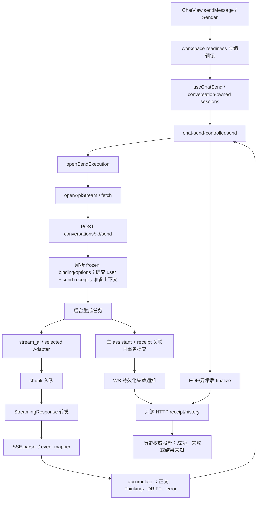
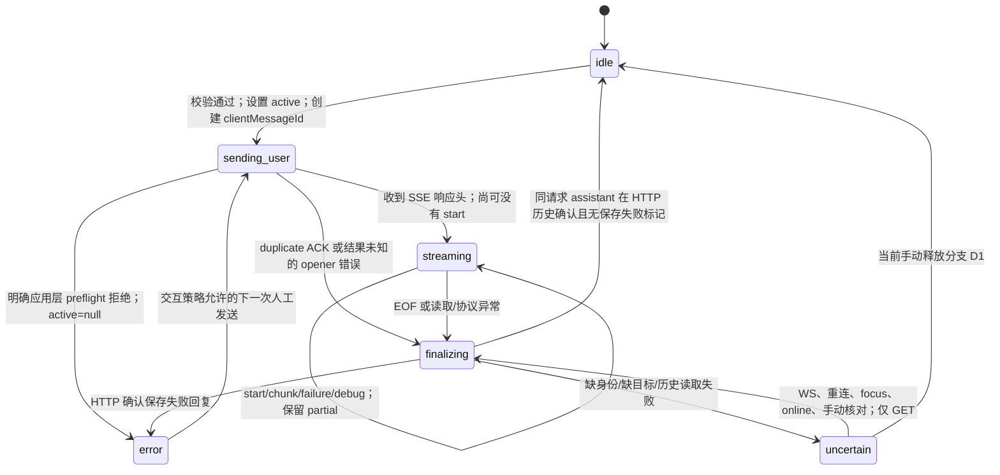
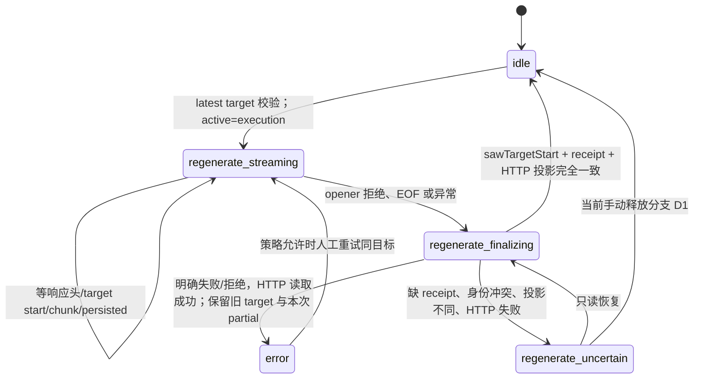
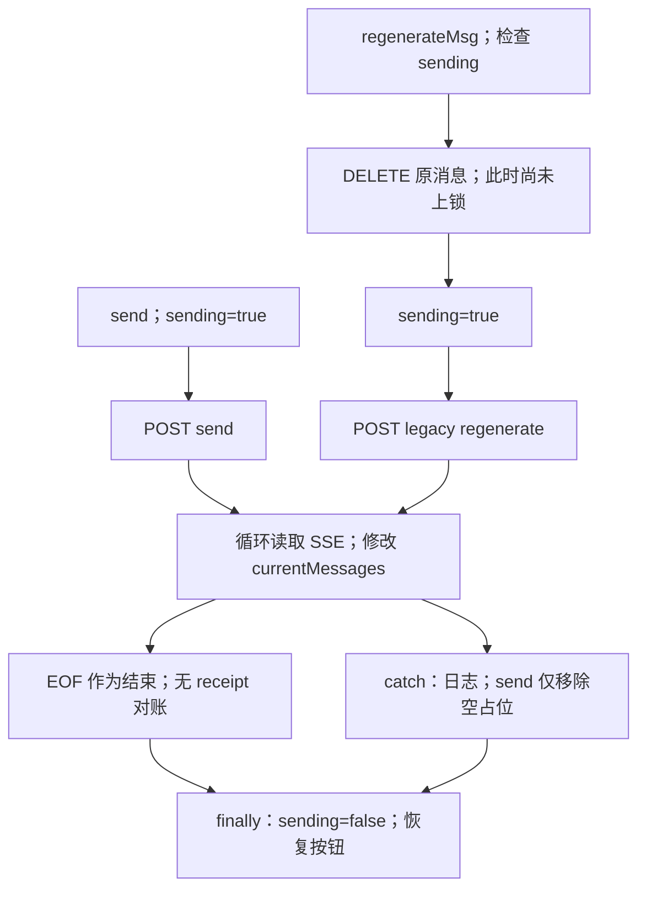

# Penumbra / AionHome Chat 流式输出与状态管理审计

审计日期：2026-11-17（Asia/Shanghai）。本轮仅新增本报告，没有修改源码、现有测试或配置，没有 commit、push、deploy。

## 1. 基线、范围与结论

| 仓库 | 审计 HEAD | 开始时工作树 |
| --- | --- | --- |
| Penumbra `/Users/remix/Desktop/Penumbra` | `cf15b1564d38e57de1d758c164755c1b8eaa7bce` | 干净 |
| AionHome `/Users/remix/Desktop/AionsHome-main` | `ee130a95b64af3a8aaff0604459075fc05e5cdd9` | 干净 |

主范围是普通 Main Chat：Penumbra 普通发送、消息操作中的重新生成、AionHome 请求入口、Runtime/Provider Adapter、SSE、主回复持久化及历史对账。另追踪仍在使用的 AionHome 旧版 `static/chat.html` 和无目标 ID 的 legacy regenerate，以免把两种重生成契约混为一谈。Diary Chat 是独立入口和状态机，不属于这里的普通 Main Chat 链路；本文不声称审计了 Diary、Core Wake、所有工具续写状态机或生产网关配置。工具续写仅检查它与主回复身份、落盘、通知的交界。

本次关联既有稳定性修复和 canonical regenerate 契约边界，不实施重构阶段/功能 PR。遵守后端 AGENTS.md 要求，已检查运行时模型和重构计划；消息身份与持久化、prompt 顺序、command 副作用、WS 类型/payload/timing、Provider/协议选择均无运行时变化。

**结论：已有的结果未知、receipt + HTTP 历史、会话隔离及原子重生成保护有实际价值，不能整体删掉。当前仍存在正文丢失和错误改判成功的路径。** 八项 D 类问题如下；P1 表示可能丢正文或错误提交，P2 表示状态/恢复/诊断风险，不代表已在生产复现。

| 编号 | 分类 / 优先级 | 确认的问题 | 证据方式 |
| --- | --- | --- | --- |
| D1 | D / P1 | 手动核对结果仍未知时清空 partial 和 active；旧的成功读取标志还能跨过本次读取失败 | 前端真实 controller 隔离探针 |
| D2 | D / P1 | 部分 Adapter 把缺终止事件/解析损坏的流作为正常结束；canonical regenerate 可提交截断正文 | 当前 Adapter 函数 + MockTransport，调用链静态确认 |
| D3 | D / P2 | send 空回复被后端标为失败却保存为空行，前端按无错误标记改判成功 | 后端实际路由假 Provider + 前端 controller 探针 |
| D4 | D / P2 | send 后台初始化位于终结 finally 之外，异常时没有 done，SSE 等到客户端 idle timeout | 当前后台函数隔离执行 |
| D5 | D / P2 | 默认无限等待响应头，期间无法进入只读恢复或从 UI 取消等待 | 真实 execution client + controller，虚拟时间探针 |
| D6 | D / P1 | AionHome 旧页 regenerate 先 DELETE 原回复，失败无法恢复；锁在 DELETE 之后才设置 | 源码和既有兼容测试 |
| D7 | D / P2 | 旧页 SSE 使用可变的当前会话，切会话后迟到事件可能污染新会话视图 | 调用链静态确认 |
| D8 | D / P2 | Provider 的 SSE error 仅从 payload 提取 request ID，遗漏只在成功响应头里的 ID | Adapter/错误投影调用链静态确认 |

本文的“已确认”表示代码路径或合成输入已成立；没有请求真实 Provider、发送生产 Chat 消息或读取/操作生产数据库。C 类问题和能力限制另列，不把未知结果武断认定为失败。

## 2. 当前架构和实际调用链

### 2.1 Penumbra 普通发送

入口与边界：

1. [ChatView.tsx:107](/Users/remix/Desktop/Penumbra/src/components/chat/ChatView.tsx:107) → `send.send`，先处理历史窗口、owner、编辑/设置保存和 readiness。
2. [useChatSend.ts:23](/Users/remix/Desktop/Penumbra/src/components/chat-workspace/useChatSend.ts:23) → [chat-execution-sessions.ts:9](/Users/remix/Desktop/Penumbra/src/application/chat-send/chat-execution-sessions.ts:9) → 每个 conversation 一个 controller。页面切换/卸载不 dispose 正在执行的请求；模块生命周期内保留，浏览器刷新则不保留内存执行状态。
3. [chat-send-controller.ts:446](/Users/remix/Desktop/Penumbra/src/application/chat-send/chat-send-controller.ts:446) → 映射 input → [chat-execution-client.ts:27](/Users/remix/Desktop/Penumbra/src/application/chat-execution/chat-execution-client.ts:27) → [api.ts:116](/Users/remix/Desktop/Penumbra/src/lib/api.ts:116)。同一会话只能有一个 active，其他会话可独立执行。
4. 后端 [routes/chat.py:1319](/Users/remix/Desktop/AionsHome-main/aion-chat/routes/chat.py:1319) 解析 conversation Main 配置和 frozen binding/options，在 [routes/chat.py:755](/Users/remix/Desktop/AionsHome-main/aion-chat/routes/chat.py:755) 提交 user 与 receipt，再准备上下文。`start` 并不等于请求刚被接受：user 此时已经落盘。
5. [routes/chat.py:1953](/Users/remix/Desktop/AionsHome-main/aion-chat/routes/chat.py:1953) 后台任务 → [ai_providers.py:2416](/Users/remix/Desktop/AionsHome-main/aion-chat/ai_providers.py:2416) `stream_ai` → 根据 frozen transport 分派 Adapter。每个 chunk 同时累积与入队；[routes/chat.py:2739](/Users/remix/Desktop/AionsHome-main/aion-chat/routes/chat.py:2739) 创建任务并以 SSE 转发。HTTP/SSE 的客户端断开不取消后台任务。
6. [sse-stream.ts:9](/Users/remix/Desktop/Penumbra/src/lib/sse/sse-stream.ts:9) → [chat-execution-events.ts:18](/Users/remix/Desktop/Penumbra/src/application/chat-execution/chat-execution-events.ts:18) → [chat-send-accumulator.ts:84](/Users/remix/Desktop/Penumbra/src/application/chat-send/chat-send-accumulator.ts:84) → controller `consume`。累积器只做展示过滤，不执行业务 command。
7. [routes/chat.py:2519](/Users/remix/Desktop/AionsHome-main/aion-chat/routes/chat.py:2519) 提交 assistant、主回复 receipt、设备快照等 → `msg_created` → 后处理/command dispatch → debug → 内部 done。前端在 EOF 或异常后 [chat-send-controller.ts:219](/Users/remix/Desktop/Penumbra/src/application/chat-send/chat-send-controller.ts:219) 只读对账，不能以 EOF 认定提交成功。

主回复和工具续写不是同一个成功边界：[reply_commands.py:88](/Users/remix/Desktop/AionsHome-main/aion-chat/reply_commands.py:88) 可派生 follow-up，进入 [routes/chat.py:4296](/Users/remix/Desktop/AionsHome-main/aion-chat/routes/chat.py:4296) 的结果批次执行。send receipt 只关联主 assistant，不会被后续工具回复改指向；前端主请求变 idle 不证明全部异步副作用完成。

### 2.2 Penumbra 重生成与指定消息重生成

当前 Penumbra 的重新生成操作本身就是**指定持久消息 ID 的 canonical regenerate**，没有另一个无目标 ID 的 Penumbra 重生成 controller。

[ChatView.tsx:130](/Users/remix/Desktop/Penumbra/src/components/chat/ChatView.tsx:130) → [chat-regenerate-policy.ts:13](/Users/remix/Desktop/Penumbra/src/components/chat-workspace/chat-regenerate-policy.ts:13) 选当前最新普通 assistant，并要求传入 ID 等于该目标 → controller `regenerate` → [chat-execution-client.ts:67](/Users/remix/Desktop/Penumbra/src/application/chat-execution/chat-execution-client.ts:67) → `POST /api/conversations/{conversation_id}/messages/{message_id}/regenerate` → [routes/chat.py:3788](/Users/remix/Desktop/AionsHome-main/aion-chat/routes/chat.py:3788)。指定 ID 不代表允许任意历史消息重生成；前后端都限制 latest、非 carryover、assistant。

后端 `load_target` → `reserve_target` → 第二次快照校验 → `_background_regenerate` → `_build_canonical_regenerate_context` → `stream_ai` → 输出校验/解析 → `commit_replacement` → WS `msg_updated` → named `event: persisted` → 副作用/debug → 释放占用、内部 done。

[regenerate_contract.py:163](/Users/remix/Desktop/AionsHome-main/aion-chat/regenerate_contract.py:163) 在 `BEGIN IMMEDIATE` 中重新验证 conversation/target/latest/全会话快照/设备快照，原 ID、rowid、created_at 保留，正文/Thinking/DRIFT 等原子替换，voice/HEART 清理同事务。Provider 失败或事务冲突都不先删除原正文。

### 2.3 AionHome 旧版重生成不是 canonical

[static/chat.html:4423](/Users/remix/Desktop/AionsHome-main/aion-chat/static/chat.html:4423) `regenerateMsg(aiMsgId)` → **先 `DELETE /api/messages/{aiMsgId}`** → `POST /api/conversations/{conv_id}/regenerate` → [routes/chat.py:5099](/Users/remix/Desktop/AionsHome-main/aion-chat/routes/chat.py:5099) 重建上下文、后台调用 Provider、INSERT 一个新 assistant → WS `msg_created` → SSE EOF。无 canonical target guard、原 ID 原子替换和 persisted receipt。

这不是死代码：[test_canonical_regenerate_route.py:1274](/Users/remix/Desktop/AionsHome-main/aion-chat/tests/contract/test_canonical_regenerate_route.py:1274) 明确断言旧页继续使用 DELETE + legacy endpoint。不能将 Penumbra 的保护外推到旧页，也不能未经迁移就删除 legacy 路由。

## 3. 生命周期图

### 3.1 普通发送

图中的 `sending_user` 对应源码 `sending-user`，`uncertain` 对应 `finalization-uncertain`。Success 是带 `confirmedSend` 的 idle，不是独立状态。opener 返回 true 只表示流/duplicate 被接收，不表示 Provider 或持久化成功。

### 3.2 Penumbra 指定消息重生成（也用于普通重生成按钮）

`regenerate-streaming` 在 HTTP 请求前就发布；它同时覆盖请求准备、发送、Streaming，不能仅看状态名判断 Provider 已启动。`persisted` 不直接结束消费，仍等待 EOF，再用 HTTP 对账。

### 3.3 旧版普通发送与 legacy regenerate

旧页没有 Finalizing/结果未知锁和明确 Cancelled 状态。入口及清理分别见 [static/chat.html:4056](/Users/remix/Desktop/AionsHome-main/aion-chat/static/chat.html:4056)、[static/chat.html:4352](/Users/remix/Desktop/AionsHome-main/aion-chat/static/chat.html:4352)、[static/chat.html:4595](/Users/remix/Desktop/AionsHome-main/aion-chat/static/chat.html:4595)。

## 4. 状态设置、清理及并发检查

| 阶段/分支 | 设置与清理位置 | 审计判断 |
| --- | --- | --- |
| 空内容、无 conversation/target、controller disposed 或已有 active | [controller:446](/Users/remix/Desktop/Penumbra/src/application/chat-send/chat-send-controller.ts:446)、[controller:541](/Users/remix/Desktop/Penumbra/src/application/chat-send/chat-send-controller.ts:541) 在创建 active 前返回 false | 不产生 generating 残留 |
| UUID 失败 | [controller:460](/Users/remix/Desktop/Penumbra/src/application/chat-send/chat-send-controller.ts:460)、[controller:557](/Users/remix/Desktop/Penumbra/src/application/chat-send/chat-send-controller.ts:557) 发布 error，未占用 active | 有清理边界 |
| 请求发送 | [controller:494](/Users/remix/Desktop/Penumbra/src/application/chat-send/chat-send-controller.ts:494)、[controller:586](/Users/remix/Desktop/Penumbra/src/application/chat-send/chat-send-controller.ts:586) 先同步设置 active 再 await | 同会话重复触发被 controller 锁阻止；UI 禁用只是另一道交互边界 |
| send 明确拒绝 | [controller:515](/Users/remix/Desktop/Penumbra/src/application/chat-send/chat-send-controller.ts:515) active=null，保存 rejectedSubmission | 用户提交保留；不把未知 5xx 当拒绝 |
| send 未知 opener 错误/duplicate ACK | [controller:524](/Users/remix/Desktop/Penumbra/src/application/chat-send/chat-send-controller.ts:524)、[controller:529](/Users/remix/Desktop/Penumbra/src/application/chat-send/chat-send-controller.ts:529) finalize | 只 GET，不重新 POST |
| regenerate opener 异常 | [controller:599](/Users/remix/Desktop/Penumbra/src/application/chat-send/chat-send-controller.ts:599) 分类后 finalize | 即使明确拒绝也先重读 target；读失败仍未知，避免伪造当前历史 |
| Streaming 异常/EOF | [controller:342](/Users/remix/Desktop/Penumbra/src/application/chat-send/chat-send-controller.ts:342) catch 保留 error/accumulator，flush 后 finalize | 不在 catch 直接清正文；Provider failure 事件会继续消费到收尾 |
| Finalizing | [controller:336](/Users/remix/Desktop/Penumbra/src/application/chat-send/chat-send-controller.ts:336) 同一 execution 合并并发 finalization promise，finally 清 promise | 必要保护；不是生成重试 |
| 对账成功或确认失败 | [controller:276](/Users/remix/Desktop/Penumbra/src/application/chat-send/chat-send-controller.ts:276) → active=null → idle/error | 不能只凭 SSE transport error 判失败；D3 是保存状态表达不完整的例外 |
| 对账失败 | [controller:310](/Users/remix/Desktop/Penumbra/src/application/chat-send/chat-send-controller.ts:310) 保留 active、partial、错误和 execution ID，发布 uncertain | 这是有意的未知锁，不等于漏 finally；D1 是错误释放边界 |
| 手动核对/人工解除 | [controller:614](/Users/remix/Desktop/Penumbra/src/application/chat-send/chat-send-controller.ts:614)、[controller:654](/Users/remix/Desktop/Penumbra/src/application/chat-send/chat-send-controller.ts:654) | 当前直接置 idle 存在 D1；`releaseAfterReview` 虽有 API/prop，当前 notice 没渲染对应按钮，手动核对路径已可达 |
| controller dispose | [controller:669](/Users/remix/Desktop/Penumbra/src/application/chat-send/chat-send-controller.ts:669) 先 disposed、清 listeners，再 abort 读取、active=null | 迟到结果不能 publish；生产 hook 导航不调用 dispose，无用户 Stop API |
| 旧事件/历史返回 | [controller:438](/Users/remix/Desktop/Penumbra/src/application/chat-send/chat-send-controller.ts:438) 对象身份；[workspace-controller:387](/Users/remix/Desktop/Penumbra/src/components/chat-workspace/chat-workspace-controller.ts:387) sequence、abort、owner、disposed | 当前 Penumbra 没发现上一轮 SSE 直接覆盖新 execution 的可达路径；旧页另见 D7 |

Penumbra 没有独立 `generating` boolean；[controller:699](/Users/remix/Desktop/Penumbra/src/application/chat-send/chat-send-controller.ts:699) 从状态派生 active。[chat-sender-policy.ts:20](/Users/remix/Desktop/Penumbra/src/components/chat-workspace/chat-sender-policy.ts:20) 和 regenerate policy 再结合 workspace readiness 控制交互。Error 不一定意味着“发送可用”：未确认失败的 error 也会被 UI 锁住。

取消边界需要准确表述：`dispose/AbortSignal` 取消的是前端读取；`ApiError.ABORTED` 映射“后台可能仍在执行”，不是 Provider failure。后端 canonical `CancelledError` 单独处理并释放 target（[routes/chat.py:3850](/Users/remix/Desktop/AionsHome-main/aion-chat/routes/chat.py:3850)、[routes/chat.py:4247](/Users/remix/Desktop/AionsHome-main/aion-chat/routes/chat.py:4247)）。没有端到端的用户停止生成/服务端停止确认协议，因此不能展示为已成功停止。

## 5. HTTP / SSE / Provider 错误矩阵

这里的应用 HTTP 是浏览器到 AionHome，Provider HTTP 是 AionHome 到上游。后者的 524 可以出现在前者的 **200 SSE** 中；两者不能互推。

| 触发 | 应用 HTTP / SSE | Provider 真实边界 | 后端已提交什么 | Penumbra 行为及限制 |
| --- | --- | --- | --- | --- |
| 登录、conversation/model/options preflight 明确拒绝 | 401/404/409/422/503，匹配已知应用结构/code | 一般未进入主 Provider | send 主 user 在这些早期检查前尚未写入；regenerate 不替换 target | `isDefiniteChatRejection` 精确识别，不能泛化到同 HTTP 状态的代理页面 |
| canonical 第二次读内部错误 | 500 + 精确 `regenerate_preflight_failed` | 尚未创建生成任务，且 reserve 已释放才返回此 code | 原 target 保留 | 明确拒绝；裸 500 仍未知 |
| Provider 非 200，如 403/429/524 | 通常应用 200 SSE，chunk 携带安全错误标记；canonical 另有 `type:error`/debug | Adapter 已拿到真实上游 HTTP、错误正文/ID | send 保存 partial + 失败标记并关联 receipt；canonical 保留旧 target | 累积 error 详情、HTTP 回填确认保存失败；不猜测同一个 403 的业务原因 |
| Provider HTTP 200 内的普通/named SSE error | 应用 200 SSE；转换为 `provider_execution_failed` 与安全详情 | 上游流内失败；payload code 不等于真实 HTTP code | send 保存失败回复；canonical 不替换 | 不应合成“上游 HTTP 429/524”等不存在的响应状态 |
| Provider ReadTimeout、连接/协议异常 | 应用可能仍 200 SSE；路由生成失败标记 | 主调用失败，但此前可能已吐出 partial | send 尽可能保存 partial + 标记；canonical 保留原正文 | 错误标记与 partial 分开显示；HTTPStatusError 可补上真实 response 详情，普通内部异常不直接回显 |
| Provider 无协议终止却正常 EOF/坏帧被吞 | 应用 200 SSE/正常 EOF | 实际完整性没有确认 | 部分 Adapter 仍让 send 保存或 canonical 替换 | D2；不能把 HTTP 200/EOF 当 Provider 成功 |
| 应用入口/网关 524、408、502、裸 5xx、网络断开 | opener 失败，可能没有 start | 主 Provider 可能没启动、正在执行、已完成 | user/assistant 都可能已提交 | receipt 查身份 → HTTP history；没有证据保持 uncertain，不自动重发 |
| 前端 headers 后 120s 没有任何字节 | ApiError `TIMEOUT`，状态 0 | 后端 Provider 的 300/600s read timeout 尚可能未到 | 后台继续；可能稍后提交 | finalize → history；这是读取超时，不是停止确认 |
| 前端主动 abort/dispose | `ABORTED`/读取取消 | 不代表上游被取消 | 后台仍可能提交 | disposed 忽略后续事件；不存在用户 Stop 成功状态 |
| send 后处理/DB 内部异常 | 外层只打印异常后 done，或初始化异常缺 done | Provider 可能已成功 | 视异常时点：user-only 或 assistant 已提交 | HTTP 对账比传输更权威；缺 assistant 保持未知；D4 会延迟到超时 |
| canonical 提交冲突 | 应用 200 SSE `regenerate_conflict` | Provider 可能已完整生成 | 事务回滚，无替换 receipt | 原 target + 本次未保存 partial；不自动重试 |
| canonical DB/输出准备内部错误 | 应用 200 SSE `provider_execution_failed` | **不能据 code 认定 Provider 失败** | 不发 persisted；事务普通异常保留 cause，回滚 | UI 安全失败信息；后端阶段日志才区分 commit/internal 与 Provider，见 C2 |
| 主回复已提交但后续 WS/SSE/副作用失败 | SSE 错误、缺 debug 或断开均可能 | 主生成可能成功 | assistant 已在 DB | send receipt/history 可覆盖旧连接错误；canonical 只有已收到有效 receipt + HTTP 才能确认 |
| canonical commit 成功但 persisted 帧丢失 | 连接断开或超时 | 主生成/替换可能成功 | 新 target 已提交，WS 可能已发 | 即使 HTTP 内容变化也继续未知；缺少本次执行身份，不能用同 ID 的旧行假冒本轮成功 |
| duplicate send | 应用 200 JSON `{ok,msg_id,duplicate}` | 本次没有再创建主 Provider 任务 | 原 user receipt 存在，assistant 可仍为空 | ACK 只证明 user 接受，仍需 receipt + history；不是完成 ACK |

矩阵实现依据：[chat-send-rejection.ts:6](/Users/remix/Desktop/Penumbra/src/application/chat-send/chat-send-rejection.ts:6)、[chat-send-errors.ts:22](/Users/remix/Desktop/Penumbra/src/application/chat-send/chat-send-errors.ts:22)、[ai_providers.py:458](/Users/remix/Desktop/AionsHome-main/aion-chat/ai_providers.py:458)、[routes/chat.py:2241](/Users/remix/Desktop/AionsHome-main/aion-chat/routes/chat.py:2241)、[routes/chat.py:4074](/Users/remix/Desktop/AionsHome-main/aion-chat/routes/chat.py:4074)、[routes/chat.py:4157](/Users/remix/Desktop/AionsHome-main/aion-chat/routes/chat.py:4157)。

## 6. 持久化、回填和稳定性保护

### 6.1 send 身份和提交证据

- `clientMessageId` 是每次发送创建的 UUID，后端 `(conv_id, client_msg_id)` 为 receipt 主键。[routes/chat.py:755](/Users/remix/Desktop/AionsHome-main/aion-chat/routes/chat.py:755) 用写事务同步提交 user 和 receipt，并跨进程去重；重复同 ID 不再启动主生成。
- [chat_send_receipts.py:22](/Users/remix/Desktop/AionsHome-main/aion-chat/chat_send_receipts.py:22) 仅返回关联的 user/主 assistant 身份，JOIN 限制 role/conversation，404 和 assistant=null 均表示未知。主 assistant 与 receipt link 同事务提交，查询 `Cache-Control: no-store`。工具续写不会抢占此关联。
- 前端 [chat-send-result.ts:12](/Users/remix/Desktop/Penumbra/src/application/chat-send/chat-send-result.ts:12) 验证 identity；[controller:164](/Users/remix/Desktop/Penumbra/src/application/chat-send/chat-send-controller.ts:164) 合并 receipt 并发读取，再核对 duplicate/已知 user ID。只 user、无关 assistant、system/tool 都不能证明生成完成。
- [controller:199](/Users/remix/Desktop/Penumbra/src/application/chat-send/chat-send-controller.ts:199) 优先用本轮 streamed assistant，缺身份时用 receipt；生产 reconciler 返回 assistant 投影。保存行决定成功/失败，连接错误可以被真实提交结果消除。
- [ChatView.tsx:322](/Users/remix/Desktop/Penumbra/src/components/chat/ChatView.tsx:322) 仅按 confirmed/accepted send 的 conversation + client ID 清理对应 SubmissionRecovery，保留下一轮草稿/附件。人工解除未知不应生成成功标记，目前也没有生成该标记；但 D1 仍丢 assistant partial，用户提交恢复副本不能替代 assistant 正文副本。

### 6.2 regenerate 的不同证明要求

[controller:739](/Users/remix/Desktop/Penumbra/src/application/chat-send/chat-send-controller.ts:739) 和 [chat-regenerate-persistence.ts:33](/Users/remix/Desktop/Penumbra/src/application/chat-send/chat-regenerate-persistence.ts:33) 要求 `sawTargetStart`、receipt 目标身份正确且 HTTP 的 id/content/Thinking/DRIFT 与 receipt 完全相同。空字符串/null 可规范化，不能 trim 或仅凭文字变化推断成功，因为正确生成也可能与旧正文完全相同。

receipt 比 SSE partial 更接近后处理后的提交结果；不能用 accumulator 代替 receipt。receipt 不包含 attachments/工具全部副作用结果，故它确认的是主消息投影。失败保留旧 target，本次 partial 单独显示为 unconfirmed；[chat-execution-composer.ts:22](/Users/remix/Desktop/Penumbra/src/components/chat-workspace/presentation/chat-execution-composer.ts:22)、[chat-execution-composer.ts:35](/Users/remix/Desktop/Penumbra/src/components/chat-workspace/presentation/chat-execution-composer.ts:35)。

### 6.3 WS 与 HTTP 历史

[ChatView.tsx:88](/Users/remix/Desktop/Penumbra/src/components/chat/ChatView.tsx:88) 接入 realtime。uncertain 时 WS/重连触发 retryFinalization；focus/online、工作区进入 ready 或切换回来也触发只读恢复：[useChatSend.ts:43](/Users/remix/Desktop/Penumbra/src/components/chat-workspace/useChatSend.ts:43)。没有自动重新 POST 的循环。

[chat-realtime-coordinator.ts:92](/Users/remix/Desktop/Penumbra/src/application/chat-realtime/chat-realtime-coordinator.ts:92) 合并失效通知、序列化当前历史请求，active 非 recovering 时延后历史刷新。[workspace-controller:365](/Users/remix/Desktop/Penumbra/src/components/chat-workspace/chat-workspace-controller.ts:365) 防 stale、切会话、分页窗口覆盖。选中 workspace 无法拥有读取时，[useChatSend.ts:25](/Users/remix/Desktop/Penumbra/src/components/chat-workspace/useChatSend.ts:25) 回退到 [chat-background-reconciliation.ts:5](/Users/remix/Desktop/Penumbra/src/application/chat-send/chat-background-reconciliation.ts:5) 的独立 HTTP window，避免写入别的会话视图。这个 fallback 是 GET 的替代 owner，不是 Provider fallback。

历史窗口只证明窗口内事实，找不到目标不证明数据库没有目标。background send 读取默认窗口；selected reload 也可能只含尾部窗口：[message-history-service.ts:90](/Users/remix/Desktop/Penumbra/src/application/message-history/message-history-service.ts:90)。旧主回复被较多续写推离窗口时可能持续未知；可后续按已知 assistant ID 读取 anchor，但不能移除角色/owner 校验。

### 6.4 已有稳定性修复复核

| 保护 | 本次判断 | 当前证据/限制 |
| --- | --- | --- |
| 保留 partial，区分 Thinking/DRIFT/私有 command 与公开正文 | 继续有效，但人工释放有 D1 | [accumulator:105](/Users/remix/Desktop/Penumbra/src/application/chat-send/chat-send-accumulator.ts:105)、`:258`；已有 thinking/current-wire/partial 测试通过 |
| 安全保留真实 Provider 信息，避免按 403 猜测原因 | 非 2xx/body 及 payload 路径仍有效；header-only SSE ID 有 D8 | [ai_providers.py:406](/Users/remix/Desktop/AionsHome-main/aion-chat/ai_providers.py:406)、[assistant-failure.ts:31](/Users/remix/Desktop/Penumbra/src/domain/message/assistant-failure.ts:31)；upstream/stability 测试通过 |
| 524/断流后不自动重发，使用 receipt + history | 继续有效 | [controller:219](/Users/remix/Desktop/Penumbra/src/application/chat-send/chat-send-controller.ts:219)；result-reconciliation/send-receipts 测试通过 |
| regenerate 内部 preflight 500 与真实冲突分开 | 继续有效 | [routes/chat.py:3841](/Users/remix/Desktop/AionsHome-main/aion-chat/routes/chat.py:3841)、[regenerate_contract.py:263](/Users/remix/Desktop/AionsHome-main/aion-chat/regenerate_contract.py:263)；canonical/atomic 测试通过 |
| 不静默更换 Provider/协议 | 当前主链有效 | frozen binding 传入 `stream_ai`；[ai_providers.py:2808](/Users/remix/Desktop/AionsHome-main/aion-chat/ai_providers.py:2808)、`:2978` 显式重抛，不执行另一协议 |
| active SSE 不被旧总计时器误杀 | 继续有效 | headers 默认不设 deadline，body 每字节刷新 120s；timeout 测试通过。但无限 headers 等待有 D5 |
| Anthropic 缺协议终止/损坏输出不提交成功 | 继续有效 | [ai_providers.py:2268](/Users/remix/Desktop/AionsHome-main/aion-chat/ai_providers.py:2268) 抛 RemoteProtocolError/unsafe；不能外推至其他 Adapter，见 D2 |

## 7. 过度防御检查清单

A＝必要保护；B＝可简化但当前无明显错误；C＝可疑防御/兼容假设，需要先收敛契约；D＝实际错误或状态不一致风险。以下每项按真实保护边界判断，不以重复次数决定删除。

| 检查项 | 分类 | 实际调用关系、位置与理由 |
| --- | --- | --- |
| UI readiness + controller active + 后端 target guard/事务重验 | A | ChatView → controller → route → commit；分别防交互非法、同页重复、其他客户端/worker 的竞态。进程内 guard 不能替代 DB 快照事务；[ChatView:130](/Users/remix/Desktop/Penumbra/src/components/chat/ChatView.tsx:130)、[regenerate_contract:60](/Users/remix/Desktop/AionsHome-main/aion-chat/regenerate_contract.py:60)、`:163` |
| 每个 await/事件后的 isCurrent 与 workspace sequence/owner | A | 防已经释放/disposed 的 execution 和陈旧 history 发布；两个对象生命周期不同，不能合并为单个 boolean；[controller:438](/Users/remix/Desktop/Penumbra/src/application/chat-send/chat-send-controller.ts:438)、[workspace:394](/Users/remix/Desktop/Penumbra/src/components/chat-workspace/chat-workspace-controller.ts:394) |
| accumulator pending、Thinking/command 嵌套与 EOF flush | A | 网络可拆分任何标记，防内部命令/错误前缀泄露并保留正文；[accumulator:151](/Users/remix/Desktop/Penumbra/src/application/chat-send/chat-send-accumulator.ts:151)、`:258`。不是可以直接换成几个 replace 的冗余状态 |
| Provider → 安全错误文本 → wire mapper → UI 安全展示 | A，格式层可 B | 后端拥有 secret 脱敏，前端还要面对历史文本/代理 HTTP，分别保护不同边界；[ai_providers:458](/Users/remix/Desktop/AionsHome-main/aion-chat/ai_providers.py:458) → [assistant-failure:44](/Users/remix/Desktop/Penumbra/src/domain/message/assistant-failure.ts:44)。不能删除 request ID 或将上游改成固定泛化提示 |
| API timeout + stream idle + Provider read timeout | A，缺口 D5 | 同一 API timer 在 headers 后 reset 为 idle，不是叠加两个总时限；Provider timeout 属于另一连接。120s 客户端与 300/600s 上游不等长是可发生的正常边界；[api:321](/Users/remix/Desktop/Penumbra/src/lib/api.ts:321)、[ai_providers:948](/Users/remix/Desktop/AionsHome-main/aion-chat/ai_providers.py:948)、`:1234`、`:1735` |
| API managed body 和通用 SSE parser 的 cancel/finally | A | 前者管理 fetch/timer，后者管理自己的 reader/framing；主 client 没向 parser 再传 signal，取消主要由 managed body 传播；[api:291](/Users/remix/Desktop/Penumbra/src/lib/api.ts:291) → [sse-stream:9](/Users/remix/Desktop/Penumbra/src/lib/sse/sse-stream.ts:9) |
| opener catch、consume catch、finalization catch | A | 分别处理请求拒绝/未知、流中断、权威读取失败；不能统一成 catch 后置 idle；[controller:515](/Users/remix/Desktop/Penumbra/src/application/chat-send/chat-send-controller.ts:515)、`:414`、`:310` |
| 重复 finalization、receipt 请求 | A | `execution.finalization`/`receiptLookup` 合并同一执行的并发 GET；多次 focus/WS 不应重新 POST；[controller:164](/Users/remix/Desktop/Penumbra/src/application/chat-send/chat-send-controller.ts:164)、`:336`。GET 在后续事件再次触发有新事实价值 |
| selected reconcile 失败后 background reconcile | A，可局部 B | 保护导航/dispose/owner 变化；当前任何失败都会再 GET，临时网络错误也会多读一次。可仅对 owner-stale 回退，但先保持导航恢复测试；[useChatSend:25](/Users/remix/Desktop/Penumbra/src/components/chat-workspace/useChatSend.ts:25) |
| regenerate load-target 两次 + commit 再验 | A | 请求校验、reserve 竞态、生成期间外部写入分别发生于不同时间；不是三次重复检查；[routes/chat:3815](/Users/remix/Desktop/AionsHome-main/aion-chat/routes/chat.py:3815)、`:3841` → [regenerate_contract:174](/Users/remix/Desktop/AionsHome-main/aion-chat/regenerate_contract.py:174) |
| 相同 rollback + raise 的两个 except | B | [regenerate_contract:263](/Users/remix/Desktop/AionsHome-main/aion-chat/regenerate_contract.py:263) 两个分支效果相同，可合并 `except Exception`，保留原异常类型/cause 和 rollback，不能再统一包装 conflict |
| Anthropic `except Exception: raise` | B | [ai_providers:2808](/Users/remix/Desktop/AionsHome-main/aion-chat/ai_providers.py:2808)、`:2978` 无转换/清理，可移除 try/except 外壳，保留“不执行另一协议”的控制流与回归 |
| workspace currentHistory 再判 null | B | [workspace:365](/Users/remix/Desktop/Penumbra/src/components/chat-workspace/chat-workspace-controller.ts:365) 首次 guard 已确认 history 非空，取本地引用前无 await；`:382` 重复判断可删。后续 await 后的 stale guard 必须保留 |
| composer send 已落盘 ID 再查一次 | B | [composer:33](/Users/remix/Desktop/Penumbra/src/components/chat-workspace/presentation/chat-execution-composer.ts:33) 已覆盖 send streaming/finalizing/uncertain；`:48` 在同 owner、send recovered 分支重复相同判断，可简化一次 |
| copyOwn/copyRegenerateOwn | B | [chat-send-request:44](/Users/remix/Desktop/Penumbra/src/application/chat-send/chat-send-request.ts:44) 与 `:59` 同一“只复制显式值”规则，可抽窄 helper；保留 null/undefined/0/false 差异 |
| 观测/debug/shadow 的多个 best-effort catch | A，组织形式可 B | 真实边界是诊断失败不得阻止生成和提交；[chat-execution-client:155](/Users/remix/Desktop/Penumbra/src/application/chat-execution/chat-execution-client.ts:155)、[routes/chat:2690](/Users/remix/Desktop/AionsHome-main/aion-chat/routes/chat.py:2690)。可统一无抛出的观察 helper，不能把业务异常也吞掉 |
| 第二个不同 start 当“后端 retry” | C1 | [controller:350](/Users/remix/Desktop/Penumbra/src/application/chat-send/chat-send-controller.ts:350) 清空原 accumulator/error；当前 send route 每次仅一个 start、没有该重试循环。合成 [chat-stream-retry.test.ts:16](/Users/remix/Desktop/Penumbra/src/application/chat-send/chat-stream-retry.test.ts:16) 固化了兼容假设，不证明当前服务端真有此行为。建议先确认历史客户端/服务端契约，未知冲突保留原 partial 并转 contract/对账；不增加 retry |
| `provider_execution_failed` 覆盖提交/准备内部错误 | C2 | [routes/chat:4164](/Users/remix/Desktop/AionsHome-main/aion-chat/routes/chat.py:4164) 捕获 DB 等内部错误仍发同 code；保护了内部异常隐私，却模糊 Provider 与 persistence 边界。保留安全展示，阶段日志用于真实归因；后续如增稳定 stage，需单独契约 PR |
| 缺 regenerate receipt 就保留未知 | A；恢复能力缺口 C3 | [controller:249](/Users/remix/Desktop/Penumbra/src/application/chat-send/chat-send-controller.ts:249)、`:739` 防旧 target 假冒新提交。receipt 仅在本次 SSE，断流后 HTTP 不能按 execution ID 补取；不能为了消锁放宽为“target ID 存在即可” |
| 本地请求校验失败和部分已知 preflight 也进入未知 | C4 | [chat-execution-request:15](/Users/remix/Desktop/Penumbra/src/application/chat-execution/chat-execution-request.ts:15) 在 fetch 前可抛 ContractError，controller opener catch 与流协议错误未区分；[routes/chat:710](/Users/remix/Desktop/AionsHome-main/aion-chat/routes/chat.py:710) 的 carryover 解析也可在 user 持久化前返回 `422 invalid_carryover`，而 [chat-send-rejection:26](/Users/remix/Desktop/Penumbra/src/application/chat-send/chat-send-rejection.ts:26) 未收录该 code。现有 UI 通常产生合法输入，但本地非法参数或 carryover 来源消息并发变化会进入不必要的未知锁。建议先加独立的“尚未 dispatch”错误类别，补充有服务端阶段保证的精确 code；不能将所有 ContractError/422 当明确拒绝 |
| 手动核对后 idle | D1 | 是解除过度锁定的兜底，但跨越了“成功读取历史≠这次生成已结束”的边界，且丢 partial；详见下一节 |
| 普通 Adapter 宽 catch 后继续 | D2 | 本想容忍单帧损坏，却使 Main 的完整性丢失；`stream_event` 仅对 append attempt 生效；[ai_providers:1148](/Users/remix/Desktop/AionsHome-main/aion-chat/ai_providers.py:1148) → [append_reply_runtime:393](/Users/remix/Desktop/AionsHome-main/aion-chat/append_reply_runtime.py:393) |
| `_recent_client_ids` 历史兼容变量 | B | [routes/chat:187](/Users/remix/Desktop/AionsHome-main/aion-chat/routes/chat.py:187) 注释仍说 500ms 去重；当前业务仅声明不读写，实际去重已迁到 DB receipt，测试仍清变量。可同步清理变量/注释/测试依赖，不能删除 DB 去重 |
| legacy route/UI 兼容分支 | D6/D7；不能直接删 | 有实际旧页消费者且兼容测试锁定。应迁移消费者再考虑收缩；不能假定无人使用 |

未发现 Main send/canonical regenerate 在本次失败后自动换 Provider、协议或自动重新 POST 的重试。诊断/工具续写自己的 owner budget 不等于主请求重试，不能借“去重”顺手合并这些业务边界。

## 8. 确认问题及最小修复建议（本轮均未实施）

### D1：手动“重新核对”清空未保存正文，旧读取成功标志还能解除本次失败

**调用链/位置：** [ChatView.tsx:192](/Users/remix/Desktop/Penumbra/src/components/chat/ChatView.tsx:192) `recoverExecution` → `retryFinalization({manual:true})` → [controller:637](/Users/remix/Desktop/Penumbra/src/application/chat-send/chat-send-controller.ts:637) → 只要 `active.recoveryReadSucceeded` 为 true 且仍 uncertain，就 `active=null; publish(idle)`。该标志在 [controller:242](/Users/remix/Desktop/Penumbra/src/application/chat-send/chat-send-controller.ts:242) 成功读历史时置 true，此后不按轮次复位。`releaseAfterReview` 的同类分支在 `:654`。

**复现/影响：** send 或 regenerate 已有 partial，断流，HTTP 只返回旧 target/user 或空窗口；自动核对保留 partial，点击手动核对则 idle，composer 再无临时正文来源。进一步让首次 HTTP 成功、手动这次 HTTP 抛错，仍会因旧 true 释放。后端可能还在运行，下一次人工发送会与上一轮后台执行重叠；这不是自动重试，却也不是后台停止证据。

**最小方案：** “重新核对”仅重读，不隐式解除未知；若确需提供人工解除，使用明确的独立动作，将未保存的 assistant 正文/Thinking/DRIFT/error 移到按 execution ID 保存的恢复记录，锁与恢复展示分离。每次读取的成功状态必须绑定本轮读取/当前 execution，失败不能复用旧 true。人工解除不生成 confirmedSend，不自动 POST。不能简单把 recoveryReadSucceeded 重置一下就宣称修完正文丢失。

**验证要求：** send/regenerate partial 在手动核对后仍可恢复；首次成功/本次失败不能释放；晚到的保存只按原 execution 对账，不清下一条草稿。临时探针两类 partial + 跨读失败均已复现。

### D2：缺少终止或损坏的 Provider 流可能被当成可提交结果

**调用链/位置：** `stream_ai` → `call_siliconflow/call_aipro/call_custom` 看到 `[DONE]` 会 return，但 EOF 不检查是否曾看到合法完成；Gemini 也未用 finishReason 决定 Main 完整性。见 [ai_providers.py:958](/Users/remix/Desktop/AionsHome-main/aion-chat/ai_providers.py:958)、[ai_providers.py:1025](/Users/remix/Desktop/AionsHome-main/aion-chat/ai_providers.py:1025)、[ai_providers.py:1112](/Users/remix/Desktop/AionsHome-main/aion-chat/ai_providers.py:1112)、[ai_providers.py:1244](/Users/remix/Desktop/AionsHome-main/aion-chat/ai_providers.py:1244)。宽 `except Exception` 只调用 `stream_event(error=malformed_event)`；[append_reply_runtime.py:393](/Users/remix/Desktop/AionsHome-main/aion-chat/append_reply_runtime.py:393) 对非 `_append_attempt` 不记录状态。

**实际传播：** Adapter 返回 partial、未抛错 → send 在 [routes/chat.py:2233](/Users/remix/Desktop/AionsHome-main/aion-chat/routes/chat.py:2233) 检查 Anthropic unsafe、在 `:2271` 识别文本失败标记/空结果，非空 partial 可成功 INSERT；canonical 在 [routes/chat.py:4090](/Users/remix/Desktop/AionsHome-main/aion-chat/routes/chat.py:4090) 仅检查标记/空文/Anthropic unsafe，再于 `:4147` 替换旧目标。前端收到 persisted + HTTP 一致，正确地确认了**错误提交的不完整正文**；前端多加一个 HTTP 检查不能解决根因。

**证据/影响：** 对当前 `call_aipro` 函数使用 MockTransport，返回一个合法 partial 帧后干净 EOF，以及 partial + 非法 JSON 后 EOF，两者均正常返回 partial、不抛错。这里不是 httpx 抛出的连接截断；是上游/代理以正常 EOF 提前结束，因此底层 HTTP 不会替应用判断协议完整性。其他同形 Adapter 为静态确认，未逐一动态复现。存在重生成覆盖成功旧正文的风险。

**最小方案：** 在 Adapter 内按协议记录合法结束、损坏/限制状态；缺终止且无协议认可的完成依据时抛安全的完整性异常。OpenAI 兼容实现是否允许以 finish_reason 正常结束需先固化现有契约，不能机械要求所有 Provider 必须发同一个 `[DONE]`。send 保存 partial + 明确失败标记；canonical 保留旧正文，不发 persisted。保留 Anthropic 现有保护，不 fallback、不 retry。

**验证要求：** 三类 OpenAI Adapter、Gemini 的合法终止/可接受 finish、缺终止、坏帧、输出限制；正常长流不误判。验证 canonical 不替换旧目标，send 保留 partial 和错误。

### D3：空回复失败在 HTTP 对账时变成成功

**调用链/位置：** [routes/chat.py:2268](/Users/remix/Desktop/AionsHome-main/aion-chat/routes/chat.py:2268) 空文本且无 Thinking/DRIFT 令 `has_error=True`；只有 Anthropic 特定 empty-text 诊断才在 [routes/chat.py:2505](/Users/remix/Desktop/AionsHome-main/aion-chat/routes/chat.py:2505) 写入错误正文。普通空输出仍在 `:2520` INSERT `content=''` 并关联 receipt，末尾 debug 报 `has_error:true`。前端已接收 debug failure，却在 [controller:279](/Users/remix/Desktop/Penumbra/src/application/chat-send/chat-send-controller.ts:279) 仅按保存正文中的失败标记重新计算 `terminalFailure`，空串没有标记，于是 idle + confirmedSend。

**证据/影响：** 实际 send 路由、临时 SQLite、fake Provider 输出空串，确认保存空 assistant 且 SSE debug has_error=true；前端同样保存投影可覆盖明确 debug failure。界面可能出现空消息且恢复提交被标记已接受/成功，后续人工恢复缺乏失败依据。

**最小方案：** 后端在“真正无公开结果也无 Thinking/DRIFT”的失败分支写入现有安全失败标记，确保持久化状态可以表达这次失败。不要用“所有 content 空行一律失败”的前端规则误伤合法 Thinking/DRIFT-only 回复；也不要只相信旧 SSE 错误而破坏“HTTP 已保存成功覆盖连接错误”的修复。

### D4：send 后台初始化异常不进入收尾

**调用链/位置：** [routes/chat.py:1953](/Users/remix/Desktop/AionsHome-main/aion-chat/routes/chat.py:1953) `_bg_generate` 在 `:1969` 缓存初始化、`:1991` MCP catalog selection、`:2070` parity candidate 等 await/调用后，到 `:2090` 才进入有 `finally done` 的 try。任务由 `:2739` 创建，SSE 转发在 `:2747` 等 `_q.get()`。

**证据/影响：** 从当前源码 AST 提取原后台函数，仅注入假 `get_db` 在缓存初始化抛错，异常直接退出，队列为空且没有 done。前端已拿到 SSE headers 后一般 120s idle timeout 才进入恢复，后台没有 assistant 结果，user receipt 可长期只有 user。客户端的 timeout 是兜底，不能替代后端任务终结。

**最小方案：** 让整个后台主体（含初始化）被一个最外层 try/finally 包含，必然通知转发结束；在未提交阶段发安全失败事件/阶段日志，避免直接回显内部异常。保留 Provider 层 catch 对 partial 持久化的作用，不把这些不同边界合成一个“失败即丢正文”。已提交后的异常不得改写成未提交。

### D5：响应头阶段没有终止/恢复入口

**调用链/位置：** [chat-execution-client.ts:38](/Users/remix/Desktop/Penumbra/src/application/chat-execution/chat-execution-client.ts:38)、`:79` 默认 `timeoutMs:0`；body idle 计时在拿到 response、创建 managed body 后才开始。controller 在 `await openExecution/openRegenerate` 期间分别保持 sending-user/regenerate-streaming。`retryFinalization` 只处理 error/uncertain，[controller:627](/Users/remix/Desktop/Penumbra/src/application/chat-send/chat-send-controller.ts:627) 对这两种等待状态不操作；notice 也没有用户取消读取按钮。

**证据/影响：** fake fetch 永不返回，虚拟时间推进 1 小时，controller 仍 active；手动 retry/release API 不改变该状态。请求准备 hang、网关长时间不发 headers 等场景没有应用层退出路径。真实网络/网关可能会先断开，但这不是代码保证。

**最小方案：** 保留“长准备不能被旧 30s 总计时误杀”的修复。单独设计有界的准备等待或明确的“停止等待并核对”动作：仅 abort 前端读取，转结果未知并按原 client ID 对账，不声称后端停止，不重发。与 D1 一起确保 detached 结果和 partial 可保留；不得把新超时直接映射成安全失败/解锁。

### D6：旧页先删除旧回复、后上锁再生成

**调用链/位置：** [static/chat.html:4423](/Users/remix/Desktop/AionsHome-main/aion-chat/static/chat.html:4423) guard → `await api(DELETE)` → 移除 currentMessages → `sending=true` → legacy POST。后端 [routes/chat.py:1260](/Users/remix/Desktop/AionsHome-main/aion-chat/routes/chat.py:1260) 真正删除，legacy 于 [routes/chat.py:5932](/Users/remix/Desktop/AionsHome-main/aion-chat/routes/chat.py:5932) 左右 INSERT 新回复，两个请求没有共享事务。

**影响：** POST preflight/Provider/网络失败都不能恢复已删除正文；DELETE await 期间再点 regenerate 或 send 可以通过 sending guard。此问题属于旧页消费者，当前 Penumbra canonical 不走此路径。既有测试有意保持兼容，不意味着符合本次不丢正文要求。

**最小方案：** 在独立旧页迁移 PR 中先同步抢占发送锁，再将 latest 目标交给 canonical endpoint，消费其失败/receipt 并用 HTTP 对账，移除预删。旧页目前允许对任意 assistant 显示 regenerate 操作，canonical 仅 latest，因此迁移需同步禁用非 latest；不能只改 URL 导致功能退化，也不能直接删除 legacy route 影响其他消费者。

### D7：旧页切会话后迟到 SSE 使用了新 owner

**调用链/位置：** [static/chat.html:3950](/Users/remix/Desktop/AionsHome-main/aion-chat/static/chat.html:3950) `selectConv` 不检查 sending，改变全局 currentConvId/currentMessages；send 在 [static/chat.html:4160](/Users/remix/Desktop/AionsHome-main/aion-chat/static/chat.html:4160) 的 start 分支向当前数组添加消息，conv_id 也取当前全局；regenerate 的同类分支在 `:4469`。send 虽保存 `sentConvId`，主要用于 URL feedback，流事件没有逐次核对它。

**影响：** A 请求在等待 start 时切到 B，A 迟到 start 会以 B 的 conv_id 插入 B 的数组；chunk/工具事件继续操作全局视图。不是后端真的把主回复写入 B，但前端与 DB 暂时不一致，操作目标也可能混淆。旧页 finally 清全局 sending/按钮，同样没有 execution 身份校验。

**最小方案：** 旧页每次 execution 捕获 immutable owner + token，每次异步回调核对；非当前会话的事件不写当前视图，恢复时只读本会话历史。若采用临时禁用切换方案，也要保留断流后的结果恢复。不要将这项旧页问题误报为 Penumbra controller 缺少 token。

### D8：SSE error 的 header-only request ID 遗失

**调用链/位置：** 非 2xx 使用 [ai_providers.py:458](/Users/remix/Desktop/AionsHome-main/aion-chat/ai_providers.py:458) 的 response diagnostic，可以读取 request-ID headers；HTTP 200 SSE error 使用 [ai_providers.py:470](/Users/remix/Desktop/AionsHome-main/aion-chat/ai_providers.py:470) 仅传 payload，diagnostic 没有 response headers。调用点例如 [ai_providers.py:1126](/Users/remix/Desktop/AionsHome-main/aion-chat/ai_providers.py:1126)、`:1258`；Anthropic SSE error 同样把 payload 投影为诊断（[ai_providers.py:1880](/Users/remix/Desktop/AionsHome-main/aion-chat/ai_providers.py:1880) 附近）。

**影响：** 上游把 request ID 放在成功响应头、error payload 不重复带 ID 时，真实错误原因仍可保留，但请求 ID 不能沿错误文本/持久化到前端。当前有 request ID 保护，不等于所有 SSE error 都覆盖了 header 来源。

**最小方案：** 建立流时将 allowlist 中的 request-ID headers 做同样的有界、脱敏投影，流错误时合并到现有诊断，payload ID 优先；不转储整组 headers，不合成新的 Provider HTTP 状态。用“仅 header ID、仅 payload ID、二者均有、敏感 header 不泄露”验证。

## 9. 建议的后续 PR 及依赖

| PR | 单一边界与建议范围 | 依赖/验收 |
| --- | --- | --- |
| PR1：未知结果恢复不丢正文 | 修 D1，分开核对、人工解除、execution 恢复副本；按读取轮次处理 recovery 标志 | 无前置；保留 receipt/HTTP 权威、草稿 client ID 对账，禁止自动 POST |
| PR2：Provider 完整性契约 | 修 D2，Adapter 按协议记录终止/损坏并保留 partial；send/canonical 消费失败结果 | 与 PR1 可独立；必须覆盖合法终止兼容与 canonical 不覆盖旧正文，不扩到性能优化 |
| PR3：send 失败持久化与任务收尾 | 修 D3/D4，空失败有可持久标记；初始化也保证 done/安全错误 | 可独立，复用 PR2 的完整性用例；保留已提交结果、错误原因和 ID |
| PR4：准备等待恢复入口 | 修 D5，仅停止读取/未知恢复，不声明服务端停止 | 建议在 PR1 后；不恢复旧 30s 总时限，不新增自动 retry |
| PR5：SSE request ID 诊断补齐 | 修 D8，安全投影 headers 与 payload | 可独立；不改错误归因与 Provider/协议选择 |
| PR6：旧页迁移 | 修 D6/D7，immutable owner、同步锁、latest 约束、canonical + receipt/HTTP | 建议 PR1/PR2 契约稳定后；先确认旧页兼容要求，不删除 legacy 路由 |
| PR7：等价简化 | 合并 identical except/字段复制、删除本地重复 null/展示判断、清过期 `_recent_client_ids` 注释/变量 | 放在行为修复后，单独 PR；C1 第二 start 与 C2 错误阶段先明确契约，不混入“纯重构” |
| 后续可选：可查询的 regenerate 执行回执 | 解决 C3，支持断流后按本轮 execution 补取提交证明 | 需要单独 API/持久化契约确认；同 ID 历史不能替代执行身份，无需为本轮审计实施 |

每个 PR 都应单独评审持久化、事件、重试与错误契约。没有建议自动换 Provider/协议、重新发送生成、取消后删除 partial 或合并性能优化。

## 10. 验证方法、证据及限制

所有临时配置、探针、源码副本和测试 DB 都在 `/private/tmp/penumbra-chat-stream-audit`，未写回两个仓库的源码/测试/配置。没有安装依赖，没有启动生产应用 lifespan，没有载入生产 data 目录、凭据或生产 DB。

| 验证 | 结果 | 证据 |
| --- | --- | --- |
| 前端现有相关测试 | 22 文件，474 项通过 | [frontend-tests.log](/private/tmp/penumbra-chat-stream-audit/frontend-tests.log) |
| 临时前端行为探针 | 5 项通过，分别确认 send/regenerate partial 丢失、旧读取标志释放、空失败改成功、无限 headers 等待 | [probes.test.ts](/private/tmp/penumbra-chat-stream-audit/probes.test.ts)、[frontend-probes.log](/private/tmp/penumbra-chat-stream-audit/frontend-probes.log) |
| 后端现有相关测试 | 84 项全部验证通过：首次 81 通过，3 项因隔离副本缺静态文件失败；补入原版 chat.html/error formatter 后仅重跑这 3 项，全部通过 | [backend-tests.log](/private/tmp/penumbra-chat-stream-audit/backend-tests.log)、[backend-recheck.log](/private/tmp/penumbra-chat-stream-audit/backend-recheck.log) |
| 后端实际路由空回复探针 | 1 项通过（与上面 3 项一起重跑，日志显示共 4 passed） | [test_audit_empty_probe.py](/private/tmp/penumbra-chat-stream-audit/backend-copy/tests/contract/test_audit_empty_probe.py)、[backend-recheck.log](/private/tmp/penumbra-chat-stream-audit/backend-recheck.log) |
| 当前 Adapter/后台函数隔离执行 | 2 个缺终止/坏帧用例正常返回 partial；初始化异常用例未入队 done，均符合 D2/D4 | [backend-probes.py](/private/tmp/penumbra-chat-stream-audit/backend-probes.py)、[backend-probes.log](/private/tmp/penumbra-chat-stream-audit/backend-probes.log) |

前端使用临时 Vitest 配置，隔离 envDir/cache，真实 fetch 和 TCP/HTTP 请求被 guard 阻断，测试自行注入 fake fetch；无真实 WebSocket/Provider 请求。后端只复制 `.py` 和上述两份静态文件，不复制 data、`.env` 或生产 settings；复用已有 venv，禁用 pycache/pytest cache，socket 连接被 guard 阻断。Provider 使用测试假实现或 `httpx.MockTransport`，SQLite 仅在临时副本/pytest tmp 中创建。

后端现有测试范围：`test_chat_send_receipts.py`、`test_canonical_regenerate_route.py`、`test_atomic_regenerate_persistence.py`、`test_chat_upstream_errors.py`、`test_chat_stability.py`。前端覆盖 send/regenerate/current-wire/abort/timeout/reconciliation/session/composer/workspace/realtime/SSE/API 等现有测试；不是前端/后端全量测试，不包含生产网关、真实 Provider、真实浏览器网络现场或性能测试。AST 探针使用当前函数源码、注入有限依赖，用于确认局部控制流，不冒充整条生产链路 E2E。

既有测试通过不代表上述缺陷不存在：例如现有 stream-retry 测试明确期望手动置 idle，legacy 测试明确期望先 DELETE；这些测试固化的是当前行为，不足以证明符合本次“不丢正文”的审计要求。

本报告提出的修复均未实施。到此停止，等待人工确认后续 PR 范围。
