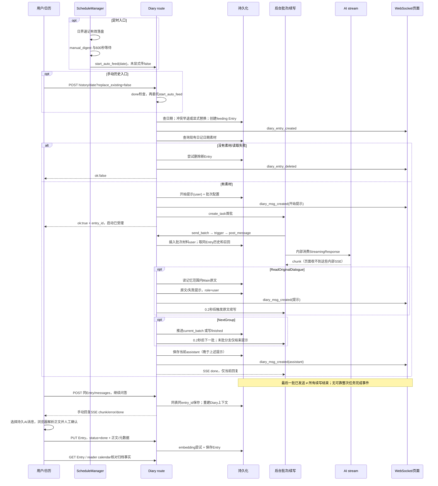

# Diary Chat PR0：自动投喂与聊天生命周期审计

审计日期：2026-10-29（Asia/Shanghai）。本轮只新增本文；未实施功能。结论针对以下本地源码快照，不代表线上部署或真实用户数据的状态。

## 1. 执行摘要、Git 快照与证据口径

| 仓库 | 实际位置 | 分支 | HEAD | 开始工作区 |
| --- | --- | --- | --- | --- |
| Penumbra | `/Users/remix/Desktop/Penumbra` | `main` | `bed3304fe7da31cb059327fc3f5822c11cbff21e` | `git status --short` 为空 |
| AionHome | `/Users/remix/Desktop/AionsHome-main` | `refactor-code-main` | `ecb9ab4a9276a351442ff4f8e2c6d91a6c0e971a` | `git status --short` 为空 |

已读 Penumbra `docs/diary-implementation.md`、`docs/chat-implementation-audit.md`，AionHome `docs/diary-reader-calendar-contract.md`。指定的 `aion-chat/AGENTS.md` 当前不存在，实际约束是仓库根目录 [AGENTS.md](/Users/remix/Desktop/AionsHome-main/AGENTS.md:1)，其要求的 [runtime model](/Users/remix/Desktop/AionsHome-main/docs/aionhome-runtime-model.md:1) 和 [master plan](/Users/remix/Desktop/AionsHome-main/docs/aionhome-refactor-master-plan.md:1) 已读。本轮属于 Phase 0 / Diary Chat PR0；不改变 persistence、Prompt 顺序、command grammar / side effect 顺序或 WS type / payload / timing，不让 Penumbra 复制后端状态机。没有以 codemap 或旧报告行号作结论。

证据标签：**[源码]** 当前静态代码事实；**[实测]** 本轮安全隔离检查；**[已有测试]** 当前测试的断言，未运行时不冒称通过；**[推导]** 由控制流推得的风险；**[待验证]** 需要合成集成测试或之后获准的人工作业。下文 `B` 指 AionHome 的 `aion-chat/`，`P` 指 Penumbra 仓库；行号均重新核对当前文件。

主要结论：

1. **历史补写已经具备后端入口，但“继续”是打开原 Entry 手动聊天，并非恢复自动任务。** 默认返回草稿冲突；显式替换会删除旧 Entry 再建新 ID。定时内部调用仍触发 truthy `Query(False)` 风险。[触发分支](/Users/remix/Desktop/AionsHome-main/aion-chat/routes/diary.py:1732)、[旧 UI 二选一](/Users/remix/Desktop/AionsHome-main/aion-chat/static/diary.html:469)、[定时调用](/Users/remix/Desktop/AionsHome-main/aion-chat/schedule.py:1903)。
2. **没有可靠的整次自动投喂任务完成信号。** `finished` 只在“已到末批又收到 NextGroup”分支写入，正常末批 Prompt 反而禁止该命令；并且此写入早于当前回复保存、不等待原文续写。`done` 只结束一条 SSE，`pending` 只证明写作记录存在。[末批命令分支](/Users/remix/Desktop/AionsHome-main/aion-chat/routes/diary.py:344)、[末批 Prompt](/Users/remix/Desktop/AionsHome-main/aion-chat/routes/diary.py:1878)、[日历投影](/Users/remix/Desktop/AionsHome-main/aion-chat/diary_reader.py:63)。
3. **重复与顺序异常不能全部归因于渲染。** 已用合成事件复现旧前端 SSE 临时消息与 WS 持久消息双显；后端也确实先保存原文提示、再保存请求原文的 assistant，且两个命令可并发触发两条续写。见 §5。
4. **自动投喂后继续聊天不需要新建 Entry 或新状态机。** 原消息接口不检查批次结束状态，继续写同表同 `entry_id` 并重建 Diary 上下文；但上下文有条数限制，不能承诺全部历史永久送模。见 §6。
5. **“提取日记正文”和“读取记忆原始对话”是两种能力。** 前者是旧前端消息文本解析并打开保存表单；后者是模型命令，读取 Main 消息并再触发 AI。没有 Diary“自动提取并归档”API。见 §7。
6. **共享 UI 的基础比旧 Chat 审计时更成熟。** 当前已有 ChatShell、展示 VM、Sender 草稿/插入/附件槽、Main 搜索和消息编辑；旧审计中的“缺少 DRIFT 支持”等结论不能直接沿用。Diary 应独立接 Entry/DTO/生成控制器，局部补 UI action 槽即可。见 §9。

安全边界：未读 `.env`、个人配置、凭据文件、真实数据库、真实日记/聊天/导出内容；未启动应用、请求线上 API、连接 WS、调用真实模型、触发真实投喂/提取/写入/删除/归档；未 commit、push、deploy。§10 的检查只执行源码 AST、合成事件和临时隔离的既有测试。

## 2. 当前功能矩阵

“后端已有”表示有可达源码，不等同于并发安全或产品闭环。

| 能力 | 后端当前实现 | 旧前端真实交互 | Penumbra 当前 | 后端缺口 / 限制 |
| --- | --- | --- | --- | --- |
| 月历与归档正文 | reader/calendar、Entry GET | 旧 calendar、按日期全条目列表 | 已接新日历契约、按需归档阅读 | 日历不表达运行进度 |
| 历史自动投喂 | 两个 POST 都存在 | 历史日期弹窗→补写→强制进入 write | 只有全局开关，没有执行入口 | 启动无幂等；Query 内部调用风险 |
| 草稿继续 / 替换 | 默认返回二选一；显式删旧建新 | confirm 确定替换，取消继续原 Entry | 未接 | 不是自动恢复；没有旧任务取消 |
| Diary 消息历史 | 全量按 created_at ASC | GET 后整体赋值 | 未接 Diary DTO / timeline | 无分页、稳定 tie-break / revision |
| 手动发送 / 续聊 | POST messages→SSE | 临时 user / AI + 流 + WS | Main 已有，Diary 未接 | Diary SSE 无消息身份；无入口生成锁 |
| 后台自动生成展示 | 内部消费 SSE；广播持久 assistant / 提示 | WS + 最多三分钟的两秒刷新 | 未订阅 Diary 事件 | 后台 chunk、不少 batch user 不广播 |
| 用户消息编辑 | PUT message，限定 role=user | prompt 编辑 | Diary 未接 | 无 row-count、版本校验、更新 WS |
| 消息删除 | DELETE 单条 | 确认后 DELETE、重读 | Diary 未接 | 无删除 WS，不清理关联 HEART |
| AI 重生成 | 新 ID，成功后删除目标及快照后缀 | 任意非 user 菜单入口 | Diary 未接 | 与 Main 同 ID canonical 规则不同 |
| 从 AI 消息提取正文 | 无专用后端 API | 浏览器解析→complete 表单 | 未接 | 解析宽松、无可靠失败识别 |
| AI 读取原始对话 | ReadOriginalDialogue→helper→续写 | 被动看提示；侧栏另有 source GET | 未接 | helper 限十条、不按 source_conv 过滤 |
| 归档 / 编辑 Entry | PUT status=done，可算 embedding | 保存表单 | 归档条目编辑已有；首次提取归档未接 | PUT 不确认命中行、无版本、无更新 WS |
| 整次任务完成 / 停止 / 恢复 | 无可靠统一契约 | 本地 _sending 仅覆盖当前请求 | 未接 | 不能从 feeding/finished/EOF 推导全局空闲 |

矩阵依据：[Diary 路由/模型](/Users/remix/Desktop/AionsHome-main/aion-chat/routes/diary.py:454)、[旧写作页](/Users/remix/Desktop/AionsHome-main/aion-chat/static/diary.html:639)、[Penumbra Diary 装配](/Users/remix/Desktop/Penumbra/src/components/diary/DiaryView.tsx:14)、[当前 Main 装配](/Users/remix/Desktop/Penumbra/src/components/chat/ChatView.tsx:70)。

## 3. 自动投喂入口、继续/替换与真实时序

### 3.1 路由及前置步骤

所有下列 Diary 相对路径均以 `/api/diary` 为前缀。

| 入口 | 参数与返回 | 实际行为 |
| --- | --- | --- |
| `POST /auto-feed/{date}` | path date；query `replace_existing=false`；成功 `{ok:true,entry_id,total_memories,batch_count}` | 创建/替换 Entry、获取当天现有记忆、持久开始提示/批次配置，create_task 首批后立即回执；不是生成完成回执 |
| `POST /auto-feed/history/{date}` | 同上；done 早退仅 `{ok:false,message}` | 额外查 done，再显式传参到 start_auto_feed；不是独立补写算法 |
| `GET /auto-feed/history?start_date=` | `[{date}]`；默认近30天、最多回溯90天、含今天，排除 done、只留有记忆日期；错误也可能 `[]` | 只是候选列表；90天上限没有施加到两个 POST，不能据此限制日历补写范围 |
| `schedule.py:_delayed_diary_feed` | 内部 `await start_auto_feed(target_date)` | 日界速记成功后总结记忆、等待至少600秒，再检查全局开关并启动 |

证据：[两入口与日期候选](/Users/remix/Desktop/AionsHome-main/aion-chat/routes/diary.py:1732)、[history 委托](/Users/remix/Desktop/AionsHome-main/aion-chat/routes/diary.py:1957)、[定时前置链](/Users/remix/Desktop/AionsHome-main/aion-chat/schedule.py:1584)。

**[源码] 手动补写不调用 manual_digest / auto_digest，不要求先完成日界速记。** 它使用当前已有 memories，按指定历史业务日期取材；每次生成里的 `instant_digest` 是关键词/状态与召回流程，不是补做全日记忆整理。自动入口先要求日界速记 Step2 成功且有效 output 已持久化，再启动 `_delayed_diary_feed`；`manual_digest()` 的失败结果或异常会记录，但仍可投喂。600秒计时与总结同时启动，总结更慢则等总结；开关关闭仍做记忆总结。`manual_digest` 自身的锁不保护 Diary Entry/消息生成。[日界成功门](/Users/remix/Desktop/AionsHome-main/aion-chat/schedule.py:1601)、[总结与等待](/Users/remix/Desktop/AionsHome-main/aion-chat/schedule.py:1794)、[总结锁](/Users/remix/Desktop/AionsHome-main/aion-chat/memory.py:887)、[已有测试](/Users/remix/Desktop/AionsHome-main/aion-chat/tests/contract/test_daily_digest_before_diary.py:144)。

**[源码] 日期不是“今天限定”。** `fetch_diary_memories_for_date` 按 `source_start_ts` 归属；缺少有效 source_start 才用 created_at。范围是当前速记最早截止小时后延10分钟，到次日同点前1秒，两端包含；使用后端进程本地时间。date 在建 Entry 后才间接 strptime 验证，POST 不先做严格日期或未来日期校验；记忆为空/读取异常会尝试删除新 Entry。历史时区/日界配置重算与 reader 保存的业务日期是不同语义，不应混用。[素材查询](/Users/remix/Desktop/AionsHome-main/aion-chat/routes/diary.py:414)、[边界](/Users/remix/Desktop/AionsHome-main/aion-chat/routes/diary.py:1647)、[启动失败清理](/Users/remix/Desktop/AionsHome-main/aion-chat/routes/diary.py:1786)。

### 3.2 已有 Entry、保护与并发

| 已有状态 / 动作 | 当前结果 | 数据与任务影响 |
| --- | --- | --- |
| done，任意 replace | start_auto_feed 返回 `diary_done_exists` 和原 ID；history 包装层更早拒绝但不带 code/ID | 顺序执行下自动投喂不覆盖 done；这不是所有写接口的只读保护 |
| writing（或其他非 done），默认 false | `{ok:false,code:'diary_draft_exists',entry_id,status,choices:['replace_auto','continue_manual']}` | 不追加批次、不重启、不删除；即使已有任务也只返回冲突 |
| 选择继续 | 旧 UI GET 原 Entry/历史，进入 write | ID 与消息沿用；没有调用“恢复自动任务”API；原后台任务若仍活跃，也未停止 |
| 显式 replace=true | DELETE 旧 Entry、commit、广播删除；再 INSERT 新 Entry | 标题/保存草稿/模型/批次配置随旧 Entry 丢失；后续取材失败也不会恢复旧 Entry |
| 两次创建 / 双入口并发 | SELECT→INSERT 没有日期锁或事务重查 | date UNIQUE 能拒绝第二个插入，但不是成功幂等回执；可暴露 IntegrityError |
| 重复替换 / 替换与归档竞争 | 无 CAS、无 status 条件 DELETE、删除与新建分开 commit | 可根据过期 SELECT 删除刚归档记录；后发替换可删除先发的新任务 Entry |

证据：[实际分支和 commit](/Users/remix/Desktop/AionsHome-main/aion-chat/routes/diary.py:1742)、[唯一日期 schema](/Users/remix/Desktop/AionsHome-main/aion-chat/database.py:353)、[旧继续交互](/Users/remix/Desktop/AionsHome-main/aion-chat/static/diary.html:480)。这些并发后果是 **[推导]**，没有在真实数据上触发。

**[源码/推导] 不可直接承诺“替换会安全级联清理消息和任务”。** schema 声明 diary_messages / diary_sent_memories 的 `ON DELETE CASCADE`，但 `get_db()` 每次只是新建 aiosqlite 连接，未开启 foreign_keys；`init_db()` 的 PRAGMA 只对其连接有效。按当前连接代码，删除 Entry 后子行可成为孤立行，用户仍无法从新 Entry 找回旧会话；若某环境另开 FK，则会级联删除。两种情况都不是安全保留旧数据。任务无 handle/cancel、无删除后写入保护，可继续向旧 ID 工作或报错。Entry 缺失时 post_message 的日期 fallback 引用了未定义的 `_currentDate`，并非规范404。[子表约束](/Users/remix/Desktop/AionsHome-main/aion-chat/database.py:389)、[连接](/Users/remix/Desktop/AionsHome-main/aion-chat/database.py:485)、[仅初始化 PRAGMA](/Users/remix/Desktop/AionsHome-main/aion-chat/database.py:67)、[缺失 Entry 分支](/Users/remix/Desktop/AionsHome-main/aion-chat/routes/diary.py:670)。本轮未查询真实连接或数据库验证部署行为。

**[实测] Query(False) 问题仍存在。** 对当前两个函数 AST 只保留签名/默认值（不执行函数体），用仓库环境 FastAPI 构造默认对象，结果均为 `default_type=Query, bool=True, declared_default=False`。当前真实链：`日界速记成功 → _schedule_day_boundary_task → _delayed_diary_feed → start_auto_feed(target_date) → replace_existing=Query对象 → not replace_existing 为 false → 删除非 done Entry`。HTTP 解析得到的 bool 不受此默认对象问题影响；HTTP history 显式转传解析后的 bool。直接 Python 调用 start_history_feed 不传参也有同类风险。done 的独立早退仍有效，但不消除上述并发窗口。推荐以后只修路由/内部业务参数边界并明确传 false，不改变“继续/替换”产品语义。[默认签名](/Users/remix/Desktop/AionsHome-main/aion-chat/routes/diary.py:1733)、[内部调用](/Users/remix/Desktop/AionsHome-main/aion-chat/schedule.py:1904)。

### 3.3 从触发到归档的时序图

下图的模型、DB、WS 均是源码关系，没有实际调用。时间上的 `0.2秒` 是延迟调度，不是串行屏障。

调用点：[首批任务](/Users/remix/Desktop/AionsHome-main/aion-chat/routes/diary.py:1844)、[send_batch](/Users/remix/Desktop/AionsHome-main/aion-chat/routes/diary.py:1863)、[trigger/内部消费](/Users/remix/Desktop/AionsHome-main/aion-chat/routes/diary.py:266)、[后处理与保存顺序](/Users/remix/Desktop/AionsHome-main/aion-chat/routes/diary.py:1038)。`send_first_batch` 当前只是转发 send_batch 的 helper；检索生产 Python 调用点未见其被调用，真实首批走 `_run_auto_feed_batch`。

### 3.4 五种“完成”必须分别表达

| 层次 | 当前可观察证据 | 不能推出的事实 |
| --- | --- | --- |
| 一条 AI 回复结束 | 当前生成器走到 SSE done；若有有效正文/DRIFT/Thinking，之前已 INSERT 并广播 | post_message 的空回复也能 done；手动异常流也可能 error 后继续保存部分回复；不证明后续任务结束 |
| 一批消化完成 | 单次 send_batch 的内部流消费返回，最多说明本批触发的一条回复结束 | ReadOriginal 续写是 create_task，未 join；模型是否理解完没有业务确认 |
| 最后一批材料发送 | current_batch 到末批并调用 post_message 插入末批 user；文本写“已全部发送” | config 在真正发送下一批前已推进；末批回复/原文读取仍可进行或失败 |
| 整次自动任务完成 | **没有可靠证据** | finished、assistant出现、SSE done、600秒日界任务返回均不足 |
| 正式归档 | Entry `status='done'` 且保存正文满足有效非空；reader calendar 返回 archived | 不要求自动任务结束；也不自动取消已有任务 |

`finished` 无对应状态变更 WS、无任务身份/失败终态/恢复游标；正常末批不触发它而可能永久保持 feeding。其读取值可以展示为旧字段事实，不能驱动“生成中/可提取/完成”按钮门禁。[finished 唯一写入](/Users/remix/Desktop/AionsHome-main/aion-chat/routes/diary.py:365)、[reader 判定](/Users/remix/Desktop/AionsHome-main/aion-chat/diary_reader.py:74)。

## 4. SSE、WebSocket、历史与消息身份

### 4.1 Diary 的真实 wire（不是 Main Chat wire）

| 通道/事件 | payload（生产字段） | 身份、顺序与前端消费 |
| --- | --- | --- |
| POST messages SSE `chunk` | `{type:'chunk',content:字符串}` | 无 user/assistant/entry ID，无 start；原始生成文本可能含命令/隐藏标记，累加仅作临时展示 |
| 同 SSE `error` | `{type:'error',content:异常文字}` | 不是持久化回执；post_message 捕获后不 return，可能仍后处理/保存部分输出并 done；前端须保留失败事实 |
| 同 SSE `done` | `{type:'done',drift:'',thinking:''}`（实际值可非空） | 没有最终清理正文、消息 ID、entry_id 或持久化 receipt；只属于当前连接；后台任务仍可继续 |
| regenerate SSE | 同 chunk/error/done，无 start / persisted | 失败早退比普通发送严格；成功的新 ID 只在后续历史/WS 可见 |
| WS `diary_entry_created` | 自动创建 `{id,date,status:'writing',created_at,updated_at}`；普通创建还带 title/content/keywords/tags/importance | Entry ID；字段不是统一完整详情；只作失效/索引刷新线索，不据此建已归档 VM |
| WS `diary_entry_deleted` | `{id:entry_id}` | 替换、显式删除、启动清理；事件无取消任务含义；清理 helper 即使 DELETE 未命中也广播 |
| WS `diary_msg_created` 提示 | `{id,entry_id,role:'user',content,created_at}` | send_diary_system_message 与开始提示：commit 后广播，是真实 Diary 消息；按 entry_id 隔离、ID upsert / 触发重读 |
| WS `diary_msg_created` assistant | `{id,entry_id,role:'assistant',content,created_at,simple_think?,thinking?}` | 代码广播前使用 drift，wire 转为 simple_think；先 commit 后广播、再发当前 SSE done；与 overlay 不能直接双 append |
| WS `auto_feed_status_changed` | `{enabled:boolean}` | 仅全局开关，不是某 Entry 进度 |
| WS `heart_whisper` | data `{type:'heart_whisper',id,msg_id,content,created_at}` | 没有 entry_id / conv_id；msg_id 是当前 dma ID；先于 assistant INSERT 广播，不能当 Diary 消息追加 |
| WS `msg_created` / `schedule_changed` | 记忆写入、日程 helper 产生 Main 通知；`msg_created.data={id,conv_id,role:'system',content,created_at,attachments:[]}`；schedule_changed 无 data | Diary 把 Entry ID 作为 conv_id 传入这些旧 helper，写的是 Main messages，不是 diary_messages。不能混入 Diary timeline |
| GET `/entries/{id}/messages` | 数组：`id,entry_id,role,content,created_at,updated_at,simple_think物理列映射成drift,thinking`；取表所有列 | HTTP 是保存事实；不附 execution/batch/parent/correlation ID，无分页；空数组也不确认 Entry 存在 |

证据：[SSE emit](/Users/remix/Desktop/AionsHome-main/aion-chat/routes/diary.py:1003)、[assistant commit/WS/done](/Users/remix/Desktop/AionsHome-main/aion-chat/routes/diary.py:1105)、[WS wire 转换](/Users/remix/Desktop/AionsHome-main/aion-chat/drift_compat.py:38)、[broadcast](/Users/remix/Desktop/AionsHome-main/aion-chat/ws.py:56)、[history](/Users/remix/Desktop/AionsHome-main/aion-chat/routes/diary.py:641)、[记忆副作用](/Users/remix/Desktop/AionsHome-main/aion-chat/routes/diary.py:55)、[日程通知](/Users/remix/Desktop/AionsHome-main/aion-chat/schedule.py:2093)。普通 post_message 的 user INSERT 没有对应 diary_msg_created，因此**后台批次材料、原文续写的触发 user 并不全部实时广播**；遇到下一个提示/assistant事件再重读才能补齐。

### 4.2 ID 与排序边界

- **[源码]** Entry 为 `diary_{毫秒}`；普通 user `dm_{请求起始毫秒}`，assistant `dma_{同一请求起始毫秒}`，但 assistant created_at 在最终保存时重新取。开始提示 `sys_{毫秒}`；通用提示 `_msg_id('sys')` 额外带8位 UUID。毫秒 ID 不是全流程统一防碰撞机制，同毫秒并发可能 PK 冲突；不要按 ID 字符串猜时间或关联关系。
- **[源码]** history 只 `ORDER BY created_at ASC`；生成读取则 DESC LIMIT 后反转，无稳定 tie-break。前端必须保留接口顺序，不能按角色/气泡内容重新拼接；时间戳相同的确定性需单独固化读取契约。
- **[源码]** `client_msg_id` 仅在 MsgCreate 声明，没有读用，没有 Main 的去重回执。不能靠 UUID 或重发请求恢复结果未知状态。
- **[建议]** Diary 持久消息用 `(entryId,messageId)`，overlay 用明确本地 attempt ID；只有本地流活动时延迟 WS 重读/展示合并，结束后整体回读替换并重绘。当前无身份回执时，不能用“最新 assistant”或正文相等当作本次发送保存成功证明，后台同 Entry 也能写 assistant。

证据：[请求字段/ID](/Users/remix/Desktop/AionsHome-main/aion-chat/routes/diary.py:466)、[user INSERT](/Users/remix/Desktop/AionsHome-main/aion-chat/routes/diary.py:667)、[assistant ID与时间](/Users/remix/Desktop/AionsHome-main/aion-chat/routes/diary.py:1003)、[提示ID](/Users/remix/Desktop/AionsHome-main/aion-chat/routes/diary.py:173)。

**[限制]** 目前可以提供“已保存的完整消息过程”与用户主动请求的实时 SSE；无法凭旧契约承诺“从日历启动后，随时进入就能看到正在生成的后台逐字流”。内部 `_consume_streaming_response` 消费而不转发 chunk，WS 没有重播 Diary 消息/流日志。首次进入、显式刷新、重连与 Diary 事件可触发有界读取，但不是任务轮询，也不能恢复丢失 chunk。[内部消费](/Users/remix/Desktop/AionsHome-main/aion-chat/routes/diary.py:266)、[旧 WS 重连](/Users/remix/Desktop/AionsHome-main/aion-chat/static/common.js:52)。

## 5. 顺序异常与重复展示：已证事实、推导和复现

### 5.1 已复现：SSE 临时 ID 与 WS 持久 ID 双显

**[源码 + 实测]** `sendDiaryMsg` 本地生成 `aiTempId='dma_'+Date.now()`，chunk 查该 ID 并追加/修改；WS init handler 按服务端 data.id upsert。两个毫秒来自不同端和时刻，通常不是同一身份。服务器在 SSE done 之前广播持久 assistant，旧 UI 因此持有两个 ID、相同正文。done 仅移除/重推本地 aiTempId，不移除服务端副本。

安全最小复现：从当前 HTML 原样提取 sendDiaryMsg，在 Node 中注入假 fetch/reader/DOM；依次给 `chunk('synthetic answer') → WS('dma-server',同正文) → done → EOF`，假 GET 返回两条权威 user/assistant。实际结果：最后一次 render 有两个 answer（`dma-server` 与本地 dma）；重读后的内存只有一个 answer，但 DOM 的最后 render 仍是双份。原因是 `await loadWriteMessages()` 末尾没有 `renderWriteMessages()`。sendSelectedMemories 有同样逻辑；regenerate 在旧目标位置流式替换、WS 新 ID 追加，也可能双显。

证据：[临时发送/stream处理](/Users/remix/Desktop/AionsHome-main/aion-chat/static/diary.html:1287)、[done/结束重读](/Users/remix/Desktop/AionsHome-main/aion-chat/static/diary.html:1366)、[WS upsert](/Users/remix/Desktop/AionsHome-main/aion-chat/static/diary.html:1742)、[导入相同模式](/Users/remix/Desktop/AionsHome-main/aion-chat/static/diary.html:1238)、[regenerate 收尾](/Users/remix/Desktop/AionsHome-main/aion-chat/static/diary.html:988)。这是**足以产生反馈现象的机制**，未证明所有历史反馈都来自它；没有读取用户现场。

### 5.2 已证：持久化顺序本身不同于用户看到的生成顺序

**[源码]** 当前 assistant 输出完后，先处理 ReadOriginal：逐条读取、保存并广播 role=user 的原文/失败提示，再 create_task 续写；之后处理 NextGroup，再处理 HEART/记忆/日程，最后才给当前 assistant 取 created_at 保存。于是 HTTP 历史可为“批次 user → 原文 user → 当前 assistant”，而页面 SSE 先显示当前 assistant、WS 后追加原文。重读后顺序改变有真实后端依据。regenerate 命令提示也在替换事务之前写入，新回复时间更晚。[post 命令顺序](/Users/remix/Desktop/AionsHome-main/aion-chat/routes/diary.py:1042)、[最终时间](/Users/remix/Desktop/AionsHome-main/aion-chat/routes/diary.py:1107)、[regenerate 对应代码](/Users/remix/Desktop/AionsHome-main/aion-chat/routes/diary.py:1535)。

**[推导]** 同回复含 ReadOriginalDialogue 与 NextGroup，会各建一个0.2秒续写任务；没有互斥或 parent/child 关联，也没有“原文全部续写结束后才发送下一批”的执行约束。0.2秒内若父回复还在慢日程/DB/WS，子任务可先读到缺少父 assistant 的历史。两个 send_next 同时读取 current_batch 再写相同 next_batch，可重复发送同一批或由交错推进跳过材料；不能用 Prompt 的“看完再 NextGroup”当锁。[两个任务](/Users/remix/Desktop/AionsHome-main/aion-chat/routes/diary.py:1058)、[批次读改写](/Users/remix/Desktop/AionsHome-main/aion-chat/routes/diary.py:355)。

### 5.3 其他已定位机制与排除范围

| 检查项 | 当前事实 | 判断 |
| --- | --- | --- |
| 历史刷新与 SSE 同时修改 | 自动跳入 write 后定时 tick 不检查 _sending；GET 完成整体覆盖 _entryMessages；下一 chunk 又找不到临时ID再追加 | [推导] 可闪烁、重建临时消息、旧快照覆盖新事件 |
| stale Entry 响应 | loadWriteMessages 没有 owner/sequence/AbortSignal；多次 await 使用可变 _currentEntry；返回无身份重查 | [推导] 切日/离页的晚到响应可污染当前内存，不能只补 React key |
| 纯后台自动批次 | 浏览器没有这些 SSE overlay，主要 WS提示/assistant + GET刷新 | [源码] 若反馈仅发生在此路径，5.1不能单独解释，需查后端/刷新竞态 |
| 真正两条后端消息 | 重复 HTTP 无去重；ReadOriginal 的 mem_id 列表不去重，重复同ID命令可多写同提示；反复末批 NextGroup 可反复写结束提示；批次竞态可多次 post | [推导] 可写两个不同 ID；不是前端 upsert 能消除，应按逻辑触发修复 |
| 重复订阅 | 旧 Diary init 只调用一次 connectCommonWS；common 在 onclose 重连 | [源码] 未找到当前正常路径重复订阅证据；不能断言它是根因 |
| React effect / key | 旧 Diary 用 innerHTML 和数组，不用 React；Penumbra 尚无 Diary timeline | [源码] React StrictMode/Diary React key 不是此旧页面的已证根因 |
| 新通用 BubbleList | key=message.id；scroll effect 有清理；不做消息数组合并 | [源码] 可复用，但不同ID重复会被正确渲染成两条，责任在适配层 |

证据：[旧tick](/Users/remix/Desktop/AionsHome-main/aion-chat/static/diary.html:526)、[旧历史加载](/Users/remix/Desktop/AionsHome-main/aion-chat/static/diary.html:639)、[旧渲染](/Users/remix/Desktop/AionsHome-main/aion-chat/static/diary.html:682)、[新key和effect](/Users/remix/Desktop/Penumbra/src/components/chat/BubbleList.tsx:206)。

### 5.4 后续最小合成复现计划（本轮不修改）

1. 当前已运行的临时ID/WS复现增加 HTTP-before-WS、WS-before-done、断流无done、GET失败与迟到GET；断言展示只有一份或明确一份未确认 overlay，且最终主动重绘。
2. fake stream 输出 `文字 + ReadOriginalDialogue(m1)`，记录 DB/WS/children 调度顺序；给 process_schedule_commands 注入延迟，检查子生成是否缺父回复。
3. 同时输出 ReadOriginal 与 NextGroup、重复同 mem_id、两路 NextGroup并发，以临时 SQLite 和 fake manager 验证重复批次/提示；不得接真实原文、模型或外部 side effect。
4. regenerate 目标后有消息、生成期间新增消息/删除目标/替换 Entry、命令后 INSERT失败；区分事务后缀删除与事务外副作用。

尚不能确定现场发生频率、是否同时涉及 provider 自身重复正文、部署版本差异、浏览器旧缓存。需要合成事件日志（attempt、Entry、message ID、通道、相对顺序），不采集真实正文，才能归并用户反馈类别。

## 6. 自动投喂后的继续对话与上下文

**[源码] 后端已经允许同 Entry 继续发消息，包括 feeding、finished、idle，甚至 done。** post_message 没有批次状态/Entry status 禁发判断；普通消息和自动批次都 INSERT diary_messages，entry_id 始终是调用参数。trigger 只是构造 role=user、context_limit=80 的 MsgCreate 再调用同 post_message。没有必须新建 Entry、重新初始化或绕过原历史的条件。done 后聊天也不会自动更新 Entry 正文或归档状态。[接口](/Users/remix/Desktop/AionsHome-main/aion-chat/routes/diary.py:658)、[trigger](/Users/remix/Desktop/AionsHome-main/aion-chat/routes/diary.py:331)。

当前后续生成读取的上下文（按实际拼装，不能照注释误读顺序）：

1. **同 Entry 最近 N 条 diary_messages**，包括批次材料、原文提示、自动续写提示和手动问答。普通默认30，自动trigger为80；调用方可传 context_limit，目前没有范围约束。过去 assistant 做隐藏命令清理，恢复允许的 DRIFT/HEART，附消息发送时间；Thinking未作为独立历史字段恢复。之前的附件移除，仅留历史最后消息附件（当前 Diary MsgCreate 本身没有附件字段）。
2. 当前 worldbook 的 AI persona/about、user persona 及 ack；当前日程能力与列表；所写 Entry 日期和当前运行时间；Diary格式/ReadOriginal/NextGroup规则与 ack。
3. dynamic_context：时间、背景浮现、核心记忆、闪现、低频浮现、相关 RAG及 ack，然后才 append 实际 Diary 历史。每次都重新 instant_digest 最近3条实际user/assistant，并召回；不是冻结首批时的一份上下文。低频计数、召回元数据也有副作用。
4. auto_feed_config 的 diary_cache_msg_id 影响 Anthropic 缓存提示；post 选模型顺序是显式 body.model → Entry JSON完整选择 → 最近 Main的兼容catalog model → Entry兼容model/DEFAULT兜底。regenerate 则读 Entry.model/DEFAULT，不跟最近 Main。这是现有不同优先级，不能为了复用 UI 静默统一。

证据：[历史与恢复](/Users/remix/Desktop/AionsHome-main/aion-chat/routes/diary.py:737)、[召回](/Users/remix/Desktop/AionsHome-main/aion-chat/routes/diary.py:811)、[拼装](/Users/remix/Desktop/AionsHome-main/aion-chat/routes/diary.py:853)、[最终append](/Users/remix/Desktop/AionsHome-main/aion-chat/routes/diary.py:1000)、[模型优先级](/Users/remix/Desktop/AionsHome-main/aion-chat/routes/diary.py:288)、[已有优先级测试](/Users/remix/Desktop/AionsHome-main/aion-chat/tests/contract/test_phase5c_auxiliary_runtime.py:324)。

继续追到真实被调模块：`build_dynamic_blocks(surfaced,now_str)` 的 time_block 内确实同时包含当前时间和背景记忆，并非只注入时钟。Diary将resolved binding/options传给 `stream_ai(...,skip_dynamic_context=True)`；没有传Main conv_id、qn_rows、diary_result或prompt_source_snapshot，因此不会由此调用读取Main缓存窗口、最新归档日记或速记正文。非Anthropic路径规范化消息后转相应transport；Anthropic路径另建 `chat_mode=True` 的system能力块，再使用调用方history，跳过builder自动动态层。**skip_dynamic_context不是“不再经过provider Prompt转换”**，不能把route history直接当最终wire快照。diary_cache_msg_id在当前route主要用作是否给reminder设缓存标记的条件，没有把该ID传给provider来建立消息级保存/任务身份。[动态块内容](/Users/remix/Desktop/AionsHome-main/aion-chat/prompts/builder.py:1690)、[统一stream入口](/Users/remix/Desktop/AionsHome-main/aion-chat/ai_providers.py:2341)、[协议分流](/Users/remix/Desktop/AionsHome-main/aion-chat/ai_providers.py:2563)、[Anthropic system/messages](/Users/remix/Desktop/AionsHome-main/aion-chat/ai_providers.py:2606)。

Diary的命令执行仍以route里的ReadOriginal/NextGroup/HEART/MEMORY_WRITE和schedule处理为准；它调用 `ReplyCommands.finish` 清理剩余标记，但没有调用 `ReplyCommands.dispatch`。即使provider能力文本或共享parser认识其他Main命令，也不能据此宣称Diary具备Main工具结果/续写运行链。[finish与dispatch分界](/Users/remix/Desktop/AionsHome-main/aion-chat/reply_commands.py:76)、[Diary调用点](/Users/remix/Desktop/AionsHome-main/aion-chat/routes/diary.py:1100)。

**[限制]** “沿用原 Diary 上下文”可指同 Entry历史继续参与、保留Diary模式；不能声称所有早期材料都在下一次Prompt中。超出N条的旧材料可能不再送入模型。Entry.content（保存草稿/归档正文）没有独立注入，完整 auto_feed_config.memories 也不会每次自动全量注入；要保留原问答应继续读同消息历史，不要另建上下文副本。

### 6.1 正在生成时能否发送

- **[源码] 后端允许并发，未发现 Diary Entry生成锁。** 普通发送、再生成、自动批次、原文续写都可交错。旧 UI `_sending` 只挡本页主动发送/导入/再生成请求；后台任务不更新它，消息编辑/删除也未统一禁用。
- **[建议]** 对本页发起、可跟踪的 SSE，先用 Diary 控制器 active ref + Sender.submitDisabled 禁止重入即可；可允许编辑下一条草稿。不必建立新后端状态机。
- **[限制]** 当前不能可靠知道所有后台续写是否空闲；`feeding` 可能永不退、`finished` 也可能仍有子任务。仅禁用 Composer 不能承诺跨页/后台/两客户端串行安全。如果要求自动续写与人工消息绝不交错，应先对后端现有命令调度边界做窄范围串行修正并补测试，不能在前端假造全局busy。无法确认的操作明确提示/允许只读刷新，不自动重发。

### 6.2 手动与自动的保存/错误/结束差异

| 路径 | user保存 | 失败 | 结束含义 |
| --- | --- | --- | --- |
| 手动 post_message | 模型解析通过后先落user，再建Prompt，之后才返回SSE | stream异常 yield error 后仍继续；部分正文/思考可被保存；错误chunk也没有普通入口专用拒存屏障。prepare失败时user可能已存 | done不一定有assistant；断开/abort不能宣称取消所有副作用 |
| 自动 trigger | 同接口，context_limit=80；服务器消费body_iterator才执行generate | `_consume_streaming_response` 遇error/指定错误前缀chunk就抛并aclose，阻止继续保存成成功assistant；首批wrapper写失败提示 | await仅当前流；子任务仍独立 |
| 下一批/原文续写 | 普通post追加新的user提示 | 下一批的create_task不由调用处try捕获实际异步异常；原文续写task也没有统一失败回执；状态可停在feeding | 没有task级终态；已写user/提示保留 |
| regenerate | 不新写用户问题，取目标前历史 | 异常、空输出、`[错误]`早退保留旧消息；替换INSERT失败回滚删除，但命令副作用在事务前 | 新ID落盘后done；不等于原任务完成 |

证据：[post异常](/Users/remix/Desktop/AionsHome-main/aion-chat/routes/diary.py:1021)、[内部拒存](/Users/remix/Desktop/AionsHome-main/aion-chat/routes/diary.py:266)、[首批失败提示](/Users/remix/Desktop/AionsHome-main/aion-chat/routes/diary.py:404)、[regenerate失败门](/Users/remix/Desktop/AionsHome-main/aion-chat/routes/diary.py:1501)。手动流与背景流断开关系不同：普通生成器直接由 StreamingResponse消费，不能套用 Main“后台总会继续”的结论；已派生的create_task不会因页面离开而自动取消。

归类：**后端已有**同Entry续聊/历史/RAG/命令；**前端缺接线**Diary client、历史/overlay协调、发送与局部禁重入、失败保留/只读恢复；**确需先明确契约**消息保存身份、部分错误输出、跨后台并发、再生成截断范围。没有必要为续聊引入新Entry、新Chat Runtime或第二套模型设置。

## 7. 消息操作、原文与归档接口矩阵

### 7.1 Diary 消息与 Entry

| 操作 | 方法/路径/参数 | 响应/身份 | 副作用与旧 UI |
| --- | --- | --- | --- |
| 历史 | GET `/entries/{entry_id}/messages` | 数组，drift canonical；created_at升序 | 不检查Entry是否存在、无分页；旧load同时还读素材和sent标记 |
| 发送 | POST同路径；JSON `{content,role='user',model?,temperature?,context_limit=30,client_msg_id?,diary_cache_breakpoint=false}` | SSE；服务端新dm/dma；client_msg_id不生效 | user先存，生成/命令可写多处；role任意字符串、content可空；UI只发非空文本 |
| 编辑 | PUT `/entries/{entry_id}/messages/{msg_id}`；`{content}` | `{ok:true}`，原ID | WHERE同Entry且role=user，更新content/updated_at；目标不存在或非user也ok，无row-count/WS。旧菜单仅user编辑，自动提示也为user所以同样可编辑 |
| 删除 | DELETE同路径 | `{ok:true}` | 删除一条，不截断后续、不更新Entry正文/状态、不删HEART、无WS；旧UI吞错误后重读且缺重绘 |
| 再生成 | POST `.../{msg_id}/regenerate?temperature=&context_limit=30` | SSE；成功新dma ID，404无目标；紧邻前一条非空user不存在则400 | route没有显式验证目标role=assistant、没有latest限制；快照目标及后面所有ID被删除，原先早于目标的N条送模；不重新插入问题；后续正文Entry不变 |
| Entry读取 | GET `/entries/{id}` | 完整条目、去embedding、tags/keywords反序列化；缺失 `{ok:false,message}` | 含auto_feed_config（可能大份素材快照）；Diary DTO应只投影必需字段，日历不用此字段推运行进度 |
| Entry编辑/归档 | PUT `/entries/{id}`；title/content/keywords[]/tags[]/importance/status/model均可选 | `{ok:true}`，原Entry ID | status=done且content提供时尝试embedding；失败无向量也能保存/旧向量可留；无非空正文守卫、无版本/行数确认、无entry_updated WS |
| Entry删除 | DELETE `/entries/{id}` | `{ok:true}` + diary_entry_deleted | 无任务取消；级联实际取决连接FK；所有status可删 |
| 新建 | POST `/entries`；`{date}` | `{ok:true,entry_id}`或`{ok:false,message,entry_id}` | 每天唯一；不生成；done/write已存在都返回已有 |

证据：[模型和Entry CRUD](/Users/remix/Desktop/AionsHome-main/aion-chat/routes/diary.py:454)、[消息操作](/Users/remix/Desktop/AionsHome-main/aion-chat/routes/diary.py:1161)、[重生成快照](/Users/remix/Desktop/AionsHome-main/aion-chat/routes/diary.py:1183)、[替换事务](/Users/remix/Desktop/AionsHome-main/aion-chat/routes/diary.py:1598)。

**[源码] 再生成不是 Main canonical regenerate。** 删除的是最初查询快照的后缀，不重查版本，也不包含随后新写的其他消息；已有后续手动问答会被删，新到消息又可能留下。原文/NextGroup/HEART/记忆/日程在替换事务前已经执行，生成最终INSERT回滚不会撤销它们。旧菜单对所有非user普通行提供重生成；新UI若只允许最新assistant属于额外产品收窄，应明确确认，不要冒称后端现有要求。[旧菜单](/Users/remix/Desktop/AionsHome-main/aion-chat/static/diary.html:695)、[重生成原文副作用](/Users/remix/Desktop/AionsHome-main/aion-chat/routes/diary.py:1535)。

**[已有测试]** `test_diary_manual_regenerate_contract.py` 覆盖错误/异常/空流保留旧assistant、只用目标前历史、成功删后缀换新消息、INSERT失败rollback。未覆盖命令副作用回滚、并发修改、任意role目标或WS删除同步；本轮未运行该文件。[失败断言](/Users/remix/Desktop/AionsHome-main/aion-chat/tests/contract/test_diary_manual_regenerate_contract.py:182)、[成功断言](/Users/remix/Desktop/AionsHome-main/aion-chat/tests/contract/test_diary_manual_regenerate_contract.py:208)。

### 7.2 三种“原文/提取”能力不能混接

| 能力 | 真正入口与身份 | 条件 / 失败 / 恢复 | 是否改Entry |
| --- | --- | --- | --- |
| 从AI消息提取日记正文 | 旧HTML `extractDiaryFromMsg(message_id)`，纯浏览器函数；不是模型命令/独立API | 菜单对非user且非system显示；函数只检查消息存在和当前Entry，没有latest、批次或完成限制 | 先改内存_currentEntry字段并进complete；用户另点保存PUT才归档 |
| AI读取原始对话 | 模型输出 `[ReadOriginalDialogue:记忆ID]`；post/regenerate后处理 regex→`get_memory_source_text` | 不依赖最后一条AI、批次状态或sent标记；只需命令和可找到的记忆范围 | 不直接改Entry正文；存原文/失败提示为Diary user，另起AI续写 |
| 用户侧栏查看素材来源 | GET `/api/memories/{mem_id}/source` | 没记忆/时间范围 `{ok:false,message}`；有范围 `{ok:true,messages:[{role,name,content,created_at}]}`，可能空；UI显示无原文/加载失败、可再点 | 只显示/多选复制，不自动送模型、写Diary或归档 |

证据：[本地提取](/Users/remix/Desktop/AionsHome-main/aion-chat/static/diary.html:774)、[AI命令](/Users/remix/Desktop/AionsHome-main/aion-chat/routes/diary.py:1042)、[source API](/Users/remix/Desktop/AionsHome-main/aion-chat/routes/memories.py:282)、[侧栏UI](/Users/remix/Desktop/AionsHome-main/aion-chat/static/diary.html:1645)。

提取正文的准确行为：优先匹配 `【标题】【正文】【关键词】【重要性】【标签】`，关键词按中英文逗号/顿号拆，重要度clamp 0..1，中文标签映射已有代码；没有标题和正文标记时走旧格式启发式。只覆盖找到的字段，旧字段可能混入新结果；普通聊天文本也可能被旧格式fallback当正文。异常才把整个text放正文并打开complete，缺标记通常不会抛错，**没有明确“提取失败”回执或可靠的恢复提示**。因此后续应先做纯解析→独立草稿预览→人工保存，解析失败保持原Entry不动；这是提取功能的局部修正建议，不是新增模型任务。

AI原文helper的准确行为：按记忆的source_start/end读取 Main `messages` 中user/assistant，created_at升序 **LIMIT 10**，未按source_conv过滤，也未排除carryover；assistant做隐藏内容清理，可按设置附HEART。缺记忆/范围/消息返回空，调用处落“无原文”提示；异常落失败提示。无论成功还是无原文都会安排“以上是你请求查看的原文...”续写，没有专门的重试API/次数上限；可继续聊天请AI再判断，不能把失败后的自动续写当成功读取。侧栏source API则排carryover、无十条上限、按时间+ID排序，**两者返回内容范围并不等价**。[helper](/Users/remix/Desktop/AionsHome-main/aion-chat/routes/diary.py:209)、[失败后仍续写](/Users/remix/Desktop/AionsHome-main/aion-chat/routes/diary.py:1047)。

编辑/删除/重试的关联影响：编辑user只改变未来上下文，不自动重跑命令；删除AI使该消息的本地提取入口消失，已提取/保存的Entry正文不回滚；重生成成功换ID且删快照后缀，旧消息菜单/提取草稿必须失效并重新选新ID，命令可再次触发。删掉批次材料/原文提示或改其内容会影响后续模型判断；config、cache_msg_id和sent记录不随单条删除修复。提取解析本身不依赖这些状态，但产出文本和可选消息会变化。HEART关联也没有这些操作的清理闭环。

### 7.3 素材导入是另一条真实交互

`GET /memories-of-day?date=` 返回上述日期素材；`GET /entries/{id}/sent-memories` 返回 `[{memory_id,sent_at}]`；`POST /entries/{id}/import-memories {memory_ids:[]}` 仅写关联，返回 `{ok:true,sent:[{id,memory_id}]}`；`DELETE /entries/{id}/sent-memories/{memory_id}` 撤销标记。旧 `sendSelectedMemories` **先标已发送，再拼纯content发送普通消息**；生成失败不会自动撤销标记。表没有 `(entry_id,memory_id)` UNIQUE，INSERT OR REPLACE 不能据此承诺语义去重。自动send_batch没有调用import_memories，不应拿“已发送标记数”当批次进度。[导入路由](/Users/remix/Desktop/AionsHome-main/aion-chat/routes/diary.py:1630)、[旧先标后发](/Users/remix/Desktop/AionsHome-main/aion-chat/static/diary.html:1163)、[schema](/Users/remix/Desktop/AionsHome-main/aion-chat/database.py:404)。

## 8. 日历首页、页面导航、状态与安全接线

### 8.1 当前路径

**[源码]** Classic `/app/diary` 和 Editorial `/editorial/app/diary` 都装配独立 DiaryView；内部是calendar → reader → editor，没有Diary Chat路由或消息控制器。日期选择只更新selectedDate，只有archived预览可openEntry；pending/invalid只展示事实。Reader隐藏但保留月历挂载，返回恢复月份、选择、滚动和焦点；编辑有自己的离开保护。全局AutoFeed开关与所选日期分离。[装配](/Users/remix/Desktop/Penumbra/src/components/apps/DesktopAppView.tsx:126)、[DiaryView](/Users/remix/Desktop/Penumbra/src/components/diary/DiaryView.tsx:14)、[导航](/Users/remix/Desktop/Penumbra/src/components/diary/useDiaryNavigation.ts:7)、[选择预览](/Users/remix/Desktop/Penumbra/src/components/diary/DiaryCalendar.tsx:88)。

当前数据流：`DiaryView/useDiary → application/diary-reader → domain/diary → 公共api → reader/calendar / Entry GET`；写入通过diary-actions控制器调用Entry PUT/设置POST并回读。没有订阅Diary WS，公共realtime mapper也未分类diary_msg_created/entry事件，当前将其视为unknown。[当前client](/Users/remix/Desktop/Penumbra/src/domain/diary/diary-client.ts:1)、[写client](/Users/remix/Desktop/Penumbra/src/domain/diary/diary-write-client.ts:21)、[realtime](/Users/remix/Desktop/Penumbra/src/application/realtime/realtime-events.ts:51)。

reader状态仍须严格使用：done且有效正文→archived；writing且有消息/保存正文→pending；done无正文/未知status/异常日期→invalid；writing完全空白省略。**没有索引不保证没有空Entry**，发起时仍需处理draft_exists。日期按保存业务字符串，不由消息时间或当前日界重算。[投影](/Users/remix/Desktop/AionsHome-main/aion-chat/diary_reader.py:63)、[已有测试](/Users/remix/Desktop/AionsHome-main/aion-chat/tests/contract/test_diary_reader_calendar_contract.py:198)。

### 8.2 推荐日历一键发起（尚未实施）

1. 选择任意合法历史日期，独立动作POST history/date，明确false；保持当前日历位置，成功只反馈“已开始投喂”，记录回执Entry ID，并读一次当月索引核对。不得根据pending显示进行中或完成。
2. 默认draft冲突保留现有“继续原Entry / 明确替换”二选一；继续只导航原ID，不自动重发；替换明确会丢旧Entry草稿和消息可达性，不能无提示或自动重试。done按拒绝结果保留阅读入口。
3. 另设“进入此日记对话”动作，以服务端回执ID或索引entry_id进入独立Diary Chat；不调用Main新会话。首次进入读取Entry身份和消息；刷新后也能由pending索引找同一Entry。空Entry因被省略时依赖本次回执或受限按日期查询，不能扩展为全量拉所有日记。
4. 两种桌面保持现有月历返回语义。后台事件只失效当前月/选中Entry，用owner/sequence抑制晚到响应；进入、重连、显式刷新时读取，不建立任务轮询或全局任务注册表。POST结果未知先只读核对，不自动重发或自动替换。

当前POST回执已经足够实现“启动后停在日历，再由用户进入同Entry”，**不需要任务完成信号**。完整实时后台chunk和确切busy不在现有契约内，应与“可浏览已保存过程”分开验收。

### 8.3 日历“尝试提取原文”的可行性

若此名称指**从AI回复提取日记正文**：没有可靠整次完成信号，首版推荐仅保留Diary Chat内消息级入口（最后一条AI也保留），不要把pending/finished/最新assistant当自动可提取门槛。可选后续便利方案是用户主动点击后，仅GET该Entry持久历史，取明确assistant ID做严格解析并预览，标“尝试从最近已保存回复提取”；无结构就提示继续对话，绝不自动归档。这只证明选中回复可解析，不证明整次任务结束，不引入轮询/持久任务状态。

若指**ReadOriginalDialogue的原始聊天**：这依赖记忆ID与模型命令，不能把它包装成“对最后AI消息调用提取API”；侧栏source GET也只是人看原文，不会自动续写。此类日历快捷入口应暂缓。旧消息级正文提取并不限定最后AI；若产品首版只把便捷入口放最后AI，可作为UI偏好，但不得移除仍需保留的真实消息操作或擅改后端规则。

## 9. Penumbra 组件复用与分层

### 9.1 当前代码已经不同于旧Chat审计

**[源码]** 当前ChatView已装配MainModelSelection、ChatShell、附件、会话CRUD、消息编辑、搜索与历史窗口；message mapper使用drift，accumulator识别DRIFT和旧marker，Main stream使用 `timeoutMs:0 + streamIdleTimeoutMs:120000`，而非旧报告中的总30秒流超时。旧审计的这些缺失/不兼容结论不能作本轮事实。这里只确认调用/解析存在，未声称Main全部线上验收完成。[当前装配](/Users/remix/Desktop/Penumbra/src/components/chat/ChatView.tsx:33)、[drift mapper](/Users/remix/Desktop/Penumbra/src/domain/message/message-mappers.ts:30)、[accumulator](/Users/remix/Desktop/Penumbra/src/application/chat-send/chat-send-accumulator.ts:238)、[当前stream配置](/Users/remix/Desktop/Penumbra/src/application/chat-execution/chat-execution-client.ts:38)。

| 组件/层 | 复用判断 | 具体边界 |
| --- | --- | --- |
| ChatView / ChatWorkspaceView | **Diary独立装配** | 耦合Main Workspace、Conversation、selection、search、send/realtime、HTTP确认；不能传假conv_id复用整页 |
| ChatShell | **直接复用** | 纯geometry/viewport，header/notices/sidebar/composer为slots；不带业务执行 |
| BubbleList | **局部解耦后复用** | 已接展示VM与不透明timelineKey、ID key、阅读锚点/跟随；regenerateTargetId仅单目标、默认禁用文案“仅最新普通回复”属于Main策略；Diary action能力由调用方供给 |
| Bubble | **局部解耦后复用** | Markdown分块、生成提示、Thinking/DRIFT/附件可复用；assistant名硬编码“知远”；没有onDelete/onExtract透传；system分支已走CapabilityMessage，不能直接假设任意Diary system正文都能显示 |
| MessageActions | **局部扩展后复用** | 复制/编辑/重生/插入/delete回调展示通用；onDelete本身已有，但Bubble/List未接；加局部消息action槽或提取回调，不重写渲染，不让组件调用Diary API |
| Sender | **直接复用交互** | onSend、submitDisabled与disabled分离、initialDraft/onDraftChange/apiRef.append、tools/feedback/attachments槽均已有；保留IME、手机键盘、草稿恢复；不接Main draft session和Main模型控件 |
| MarkdownRenderer / BubbleSegment | **直接复用** | 通用content呈现、代码复制、GFM、受控图片、搜索上下文可空；不因Diary重写渲染。归档正文Reader仍维持纯文本，不顺带改成Markdown |
| ThinkingBlock / SimpleThink | **直接复用展示** | 纯content/展开状态；UI simpleThink只是展示字段，将Diary drift映射于边界；不合并Thinking/DRIFT/正文，不暴露完整Prompt/debug |
| Main Domain Message / execution / realtime controller | **Diary独立实现** | Main要求conv_id、cache_region、carryover、工具/附件字段；Diary消息缺这些且SSE无start/persisted，重生成新ID/删后缀；不能仅替换URL复用 |
| 公共api / SSE parser / WS transport | **复用传输基础** | Diary自己做事件映射、Entry隔离、保存核对和错误语义；不要复用Main debug或模型/command执行控制器 |
| Diary reader / actions | **保留并扩展局部集成** | archived DTO/编辑控制器只服务已归档；新增writing Entry DTO、Diary消息client与application/diary-chat控制器，不把写作塞入parseArchivedDiary |

证据：[ChatShell](/Users/remix/Desktop/Penumbra/src/components/chat/ChatShell.tsx:1)、[UI VM](/Users/remix/Desktop/Penumbra/src/components/chat/chat-ui-types.ts:1)、[BubbleList props](/Users/remix/Desktop/Penumbra/src/components/chat/BubbleList.tsx:74)、[Bubble身份/actions](/Users/remix/Desktop/Penumbra/src/components/chat/Bubble.tsx:88)、[Bubble system/名字](/Users/remix/Desktop/Penumbra/src/components/chat/Bubble.tsx:115)、[MessageActions](/Users/remix/Desktop/Penumbra/src/components/chat/MessageActions.tsx:12)、[Sender](/Users/remix/Desktop/Penumbra/src/components/chat/Sender.tsx:24)、[MarkdownRenderer](/Users/remix/Desktop/Penumbra/src/components/chat/MarkdownRenderer.tsx:142)、[辅助展示](/Users/remix/Desktop/Penumbra/src/components/chat/system-command/InlineIndicator.tsx:13)。

建议边界：`domain/diary` 管Entry/消息/启动DTO和HTTP；`application/diary-chat` 管当前Entry读取、局部生成、overlay/历史核对、WS失效协调；`components/diary` 管Chat装配/导航/提取草稿；共享chat组件只接VM与回调。模型设置复用现有Registry选择能力及Entry.model存储，不新增独立模型配置系统。已有 `/api/registry/selections/{scope}/{record_id}` GET/PUT 和旧 `LLMSettings.openStored('diary',id)` 可作为后续接线依据；需要单独核对该scope DTO，不直接照搬MainSelection UI的会话优先级。[独立选择route](/Users/remix/Desktop/AionsHome-main/aion-chat/routes/registry.py:214)、[旧Entry设置](/Users/remix/Desktop/AionsHome-main/aion-chat/static/diary.html:1149)、[独立Runtime解析](/Users/remix/Desktop/AionsHome-main/aion-chat/independent_llm.py:40)。

## 10. 风险、回归边界与测试记录

| 优先级 | 风险与实施限制 | 回归重点 |
| --- | --- | --- |
| P0 | 定时Query默认对象导致非预期替换，且替换无恢复/取消 | done保护、默认继续不删、显式替换、历史日期、定时参数 |
| P1 | SSE无身份 + WS双显 + GET不重绘 | 消息ID收敛、后台同Entry事件、regenerate新ID、错误/断流 |
| P1 | 命令先于assistant保存、双分支续写并发、batch读改写无锁 | 原文→回复→下一批次序；不能用前端重排掩盖Prompt历史变化 |
| P1 | 无可靠全任务完成/后台busy；材料user不全广播 | 不误报完成、不永久禁Composer、不承诺后台逐字流 |
| P1 | regenerate删快照后缀、事务外side effects不可回滚 | 明示删除影响，不直接套Main同ID策略，不自动重试 |
| P1 | 无条件更新/CAS/受影响行事实；FK仅初始化设置 | 归档/替换竞争，Entry删除后后台写，避免自动清理真实孤立行 |
| P2 | 按timestamp单键排序、毫秒ID、client_msg_id未用 | 同毫秒并发、相同时间多条消息、重复HTTP |
| P2 | 原文helper与source API范围不同、缺来源过滤/截断事实 | 十条上限/carryover/跨会话；仅后续合成验证，不真实提取 |
| P2 | 提取宽松fallback、部分字段混合、Entry正文与消息不联动 | 无结构失败保留、预览确认、旧源ID失效、保存回读 |
| P2 | Diary副作用通知写Main表，HEART Entry ID兼容不完整 | 不在前端混入Main消息、不为展示静默改存储 |

### 10.1 本轮真正运行的安全检查

- **[实测] 隔离既有日界测试：10项通过。** 仅将 `schedule.py`、`memory.py`、`routes/diary.py`、纯配置算法 `quick_note_config.py` 与 `tests/contract/test_daily_digest_before_diary.py` 复制到自动清理的临时目录，用仓库 `.venv/bin/python -B` 执行该unittest文件。它AST抽取目标函数、mock digest/start_auto_feed/sleep，不import生产config或启动模块，无真实DB/网络/模型。验证日界顺序、开关关闭仍总结、总结失败仍启动、手动路由不做全日digest、日期边界与digest串行锁。此测试替换了start_auto_feed，**不覆盖Query bug或真实批次生命周期**。
- **[实测] Query签名检查：** 当前start_auto_feed、start_history_feed默认对象均truthy。只执行移除函数体/装饰器后的签名构造，不执行路由逻辑。
- **[实测] 旧前端合成事件检查：** 原样执行sendDiaryMsg，fetch、DOM、GET、WS消息全为合成stub。最后render两条相同answer，回读内存一条，见§5.1。未启动浏览器或真实HTTP。

### 10.2 已检查但未运行的相关测试

| 当前测试 | 已有断言范围 | 对本任务的覆盖缺口 |
| --- | --- | --- |
| B `tests/contract/test_diary_reader_calendar_contract.py` | 临时schema、只读月历、状态事实、特殊消息、月份边界、索引计划、旧GET兼容 | 不证明生成完成/并发安全；feeding/finished不等于归档的断言应保留 |
| B `tests/contract/test_diary_manual_regenerate_contract.py` | 发送模型参数、无效模型拒绝、再生成失败保留/成功替换/rollback | 无ReadOriginal/NextGroup交错、后缀并发和Entry替换测试 |
| B `tests/contract/test_main_release_hardening.py:290,330` | fake provider下trigger_diary_ai_reply使用catalog并保存；provider error不当成功assistant | 名称含auto_feed，但调用trigger，未覆盖start_auto_feed的创建/替换或整任务完成 |
| B `tests/contract/test_phase5c_auxiliary_runtime.py:324` | send/regenerate/auto的不同模型优先级、binding冻结 | 不证明全批次或独立Entry并发 |
| P `src/domain/diary/diary.test.ts`、`diary-write.test.ts` | 日期/DTO、只读调用范围、归档写白名单与开关 | 没有Diary消息/生成DTO |
| P `src/application/diary-reader/*controller.test.ts` | 取消、请求合并、晚到隔离、预览缓存、写前后回读/未知结果 | 没有启动投喂/Diary WS/SSE竞态 |
| P `src/components/diary/DiaryPresentation.test.tsx`、导航/编辑测试 | 选择与归档阅读、pending事实、返回滚动/焦点、编辑离开保护 | 没有日历后台启动后手动进入Chat与继续对话 |
| P Chat Bubble/Markdown/Sender/MessageActions、chat-scroll测试 | 通用呈现、插入/草稿、IME、滚动跟随/锚点 | Main通过不意味着Diary契约兼容 |

未跑全量前后端测试、构建或服务smoke；文档审计不需要触发可能import个人config的测试集。后续生成测试须在不含data/.env/配置的隔离源目录，以fake integrations与临时SQLite执行；本轮没有修改任何测试来让检查通过。

## 11. 推荐实施PR顺序与验收边界（等待人工确认）

| PR | 边界 | 独立验收条件 |
| --- | --- | --- |
| **PR1：Diary入口安全与消息身份契约** | 先补合成contract fixtures；修内部Query默认对象边界，保留done/草稿二选一和历史补写语义；对本地发送/再生成提供足够的user/assistant/Entry关联事实及保存回读方案，新增契约必须兼容旧SSE/WS | 定时默认不替换；手动历史不限今天/候选90天；done不被默认覆盖；连续点击/请求未知不自动重发；新旧wire fixtures同验。不得顺带改Prompt、批次策略或全局FK；并发替换窗口另有明确处理/限制 |
| **PR2：Diary Chat读取与日历导航** | domain Diary Entry/消息 DTO、只读history；application Diary控制器；用现成ChatShell/BubbleList显示保存过程；Diary事件只作失效/合并读取；pending可主动进入Chat并返回月历 | Classic/Editorial同Entry ID；切日/慢响应不串；pending仍为持久记录；重连/显式刷新恢复；无轮询/全局任务表；不借MainMessage mapper补假字段 |
| **PR3：同Entry收发与自动投喂首页闭环** | Diary发送SSE/controller/临时overlay→HTTP核对；日历POST后台发起且不跳转，独立进入Chat；局部禁重入、错误草稿/结果未知恢复 | 合成WS-before-done等顺序无双显；发起停日历；历史补写、继续原Entry和显式替换均正确；最后一批后仍可同entry_id问答、AI可再提问；不把EOF当整任务结束；后台只承诺当前可观察保存过程 |
| **PR4：消息操作与提取归档** | 接真实Diary编辑/删除/再生成（明确新ID及后缀删除）；从选中持久AI消息纯解析到独立草稿/预览，再用Entry PUT/GET核对；只扩通用action槽 | role=user编辑限制与未命中处理；删除失败不假成功；重生成失败保留/成功旧菜单失效；最后AI保留提取入口；无结构不污染Entry；只有人工保存后才归档；聊天仍可继续，归档正文不被自动同步重写 |
| **PR5：命令续写的窄范围顺序修正（若要求不交错，提前到PR3前）** | 先固化ReadOriginal/NextGroup/保存的现状fixtures，再明确父回复与两个续写分支的顺序、错误恢复和重复批次策略；不做全后端重写或新状态机 | fake慢DB/WS/commands下父子顺序可解释；组合命令无双路抢跑；重复NextGroup不重复材料；原文失败可恢复且不冒称成功；兼容旧事件。每个行为变化单独review |

PR1的消息身份可用兼容扩展的Diary SSE/保存回执解决，无需引入新Chat Runtime。若产品坚持后台逐字显示和可靠跨入口busy，应另列小范围观察契约：让现有生成路径提供明确Entry/消息身份的生命周期事实，保持旧事件语义；先说明可验证的粒度，再决定是否实施。不能以改名finished、解析自然语言或建立前端任务状态机充数。

日历快捷提取不阻塞上述PR。首版只保留Chat消息级提取完全可行；本轮不推荐为它增加轮询、任务注册表、新持久化状态或自动模型调用。归档PUT并发/CAS、FK连接策略、原文来源范围属于各自后端边界，不能借按钮迁移顺手修改；若验收确需修正，先用单独合成测试与小PR明确数据/side effect变化。

## 12. 交付核对

本文为唯一仓库新增文件；没有覆盖、清理或暂存已有内容，AionHome未修改。报告区分当前源码、隔离实测、既有测试与未验证并发推导；没有用assistant出现、WS事件、SSE done或calendar pending宣称整任务完成。下一步是人工确认上述契约限制与PR边界，之后才开始实现。
